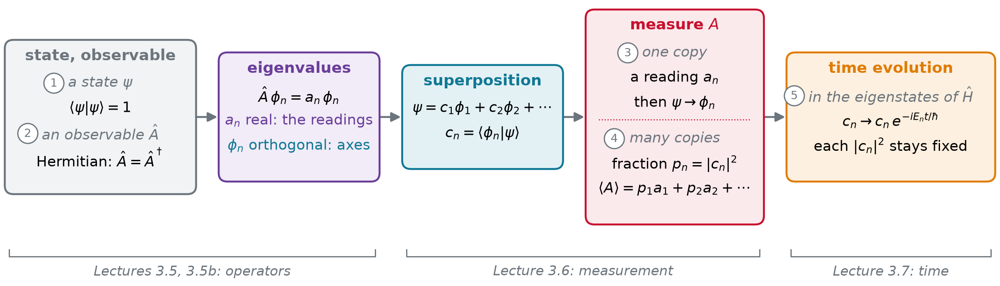
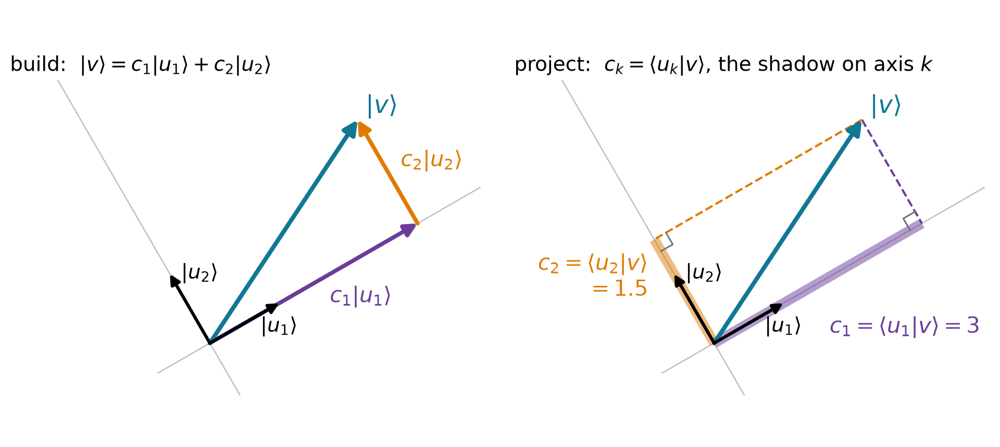
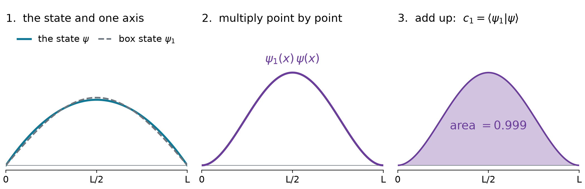
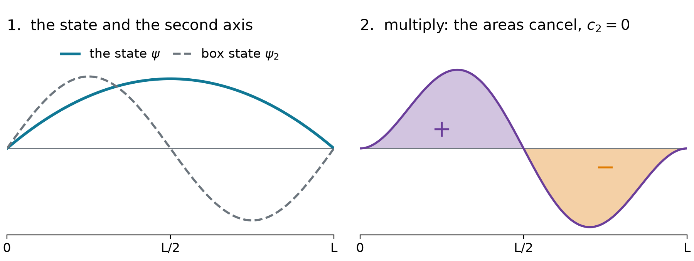
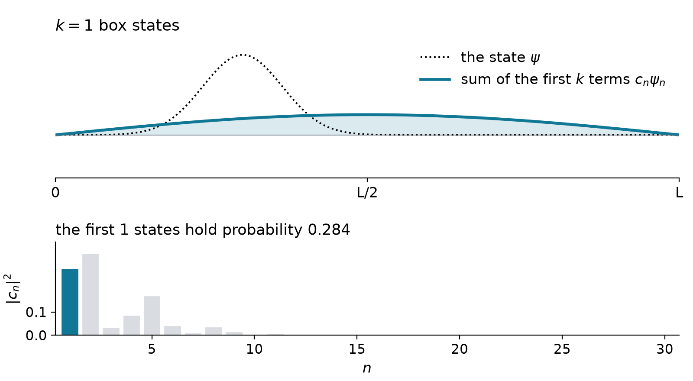
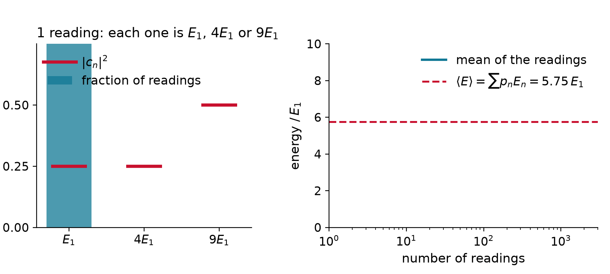
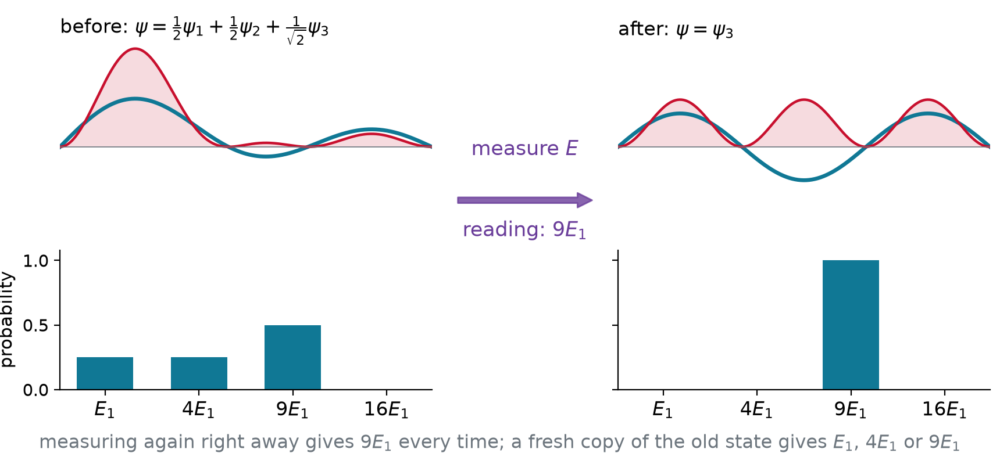
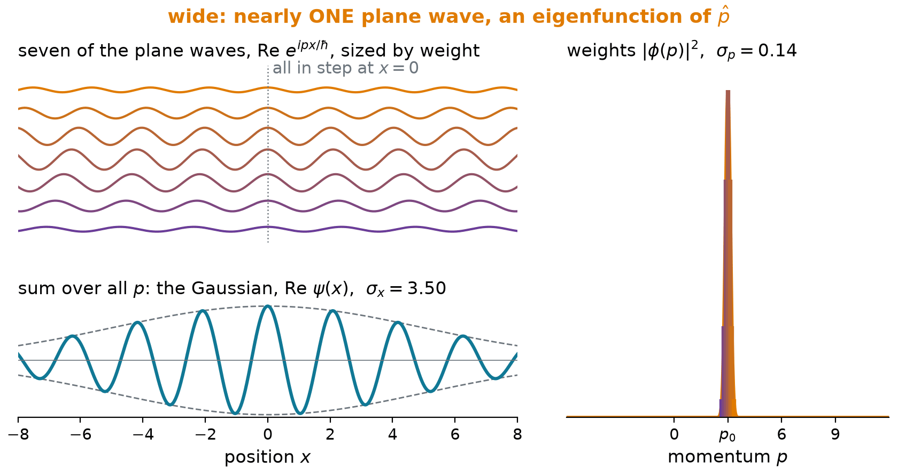
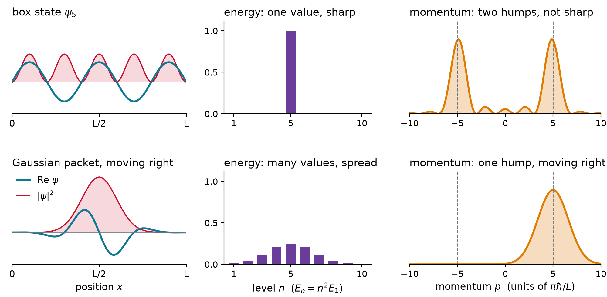
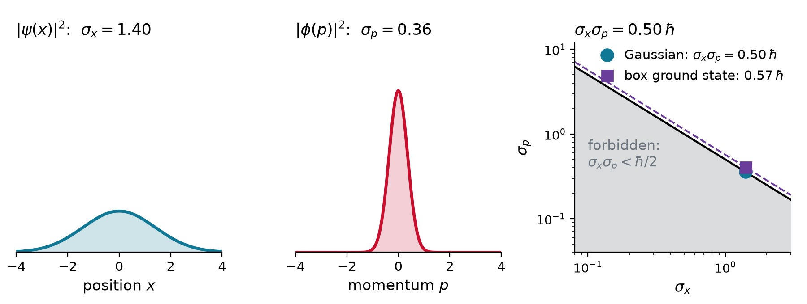

## How the postulates connect

{.nostretch width="84%" fig-align="center"}

- Hermitian gives **readings** (top) and **axes** (bottom): a measurement joins them

## A vector: build it, then project

{.nostretch width="76%" fig-align="center"}

$$\langle u_1 \vert v\rangle = c_1\,\underbrace{\langle u_1 \vert u_1\rangle}_{1} + c_2\,\underbrace{\langle u_1 \vert u_2\rangle}_{0} = c_1$$

## Example: components of a vector

::: {.worked}
Write $\lvert v\rangle = (3, 4)$ in the tilted axes $\lvert u_1\rangle = \tfrac{1}{\sqrt{2}}(1, 1)$ and $\lvert u_2\rangle = \tfrac{1}{\sqrt{2}}(1, -1)$.
:::

::: {.soln .fragment}
Each coefficient is a **projection**:

$$c_1 = \langle u_1 \vert v\rangle = \tfrac{3 + 4}{\sqrt{2}} = \tfrac{7}{\sqrt{2}}, \qquad c_2 = \langle u_2 \vert v\rangle = \tfrac{3 - 4}{\sqrt{2}} = -\tfrac{1}{\sqrt{2}}$$

$$\lvert v\rangle = c_1\lvert u_1\rangle + c_2\lvert u_2\rangle, \qquad c_1^2 + c_2^2 = \tfrac{49 + 1}{2} = 25 = \langle v \vert v\rangle$$
:::

- Perpendicular unit axes: coefficients are **projections**, and their squares add up to the **length** squared

## A function: the same two steps

- **Build:** the box states $\lvert\psi_n\rangle$ are the axes, orthonormal, $\langle \psi_m \vert \psi_n\rangle = \delta_{mn}$

$$\lvert\psi\rangle = c_1\lvert\psi_1\rangle + c_2\lvert\psi_2\rangle + c_3\lvert\psi_3\rangle + \cdots$$

- **Project:** the bra $\langle \psi_m\rvert$ picks out one coefficient, exactly as for the vector

$$\langle \psi_m \vert \psi\rangle = \sum_n c_n\,\underbrace{\langle \psi_m \vert \psi_n\rangle}_{\delta_{mn}} = c_m$$

- The only new step: a bracket of two functions is an **integral**, $\langle \psi_m \vert \psi\rangle = \int \psi_m^*\,\psi\,dx$

## One component, step by step

{.nostretch width="86%" fig-align="center"}

- The parabola $\psi = \sqrt{30/L^5}\;x(L-x)$ looks almost like $\psi_1$, so its component along $\psi_1$ is almost 1: $\ c_1 = 0.999$
- Both are **normalized**, so no component can exceed 1, and $c_1 = 1$ only if $\psi = \psi_1$

## A component that vanishes

{.nostretch width="78%" fig-align="center"}

- $\psi$ is symmetric about $L/2$, $\psi_2$ is antisymmetric: the two halves of the product cancel, so $c_2 = 0$
- The same happens for every even $n$: the parabola has **no** even components

## One structure, two settings

| | a vector in a plane | a function |
|:--------------|:------------------------|:------------------------|
| axes | $\lvert u_1\rangle, \lvert u_2\rangle$ | eigenfunctions $\lvert\phi_1\rangle, \lvert\phi_2\rangle, \dots$ |
| orthonormal | $\langle u_j \vert u_k\rangle = \delta_{jk}$ | $\langle \phi_m \vert \phi_n\rangle = \delta_{mn}$ |
| build | $\lvert v\rangle = \sum_k c_k\lvert u_k\rangle$ | $\lvert\psi\rangle = \sum_n c_n\lvert\phi_n\rangle$ |
| project | $c_k = \langle u_k \vert v\rangle$ | $c_n = \langle \phi_n \vert \psi\rangle$ |
| the bracket | multiply matching components, add | multiply point by point, integrate |

- Lecture 3.5's grid made this literal: the integral **is** the dot product of the sampled values, times $\Delta x$

## Eigenfunctions are coordinates

::: {.keyeq}
$$\lvert\psi\rangle = \sum_n c_n\,\lvert\phi_n\rangle, \qquad c_n = \langle \phi_n \vert \psi \rangle = \int \phi_n^*\,\psi\,dx$$
:::

- The eigenfunctions $\phi_n$ of an observable are the **axes**; $c_n$ says how far $\psi$ reaches along axis $n$
- Each $c_n$ is a **projection**, found exactly as for the vector: multiply, then add up

## Three one-line derivations

All three use only **orthonormality**, $\langle \phi_m \vert \phi_n \rangle = \delta_{mn}$:

$$
\begin{aligned}
\text{coefficient:}\quad & \langle \phi_m \vert \psi \rangle = \sum_n c_n\,\langle \phi_m \vert \phi_n \rangle = c_m \\[6pt]
\text{normalization:}\quad & \langle \psi \vert \psi \rangle = \sum_m\sum_n c_m^*\,c_n\,\delta_{mn} = \sum_n \lvert c_n\rvert^2 = 1 \\[6pt]
\text{average:}\quad & \langle \psi \vert \hat{A} \vert \psi \rangle = \sum_m\sum_n c_m^*\,c_n\,a_n\,\delta_{mn} = \sum_n \lvert c_n\rvert^2\,a_n
\end{aligned}
$$

- Same as the vector: squared components add up to one, the **length** of a normalized state

## Example: how much ground state is in a parabola?

::: {.worked}
Expand $\psi = \sqrt{30/L^5}\;x(L-x)$ in box states $\psi_n = \sqrt{2/L}\,\sin(n\pi x/L)$.
:::

::: {.soln .fragment}
Two integrations by parts:

$$c_n = \int_0^L \psi_n\,\psi\,dx = \frac{8\sqrt{15}}{(n\pi)^3}\ \ (n \text{ odd}), \qquad c_n = 0\ \ (n \text{ even: odd about } L/2)$$

$$\lvert c_1\rvert^2 = \frac{960}{\pi^6} = 0.9986, \qquad \lvert c_3\rvert^2 = 0.0014, \qquad \lvert c_5\rvert^2 = 0.0001$$
:::

- A smooth, spread-out state is **almost all ground state**

## A narrow state needs many eigenstates

{.nostretch width="66%" fig-align="center"}

- Sharp features need **short wavelengths**, high $n$: about ten states for a packet $0.045\,L$ wide

## A measurement returns an eigenvalue

{.nostretch width="58%" fig-align="center"}

::: {.keyeq}
$$\text{reading } a_n \text{ with probability}\quad p_n = \lvert c_n\rvert^2 = \lvert\langle \phi_n \vert \psi \rangle\rvert^2$$
:::

## Live: measure it yourself

```{=html}
<div id="mw-live" style="width: 1080px; margin: 0 auto;"></div>
<script type="module">
  import widget from "../../widgets/measure_energy.mjs";
  const opts = { state: "example", fontSize: "22px", showMean: false };
  widget.render({ model: { get: (k) => opts[k] }, el: document.getElementById("mw-live") });
</script>
```

## Averages and spreads

::: {.keyeq}
$$\langle A \rangle = \sum_n p_n\,a_n = \langle \psi \vert \hat{A} \vert \psi \rangle$$

$$\sigma_A^2 = \sum_n p_n\,\big(a_n - \langle A \rangle\big)^2 = \langle A^2 \rangle - \langle A \rangle^2$$
:::

- $\langle A\rangle$: the **average** of many readings, usually **not** a possible reading itself
- $\sigma_A = 0$ only if all the probability sits on **one** eigenvalue: only eigenstates are **sharp**

## Example: readings, average, spread

::: {.worked}
$\psi = \tfrac{1}{2}\psi_1 + \tfrac{1}{2}\psi_2 + \tfrac{1}{\sqrt{2}}\psi_3$ in a box. What can an energy measurement give, how often, and what are $\langle E\rangle$ and $\sigma_E$?
:::

::: {.soln .fragment}
$$E_1,\ 4E_1,\ 9E_1 \quad\text{with}\quad p = \tfrac{1}{4},\ \tfrac{1}{4},\ \tfrac{1}{2}$$

$$\langle E \rangle = \tfrac{1}{4}(1) + \tfrac{1}{4}(4) + \tfrac{1}{2}(9) = 5.75\,E_1$$

$$\langle E^2 \rangle = \tfrac{1}{4}(1) + \tfrac{1}{4}(16) + \tfrac{1}{2}(81) = 44.75\,E_1^2$$

$$\sigma_E = \sqrt{44.75 - 5.75^2}\;E_1 = 3.42\,E_1$$
:::

## After the measurement

{.nostretch width="70%" fig-align="center"}

- A reading of $a_n$ leaves the state $\phi_n$ (**collapse**): measure again, get $a_n$ every time
- The probabilities live in **many identically prepared copies**, not in one particle

## Spikes and plane waves

| operator | eigenfunctions | sharp | spread over |
|:--|:--|:--|:--|
| $\hat{x}$ | spikes $\delta(x - x_0)$ | position $x_0$ | **every** momentum |
| $\hat{p}$ | plane waves $e^{ipx/\hbar}$ | momentum $p$ | **every** position |

- $[\hat{x},\hat{p}] = i\hbar$: **no shared** eigenfunctions. Each eigenfunction of one is a sum of **many** eigenfunctions of the other
- On a grid the spikes are the columns with a single 1: the eigenvectors of the diagonal $X$

## A state in plane waves

::: {.keyeq}
$$\psi(x) = \int_{-\infty}^{\infty} \phi(p)\,\frac{e^{ipx/\hbar}}{\sqrt{2\pi\hbar}}\,dp, \qquad \phi(p) = \langle p \vert \psi \rangle = \int_{-\infty}^{\infty} \frac{e^{-ipx/\hbar}}{\sqrt{2\pi\hbar}}\,\psi(x)\,dx$$
:::

- The projection $c_n = \langle \psi_n \vert \psi \rangle$ again, with an integral over $p$ for the sum over $n$: the **Fourier transform**
- $\lvert\phi(p)\rvert^2\,dp$: the probability of a momentum reading between $p$ and $p + dp$
- In spikes the components are just the values, $\psi(x_0) = \langle x_0 \vert \psi \rangle$: the wavefunction we always drew

## Example: a Gaussian in momentum

::: {.worked}
Which momenta make up $\psi(x) \propto e^{-x^2/4\sigma_x^2}\,e^{ip_0x/\hbar}$?
:::

::: {.soln .fragment}
Put it into $\phi(p)$ and complete the square in the exponent:

$$\phi(p) \propto e^{-(p - p_0)^2/4\sigma_p^2}, \qquad \sigma_p = \frac{\hbar}{2\sigma_x}$$

A Gaussian again, centered at $p_0$: narrow in $x$ means wide in $p$, and $\sigma_x\sigma_p = \hbar/2$.
:::

## Squeeze it, widen it

{.nostretch width="64%" fig-align="center"}

- **Squeeze**: a spike, from **every** momentum. **Widen**: one plane wave, over **every** position
- In between: a **wave packet**, plane waves that add up at the center and cancel elsewhere

## Sharp energy or one-way momentum

{.nostretch width="66%" fig-align="center"}

- Box state: **sharp** $E$, but half moving right, half left: **spread** $p$
- Packet: one hump in $p$, but **spread** $E$: no box state is sharp in both

## The uncertainty principle

{.nostretch width="76%" fig-align="center"}

::: {.keyeq}
$$\sigma_A\,\sigma_B \geq \tfrac{1}{2}\big\lvert\langle[\hat{A},\hat{B}]\rangle\big\rvert \qquad\Longrightarrow\qquad \sigma_x\,\sigma_p \geq \hbar/2$$
:::

## Example: $\sigma_x\sigma_p$ for the box ground state

::: {.worked}
For $\psi_1 = \sqrt{2/L}\,\sin(\pi x/L)$, find $\sigma_x$, $\sigma_p$ and their product.
:::

::: {.soln .fragment}
$$\langle x\rangle = \tfrac{L}{2}, \quad \langle x^2\rangle = L^2\left(\tfrac{1}{3} - \tfrac{1}{2\pi^2}\right) \;\Rightarrow\; \sigma_x = 0.181\,L$$

$$\langle p\rangle = 0, \quad \langle p^2\rangle = 2mE_1 = \left(\tfrac{\pi\hbar}{L}\right)^2 \;\Rightarrow\; \sigma_p = \tfrac{\pi\hbar}{L}$$

$$\sigma_x\,\sigma_p = 0.181\,\pi\,\hbar = 0.568\,\hbar \;\geq\; 0.5\,\hbar$$
:::

- Independent of $L$: squeeze the box and $\sigma_p$ grows, so **confinement costs energy** ($\propto 1/L^2$)

# Takeaway {.center}

> Expand the state in the eigenfunctions of the observable: the coefficients are projections, $c_n = \langle \phi_n \vert \psi \rangle$. A measurement returns one eigenvalue $a_n$, with probability $\lvert c_n\rvert^2$, and leaves the system in $\phi_n$. Averages are weighted sums, $\langle A\rangle = \sum_n \lvert c_n\rvert^2 a_n$, sharp only in eigenstates; and observables that do not commute cannot be sharp together: a spike in position is a sum of every plane wave, and $\sigma_x\sigma_p \geq \hbar/2$.
