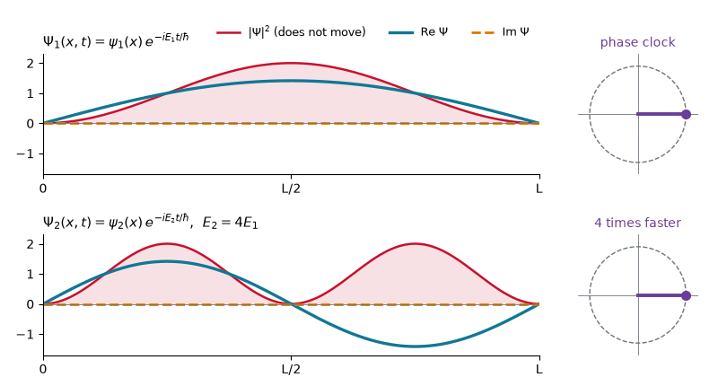
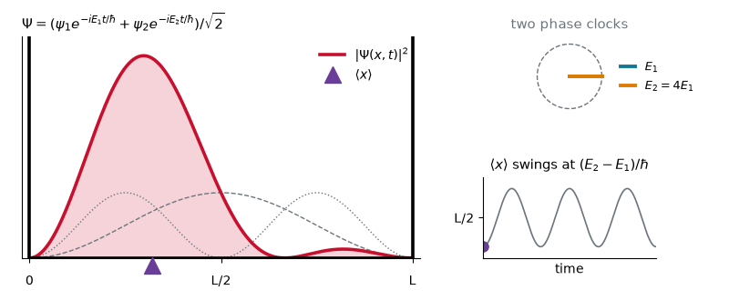
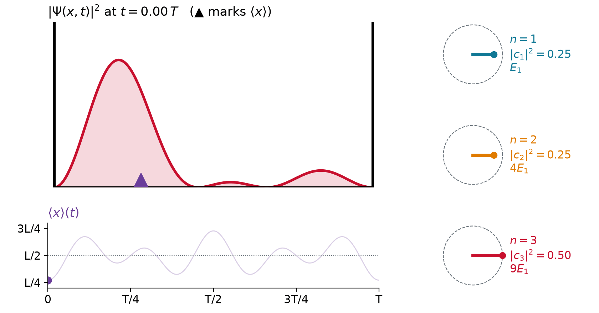
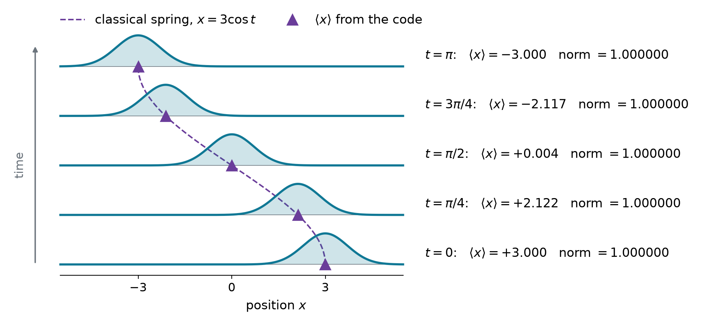
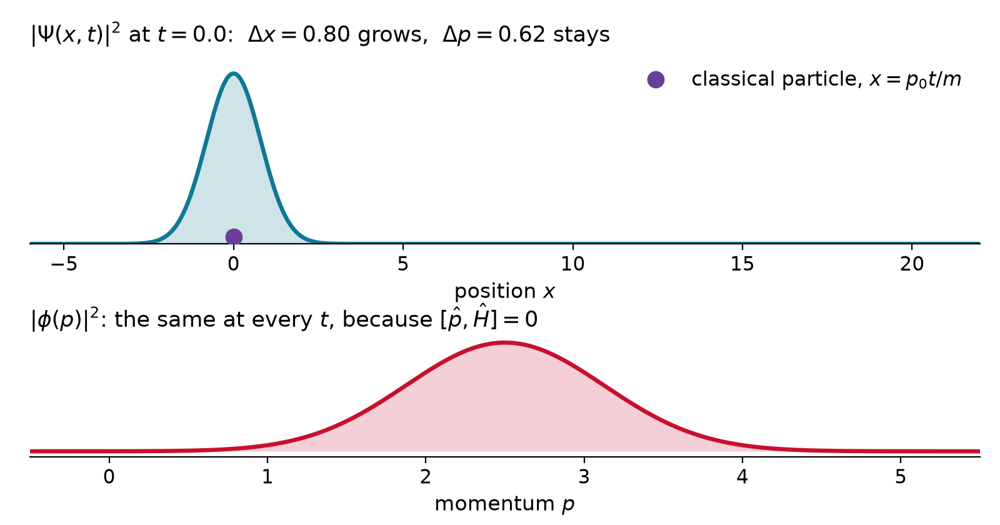
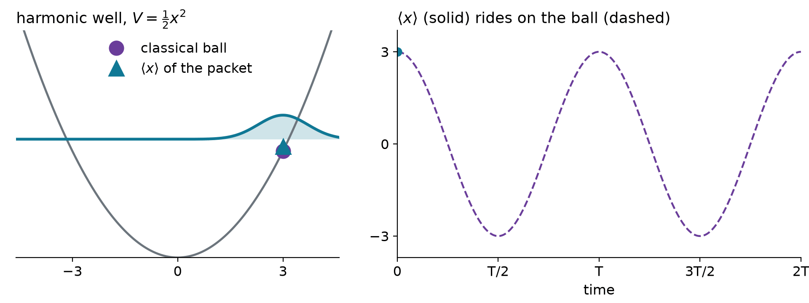
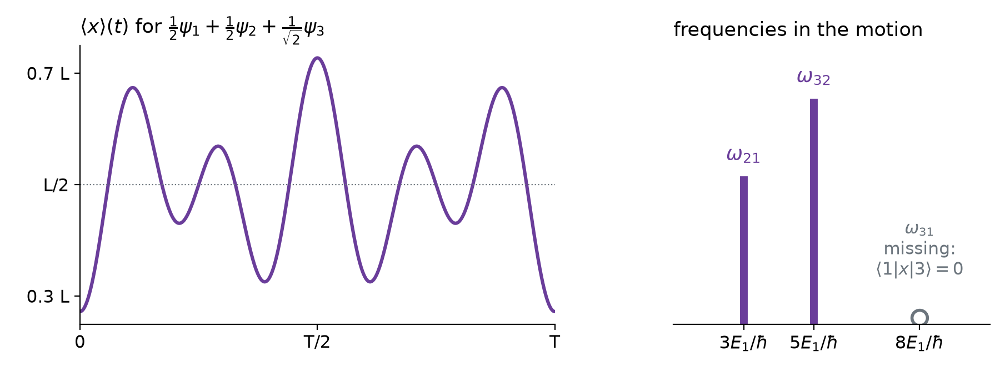
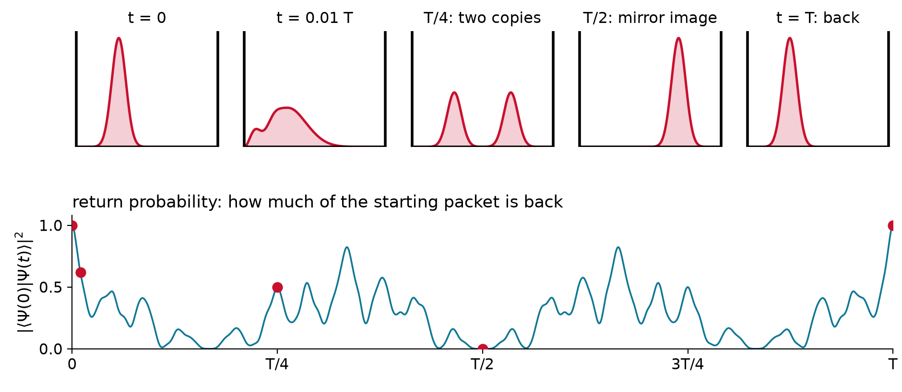
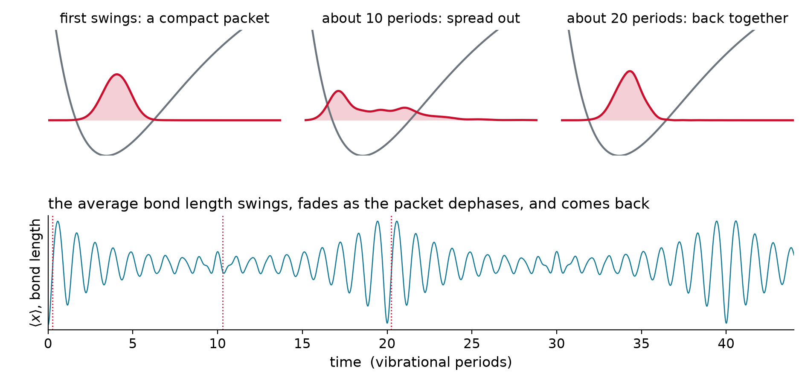

## One stationary state: only the phase turns

{.nostretch width="62%" fig-align="center"}

$$\Psi_n(x,t) = \psi_n(x)\,e^{-iE_nt/\hbar} \qquad\Longrightarrow\qquad \lvert\Psi_n\rvert^2 = \lvert\psi_n\rvert^2 \ \text{ never moves}$$

## Two states: the density sloshes

{.nostretch width="58%" fig-align="center"}

$$\lvert\Psi\rvert^2 = \tfrac{1}{2}\big(\psi_1^2 + \psi_2^2\big) + \psi_1\psi_2\cos\omega t, \qquad \omega = \frac{E_2 - E_1}{\hbar}$$

- Each term keeps **its own clock**; the **cross term** carries the difference of the two phases

## One recipe for all motion

::: {.keyeq}
$$\Psi(x,0) = \sum_n c_n\,\psi_n(x) \quad\Longrightarrow\quad \Psi(x,t) = \sum_n c_n\,e^{-iE_nt/\hbar}\,\psi_n(x)$$
:::

1. **Expand** the starting state in energy eigenstates: $c_n = \langle \psi_n \vert \Psi(0) \rangle$
2. **Attach** to each the phase of its own clock, $e^{-iE_nt/\hbar}$
3. **Add up**

- Works because the equation is **linear** and the eigenstates are a **complete** basis

## Example: does the recipe solve the equation?

::: {.worked}
Show that $\Psi(x,t) = \sum_n c_n\,e^{-iE_nt/\hbar}\,\psi_n(x)$ satisfies $i\hbar\,\partial\Psi/\partial t = \hat{H}\Psi$.
:::

::: {.soln .fragment}
$$i\hbar\,\frac{\partial\Psi}{\partial t} = \sum_n c_n\,i\hbar\left(-\frac{iE_n}{\hbar}\right)e^{-iE_nt/\hbar}\,\psi_n = \sum_n c_n\,E_n\,e^{-iE_nt/\hbar}\,\psi_n$$

$$\hat{H}\Psi = \sum_n c_n\,e^{-iE_nt/\hbar}\,\hat{H}\psi_n = \sum_n c_n\,E_n\,e^{-iE_nt/\hbar}\,\psi_n \quad\checkmark$$

Term by term, using $\hat{H}\psi_n = E_n\psi_n$. At $t = 0$ every phase is 1.
:::

## Three clocks

{.nostretch width="66%" fig-align="center"}

- Hand **lengths** $\lvert c_n\rvert$ fixed; the **angles** between hands make the motion

## Three lines of numpy

::: {style="font-size: 1.2em"}
```python
# the grid and D2 of Lecture 3.5; spring with hbar = m = omega = 1; a packet pulled to x = 3
H = -0.5 * D2 + np.diag(0.5 * x**2)
psi0 = np.exp(-(x - 3)**2 / 2) / np.pi**0.25

E, phi = np.linalg.eigh(H); phi /= np.sqrt(dx)  # 1. diagonalize once: E_n and psi_n
c = phi.T @ psi0 * dx                           # 2. expand: c_n = <psi_n|Psi(0)>
psi_t = phi @ (c * np.exp(-1j * E * t))         # 3. attach the phases, add up: Psi(x, t)
```
:::

- Line **1** finds the clocks, $E_n$ and $\psi_n$: the slow step, done **once**
- Lines **2** and **3** are the recipe: cheap for **any** starting state and **any** $t$

## What the three lines give

{.nostretch width="74%" fig-align="center"}

- $\langle x\rangle = 3\cos t$: a **classical spring** released from $x = 3$. Why? Ehrenfest, coming up
- The **norm** stays $1.000000$ at every $t$. Why? Next slide

## What never changes

**1. The weights.** Each $c_n$ turns like a clock hand; its length stays:

$$\lvert c_n\,e^{-iE_nt/\hbar}\rvert^2 = \lvert c_n\rvert^2$$

- So the **energy probabilities** are frozen, and with them $\langle E\rangle$ and $\sigma_E$

**2. The normalization.** The cross terms die by orthogonality, $\langle \psi_m \vert \psi_n \rangle = \delta_{mn}$:

$$\langle \Psi(t) \vert \Psi(t) \rangle = \sum_m\sum_n c_m^*\,c_n\,e^{i(E_m - E_n)t/\hbar}\,\langle \psi_m \vert \psi_n \rangle = \sum_n \lvert c_n\rvert^2 = 1$$

- The particle is **always somewhere**: evolution rotates the state, never stretches it

## How an average changes

Take the time derivative of $\langle A\rangle = \langle\Psi\vert\hat{A}\vert\Psi\rangle$, and plug in the Schrödinger equation for the ket and the bra:

$$\partial_t\lvert\Psi\rangle = \frac{1}{i\hbar}\,\hat{H}\lvert\Psi\rangle \qquad\qquad \partial_t\langle\Psi\rvert = -\frac{1}{i\hbar}\,\langle\Psi\rvert\hat{H}$$

::: {.keyeq}
$$\frac{d}{dt}\langle A\rangle = \frac{i}{\hbar}\,\big\langle[\hat{H},\hat{A}]\big\rangle \qquad (\hat{A} \text{ not explicitly time dependent})$$
:::

- Commutes with $\hat{H}$: a **constant of motion**

## Constants of motion

$$\hat{H} = \frac{\hat{p}^2}{2m} + V(x)$$

| observable | $[\hat{H}, \cdot\,]$ | conserved when |
|:--|:--|:--|
| energy $\hat{H}$ | $0$ | always |
| momentum $\hat{p}$ | $i\hbar\,dV/dx$ | no force |
| position $\hat{x}$ | $-i\hbar\,\hat{p}/m$ | only while $\langle p\rangle = 0$ |

- The commutators of Lecture 3.5b now say **what moves** and **what stays**

## Example: plane waves

::: {.worked}
With $V = 0$, $\hat{H} = \hat{p}^2/2m$. Is $e^{ipx/\hbar}$ an eigenfunction of $\hat{p}$? Of $\hat{H}$? Of $\hat{x}$?
:::

::: {.soln .fragment}
$$\hat{p}\,e^{ipx/\hbar} = -i\hbar\,\frac{d}{dx}\,e^{ipx/\hbar} = p\,e^{ipx/\hbar} \qquad \text{yes: eigenvalue } p$$

$$\hat{H}\,e^{ipx/\hbar} = \frac{\hat{p}^2}{2m}\,e^{ipx/\hbar} = \frac{p^2}{2m}\,e^{ipx/\hbar} \qquad \text{yes: eigenvalue } E_p = \frac{p^2}{2m}$$

$$\hat{x}\,e^{ipx/\hbar} = x\,e^{ipx/\hbar} \qquad \text{no: } x \text{ is a function, not a number}$$
:::

- $\hat{p}$ and $\hat{H}$ **commute**, so they share eigenfunctions: the plane waves

## Free particle: $x$ spreads, $p$ stays

$$\Psi(x,t) = \int \phi(p)\,\frac{e^{i(px - E_pt)/\hbar}}{\sqrt{2\pi\hbar}}\,dp$$

{.nostretch width="42%" fig-align="center"}

- Each $\phi(p)$ only turns its phase: $\lvert\phi(p)\rvert^2$ **frozen**
- The components run at different speeds $p/m$: $x$ **spreads**

## Ehrenfest: averages obey Newton

::: {.keyeq}
$$\frac{d\langle x\rangle}{dt} = \frac{\langle p\rangle}{m} \qquad\qquad \frac{d\langle p\rangle}{dt} = -\Big\langle\frac{dV}{dx}\Big\rangle$$
:::

{.nostretch width="64%" fig-align="center"}

- **Linear** force: $\langle -kx\rangle = -k\langle x\rangle$, so the center rides the ball **exactly**

## Motion holds only energy differences

$$\langle x\rangle(t) = \sum_n \lvert c_n\rvert^2 x_{nn} + \sum_{n\neq m} c_m^*\,c_n\,x_{mn}\,e^{-i(E_n - E_m)t/\hbar}, \qquad x_{mn} = \langle\psi_m\vert\hat{x}\vert\psi_n\rangle$$

{.nostretch width="58%" fig-align="center"}

- **Bohr frequencies** $(E_n - E_m)/\hbar$: the light a sloshing charge absorbs and emits

## Example: which frequencies are in the motion?

::: {.worked}
$\frac{1}{2}\psi_1 + \frac{1}{2}\psi_2 + \frac{1}{\sqrt{2}}\psi_3$ in a box: which of $\omega_{21}$, $\omega_{32}$, $\omega_{31}$ appear in $\langle x\rangle(t)$?
:::

::: {.soln .fragment}
About the center, $\psi_1$ and $\psi_3$ are **even**, $x - L/2$ is **odd**:

$$x_{13} = \tfrac{L}{2}\int\psi_1\psi_3\,dx + \int\psi_1\big(x - \tfrac{L}{2}\big)\psi_3\,dx = 0 + 0$$

$\omega_{21} = 3E_1/\hbar$ and $\omega_{32} = 5E_1/\hbar$ appear; $\omega_{31} = 8E_1/\hbar$ does not. A **selection rule**.
:::

## Revivals

{.nostretch width="48%" fig-align="center"}

::: {.keyeq}
$$T_{\text{rev}} = \frac{2\pi\hbar}{E_1} = \frac{4mL^2}{\pi\hbar}$$
:::

- $E_n = n^2E_1$: every phase $e^{-in^2E_1t/\hbar}$ returns to 1 at the **same** moment

## Example: revival in a 1 nm box

::: {.worked}
How long does an electron in a box 1 nm long take to rebuild any starting state?
:::

::: {.soln .fragment}
$$T_{\text{rev}} = \frac{4\,(9.109\times10^{-31}\ \text{kg})\,(10^{-9}\ \text{m})^2}{\pi\,(1.055\times10^{-34}\ \text{J s})} = 1.1\times10^{-14}\ \text{s} = 11\ \text{fs}$$

Twice the box, four times slower: $T_{\text{rev}} \propto L^2$.
:::

## Watching a bond vibrate

{.nostretch width="66%" fig-align="center"}

- A laser pulse makes a **packet** of vibrational states: the bond swings. **Femtochemistry**, Zewail, Nobel 1999. I₂: about 300 fs
- **Anharmonic** levels: the clocks drift apart (**dephasing**), then realign (**revival**)

## How the postulates connect

{.nostretch width="94%" fig-align="center"}

- Today filled in the last box: **time evolution** attaches a phase to each $c_n$

## The postulates, all together

| | postulate | in equations |
|:-:|:------------------------------|:----------------------|
| 1 | the state is a normalized wavefunction | $\langle \psi \vert \psi \rangle = 1$ |
| 2 | observables are linear Hermitian operators | $\hat{A} = \hat{A}^\dagger$, $\hat{A}\phi_n = a_n\phi_n$ |
| 3 | a reading is an eigenvalue; the state becomes its eigenfunction | $a_n$, then $\psi \to \phi_n$ |
| 4 | probabilities and averages | $p_n = \lvert\langle \phi_n \vert \psi \rangle\rvert^2$, $\langle A\rangle = \langle \psi \vert \hat{A} \vert \psi \rangle$ |
| 5 | evolution by the Schrödinger equation | $\Psi(t) = \sum_n c_n e^{-iE_nt/\hbar}\psi_n$ |

- The rest of the course applies these five rules to new potentials $V(x)$

# Takeaway {.center}

> Diagonalize $\hat{H}$ once, and any state's future follows: expand, attach to each eigenstate its phase $e^{-iE_nt/\hbar}$, add up. The energy probabilities and the norm never change; the relative phases make all the motion, at the Bohr frequencies $(E_n - E_m)/\hbar$ that spectroscopy measures. Averages obey Newton's laws, exactly so in a harmonic well, and observables that commute with $\hat{H}$ are conserved.
