## A molecule moves in four ways

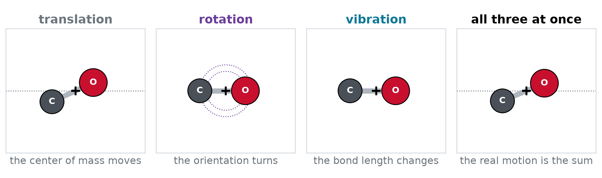{.nostretch width="94%" fig-align="center"}

- **Translation**, **rotation**, **vibration**, and the **electrons** rearranging (Chapters 5 to 8)
- In a gas they all happen at once: the real motion is their **sum**

## Each motion has its own ladder

$$E = E_{\text{trans}} + E_{\text{rot}} + E_{\text{vib}} + E_{\text{elec}}$$

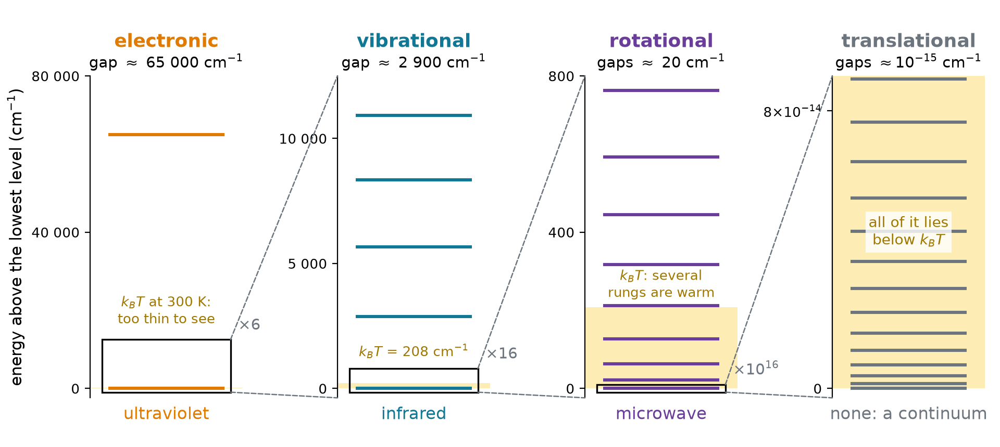{.nostretch width="86%" fig-align="center"}

## One kind of light per ladder

Light is absorbed when a photon $h\nu$ **matches a gap**:

| motion | lowest gap in HCl | wavelength | spectroscopy |
|:--|:--|:--|:--|
| electronic | about 65 000 cm$^{-1}$ | about 150 nm | **ultraviolet** |
| vibrational | 2886 cm$^{-1}$ | 3.5 μm | **infrared** |
| rotational | 21 cm$^{-1}$ | 0.5 mm | **microwave** |
| translational | $10^{-15}$ cm$^{-1}$ | none | none: a **continuum** |

- Twenty orders of magnitude: each motion answers to its **own part of the spectrum**

## Example: which motions does heat reach?

::: {.worked}
At 300 K, $k_BT = 208$ cm$^{-1}$. Relative to the lowest state, how populated are $v = 1$ and $J = 1$ of HCl?
:::

::: {.soln .fragment}
$$\text{vibration: } e^{-2886/208} = e^{-13.9} \approx 10^{-6}$$

$$\text{rotation: } e^{-21.2/208} = e^{-0.10} = 0.90$$

Molecules **fly and tumble** freely, but nearly every bond sits in $v = 0$. Electrons: $e^{-65\,000/208} \approx 10^{-136}$.
:::

- Boltzmann: a state $\Delta E$ up is populated by $e^{-\Delta E/k_BT}$

## Born-Oppenheimer: nuclei move on $E(R)$

- Electrons are **light and fast**: for each frozen geometry they settle into an energy $E(\mathbf{R}_1, \dots, \mathbf{R}_N)$
- The nuclei then move on that **potential energy surface**:

$$\hat{H}_{\text{nuc}} = \sum_{i=1}^{N} -\frac{\hbar^2}{2m_i}\nabla_i^2 + E(\mathbf{R}_1, \dots, \mathbf{R}_N)$$

- With no field, $E$ depends only on the **shape**: not on where the molecule is, not on which way it points
- The full story: Chapter 8

## Separate the motions

$$\hat{H} = \hat{H}_{\text{trans}} + \hat{H}_{\text{rot}} + \hat{H}_{\text{vib}}$$

::: {.keyeq}
$$\hat{H} = \hat{H}_a + \hat{H}_b \quad\Longrightarrow\quad \psi = \psi_a\,\psi_b, \qquad E = E_a + E_b$$
:::

- For a molecule: $\psi = \psi_{\text{trans}}\,\psi_{\text{rot}}\,\psi_{\text{vib}}$ and the energies **add**
- Seen before: the 3D box, $\psi = X(x)\,Y(y)\,Z(z)$, $E = E_x + E_y + E_z$
- Approximate: spinning stretches bonds; a small correction (Lecture 4.5)

## Example: why a sum gives a product

::: {.worked}
$\hat{H}_a$ acts only on the coordinates of $\psi_a$, $\hat{H}_b$ only on those of $\psi_b$. Show that $\psi_a\psi_b$ is an eigenfunction of $\hat{H}_a + \hat{H}_b$.
:::

::: {.soln .fragment}
$$(\hat{H}_a + \hat{H}_b)\,\psi_a\psi_b = (\hat{H}_a\psi_a)\,\psi_b + \psi_a\,(\hat{H}_b\psi_b)$$

$$= E_a\,\psi_a\psi_b + E_b\,\psi_a\psi_b = (E_a + E_b)\,\psi_a\psi_b \quad\checkmark$$

Each operator treats the other factor as a **constant**.
:::

## Counting coordinates

$N$ nuclei carry $3N$ coordinates:

| motion | what changes | nonlinear | linear |
|:--|:--|:-:|:-:|
| translation | center of mass | 3 | 3 |
| rotation | orientation | 3 | **2** |
| vibration | shape | $3N - 6$ | $3N - 5$ |

- H$_2$O: $9 = 3 + 3 + \mathbf{3}$ $\qquad$ CO$_2$: $9 = 3 + 2 + \mathbf{4}$ $\qquad$ benzene: $36 = 3 + 3 + \mathbf{30}$

## Why linear molecules lose a rotation

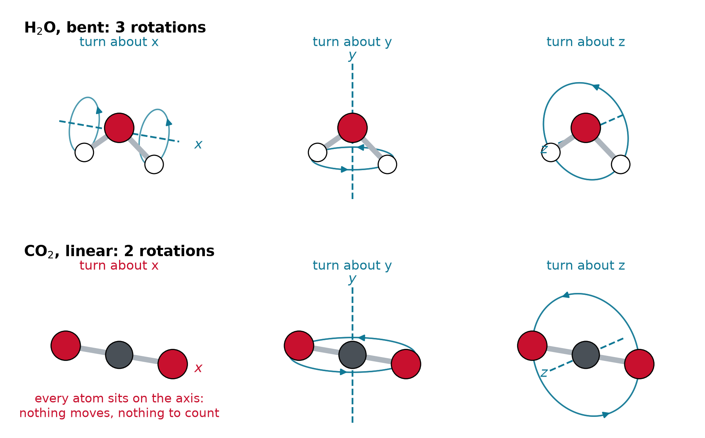{.nostretch width="64%" fig-align="center"}

- Atoms **on the axis**: a turn about it moves nothing. The spare coordinate **vibrates**

## Water: three vibrations

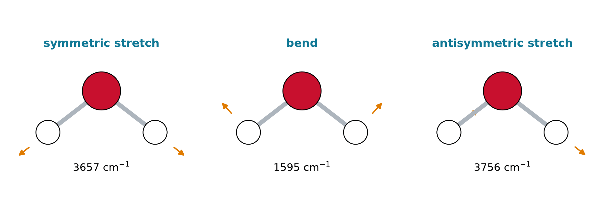{.nostretch width="92%" fig-align="center"}

- $3N - 6 = 3$ **normal modes**: every atom swings at one frequency, in step
- Near equilibrium each mode is **its own spring**: a molecule is $3N - 6$ independent oscillators

## Example: count the vibrations

::: {.worked}
How many vibrations do NH$_3$ (pyramidal), C$_2$H$_2$ (linear) and HCN (linear) have?
:::

::: {.soln .fragment}
NH$_3$: $N = 4$, nonlinear: $3N - 6 = 6$

C$_2$H$_2$: $N = 4$, linear: $3N - 5 = 7$

HCN: $N = 3$, linear: $3N - 5 = 4$ (two stretches, and a bend in two perpendicular planes)
:::

## Three motions, three model systems

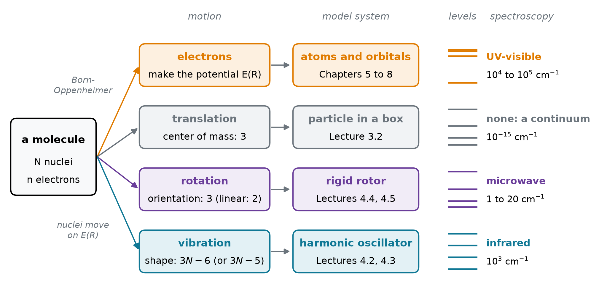{.nostretch width="88%" fig-align="center"}

## The models, side by side

| motion | classical energy | model system | levels |
|:--|:--|:--|:--|
| translation | $\dfrac{P^2}{2M}$ | particle in a box (3.2) | $\dfrac{h^2n^2}{8ML^2}$ |
| rotation | $\dfrac{L^2}{2I}$ | rigid rotor (4.4, 4.5) | $\dfrac{\hbar^2}{2I}J(J+1)$ |
| vibration | $\dfrac{p^2}{2\mu} + \dfrac{1}{2}kx^2$ | harmonic oscillator (4.2, 4.3) | $\hbar\omega\left(v + \tfrac{1}{2}\right)$ |

- The Chapter 3 recipe: classical energy $\to$ operator $\to$ solve $\hat{H}\psi = E\psi$
- Only vibration has a **potential**: the rest of today builds the classical **spring**

## Why every bond is a spring

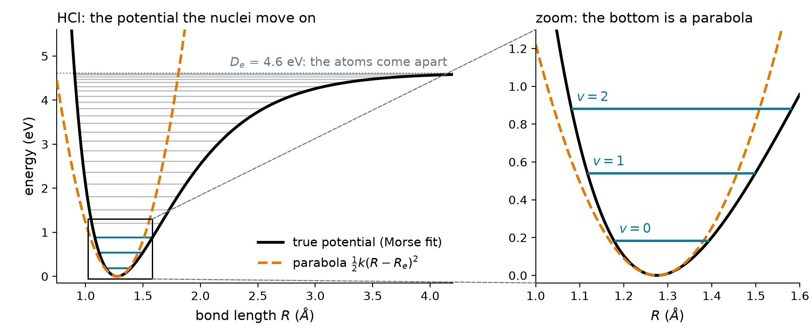{.nostretch width="84%" fig-align="center"}

- The real well is not a parabola, but its **bottom** is, and the lowest levels live there

## Taylor says: a parabola

$$U(R) = U(R_e) + U'(R_e)\,x + \tfrac{1}{2}U''(R_e)\,x^2 + \tfrac{1}{6}U'''(R_e)\,x^3 + \dots, \qquad x = R - R_e$$

- Energy from the bottom: $U(R_e) = 0$. At a minimum the slope vanishes: $U'(R_e) = 0$

::: {.keyeq}
$$U(R) \approx \frac{1}{2}k\,(R - R_e)^2, \qquad k = \left.\frac{d^2U}{dR^2}\right|_{R_e}$$
:::

- **Force constant** = curvature at the minimum. Cubic and higher terms: **anharmonicity** (Lecture 4.3)

## Example: $k$ from the Morse potential

::: {.worked}
$U(x) = D\left(1 - e^{-ax}\right)^2$: find $k$. For HCl, $D = 4.62$ eV and $a = 1.87$ Å$^{-1}$.
:::

::: {.soln .fragment}
$$e^{-ax} \approx 1 - ax + \tfrac{1}{2}a^2x^2 \quad\Longrightarrow\quad U \approx D\left(a^2x^2 - a^3x^3\right) \quad\Longrightarrow\quad k = 2Da^2$$

$$k = 2\,(7.40\times10^{-19}\ \text{J})\,(1.87\times10^{10}\ \text{m}^{-1})^2 = 518\ \text{N/m}$$
:::

- The cubic term is negative: the real well is **softer** on the side where the bond breaks

## Hooke and Newton

$$m\ddot{x} = -kx \quad\Longrightarrow\quad x(t) = A\cos(\omega t + \phi), \qquad \omega = \sqrt{\frac{k}{m}}$$

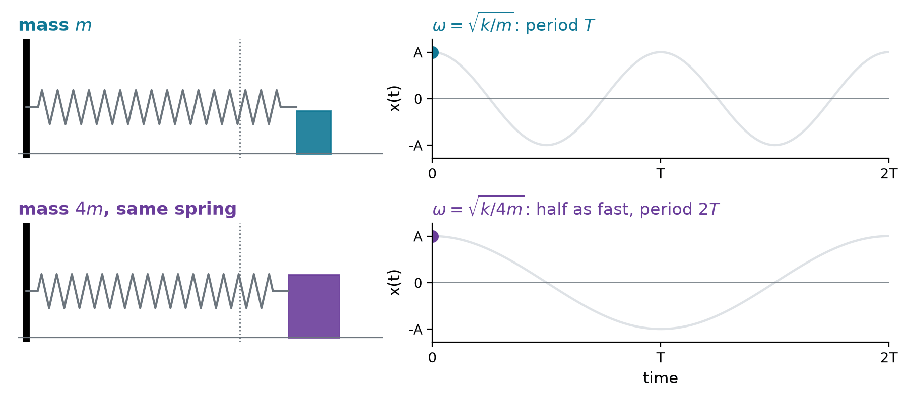{.nostretch width="58%" fig-align="center"}

- **Stiffer** spring: faster. **Heavier** mass: slower. $A$ and $\phi$ come from the start

## Energy sloshes, the total stays

::: {.keyeq}
$$x(t) = A\cos(\omega t + \phi), \qquad \omega = \sqrt{\frac{k}{m}}, \qquad E = \frac{p^2}{2m} + \frac{1}{2}kx^2 = \frac{1}{2}kA^2$$
:::

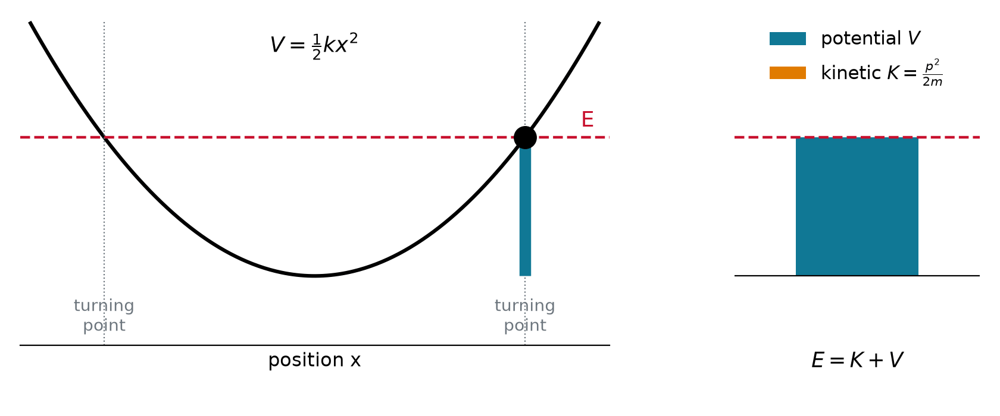{.nostretch width="50%" fig-align="center"}

- **Turning points** $\pm A$: all potential, momentarily at rest. Classically, never beyond

## Where is a classical spring found?

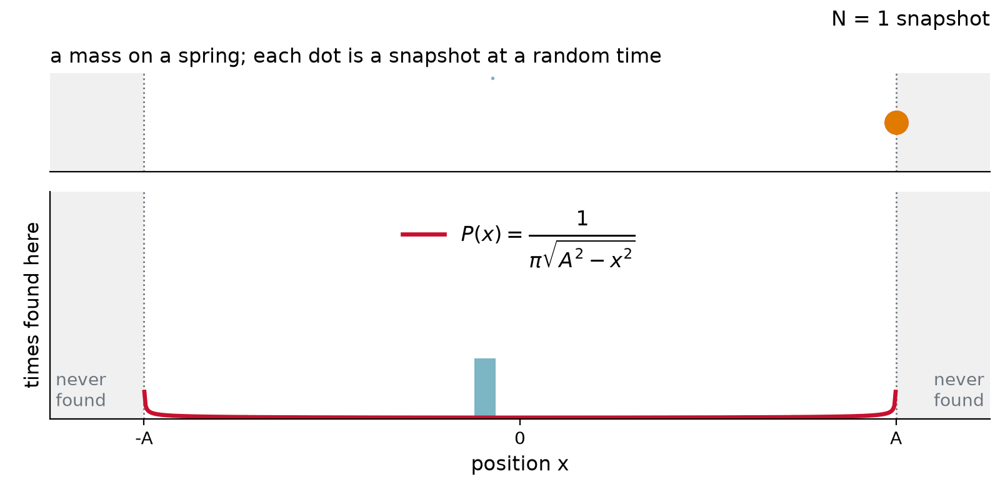{.nostretch width="58%" fig-align="center"}

$$P(x) = \frac{1}{\pi\sqrt{A^2 - x^2}}$$

- Caught most where it is **slowest**. The quantum ground state: the **opposite**

## A diatomic is one bead

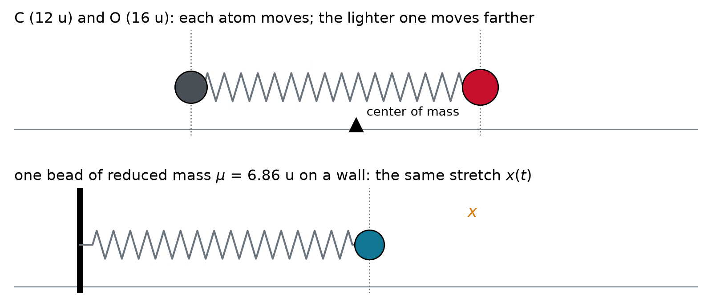{.nostretch width="50%" fig-align="center"}

::: {.keyeq}
$$\mu = \frac{m_1m_2}{m_1 + m_2}, \qquad \mu\ddot{x} = -kx, \qquad \omega = \sqrt{\frac{k}{\mu}}$$
:::

- One heavy atom: $\mu \approx$ the light mass. HCl: $\mu = 0.98$ u, **H does the moving**

## Example: the HCl stretch

::: {.worked}
For H$^{35}$Cl, $k = 516$ N/m. Find $\mu$, $\omega$ and the wavenumber $\tilde{\nu} = \omega/2\pi c$.
:::

::: {.soln .fragment}
$$\mu = \frac{(1.008)(34.97)}{35.98}\ \text{u} = 0.980\ \text{u} = 1.627\times10^{-27}\ \text{kg}$$

$$\omega = \sqrt{\frac{516}{1.627\times10^{-27}}}\ \text{s}^{-1} = 5.63\times10^{14}\ \text{s}^{-1}, \qquad \tilde{\nu} = \frac{\omega}{2\pi c} = 2990\ \text{cm}^{-1}$$

Measured: 2886 cm$^{-1}$. The gap is anharmonicity (Lecture 4.3).
:::

## Preview: the quantum spring

$$\hat{H} = -\frac{\hbar^2}{2\mu}\frac{d^2}{dx^2} + \frac{1}{2}kx^2$$

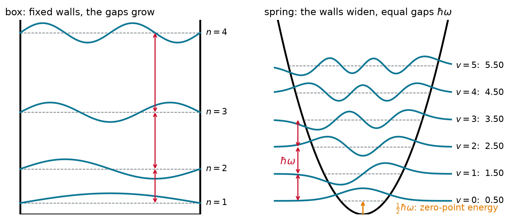{.nostretch width="60%" fig-align="center"}

- Met in 3.1 and 3.5. **Next lecture: why the steps are exactly $\hbar\omega$**

# Takeaway {.center}

> A molecule translates, rotates, vibrates and rearranges its electrons. The Hamiltonian separates, so energies add and wavefunctions multiply; the ladders differ by orders of magnitude, so each motion has its own spectroscopy. Of the $3N$ coordinates, 3 translate, 3 (or 2) rotate and $3N - 6$ (or $3N - 5$) vibrate. Near its minimum every bond is a spring: $x(t) = A\cos(\omega t + \phi)$ with $\omega = \sqrt{k/\mu}$ and $E = \frac{1}{2}kA^2$.
