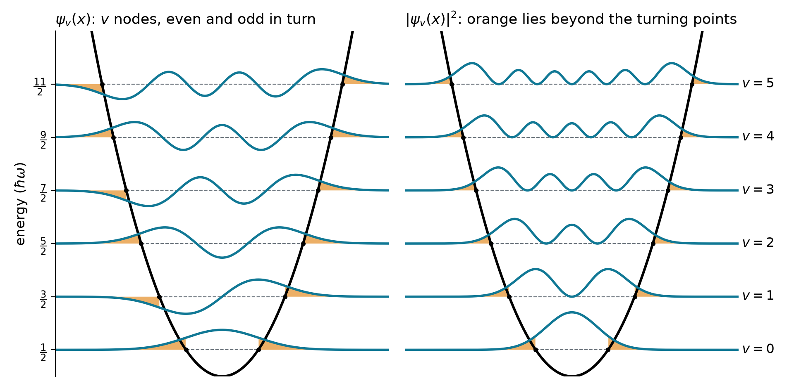
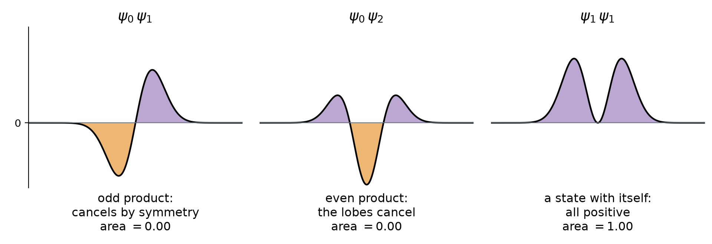
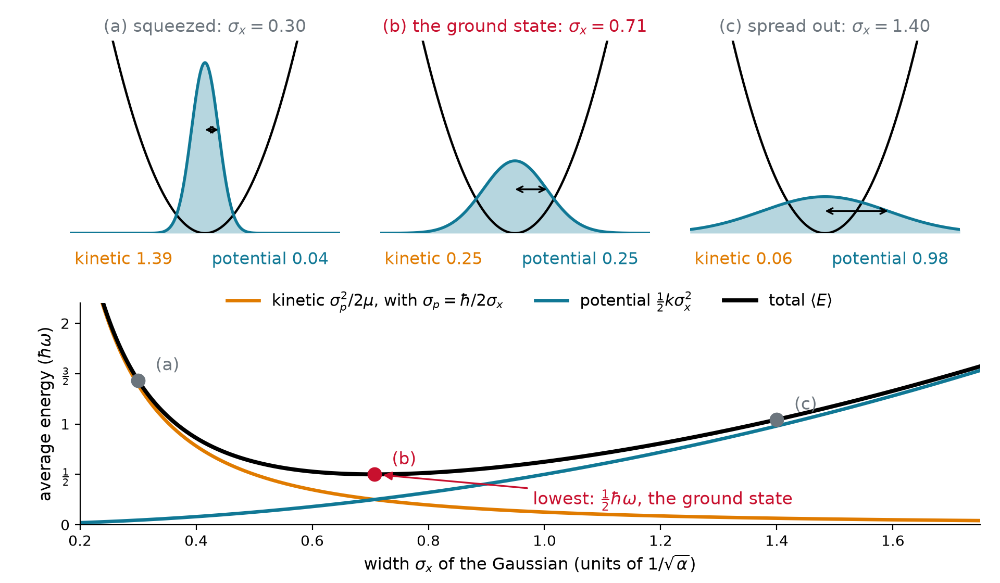
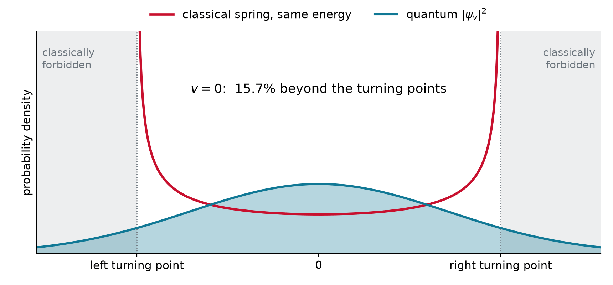
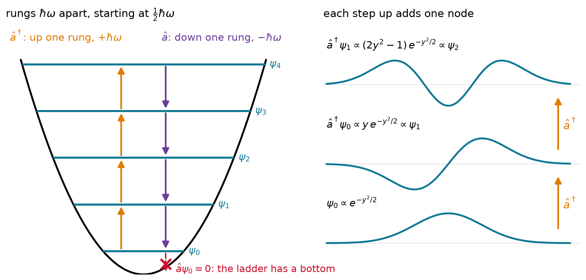
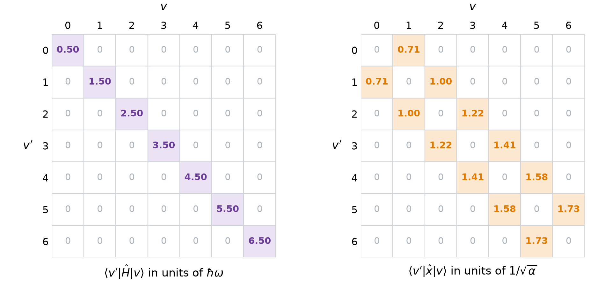

## From the spring to the Schrödinger equation

$$\hat{H} = -\frac{\hbar^2}{2\mu}\frac{d^2}{dx^2} + \frac{1}{2}kx^2, \qquad \hat{H}\psi_v = E_v\,\psi_v$$

- $x = R - R_e$: the **stretch**. $\mu$: reduced mass. $k$: force constant
- The Chapter 3 recipe: classical energy $\to$ operator $\to$ solve $\hat{H}\psi = E\psi$
- $v = 0, 1, 2, \dots$ is the **vibrational quantum number** (vee), not the frequency $\nu$ (nu)

## One energy, one length

$\hat{H}$ contains only $\hbar$, $\mu$ and $k$: they build **one energy** and **one length**

**Energy**: the gap between neighboring levels

$$\hbar\omega = \hbar\sqrt{\frac{k}{\mu}}$$

**Length**: where squeezing costs as much as stretching, $\hbar^2/\mu L^2 = kL^2$

$$L = \left(\frac{\hbar^2}{\mu k}\right)^{1/4} = \sqrt{\frac{\hbar}{\mu\omega}} \equiv \frac{1}{\sqrt{\alpha}}$$

- Every energy is a number times $\hbar\omega$, every length a number times $1/\sqrt{\alpha}$

## Example: the two scales for HCl

::: {.worked}
For HCl, $k = 516$ N/m and $\mu = 1.627\times10^{-27}$ kg. Find $\hbar\omega$ and $1/\sqrt{\alpha}$, and compare with the 127.5 pm bond.
:::

::: {.soln .fragment}
$$\omega = \sqrt{k/\mu} = 5.63\times10^{14}\ \text{s}^{-1}, \qquad \hbar\omega = 0.371\ \text{eV} = 2990\ \text{cm}^{-1}$$

$$\frac{1}{\sqrt{\alpha}} = \sqrt{\frac{\hbar}{\mu\omega}} = 10.7\ \text{pm}, \quad \text{8\% of the bond}$$
:::

- Level gaps are **infrared** photons; the bond **quivers by picometers**, it is not a smeared cloud

## The solution

::: {.keyeq}
$$E_v = \hbar\omega\left(v + \frac{1}{2}\right), \qquad v = 0, 1, 2, \dots$$

$$\psi_v(x) = N_v\,H_v\!\left(\sqrt{\alpha}\,x\right)e^{-\alpha x^2/2}, \qquad \alpha = \frac{\mu\omega}{\hbar}$$
:::

- $H_v$: Hermite polynomial of degree $v$. $N_v = \dfrac{1}{\sqrt{2^v v!}}\left(\dfrac{\alpha}{\pi}\right)^{1/4}$ normalizes
- **Evenly spaced** by $\hbar\omega$, starting $\frac{1}{2}\hbar\omega$ above the bottom of the well
- Every Bohr frequency is a multiple of $\omega$: any packet returns after **one period** (Lecture 3.7)

## Hermite polynomials

In $y = \sqrt{\alpha}\,x$ the constants drop out: every oscillator is **one problem**

$$\hat{H} = \frac{\hbar\omega}{2}\left(-\frac{d^2}{dy^2} + y^2\right)$$

| $v$ | $H_v(y)$ | $E_v$ | nodes |
|:-:|:--|:-:|:-:|
| 0 | $1$ | $\frac{1}{2}\hbar\omega$ | 0 |
| 1 | $2y$ | $\frac{3}{2}\hbar\omega$ | 1 |
| 2 | $4y^2 - 2$ | $\frac{5}{2}\hbar\omega$ | 2 |
| 3 | $8y^3 - 12y$ | $\frac{7}{2}\hbar\omega$ | 3 |

- Every state: a **polynomial times the same Gaussian**, one more node per rung

## Example: check the ground state

::: {.worked}
Show that $\psi_0 = e^{-\alpha x^2/2}$ solves $\hat{H}\psi_0 = E_0\psi_0$ only for $\alpha = \mu\omega/\hbar$, and find $E_0$.
:::

::: {.soln .fragment}
$$\psi_0'' = \left(\alpha^2x^2 - \alpha\right)\psi_0 \quad\Longrightarrow\quad \hat{H}\psi_0 = \left[\frac{\hbar^2\alpha}{2\mu} + \left(\frac{k}{2} - \frac{\hbar^2\alpha^2}{2\mu}\right)x^2\right]\psi_0$$

The $x^2$ term must vanish: $\hbar^2\alpha^2/\mu = k$, so $\alpha = \mu\omega/\hbar$, and what is left is

$$E_0 = \frac{\hbar^2\alpha}{2\mu} = \frac{1}{2}\hbar\omega$$
:::

## The states on their levels

{.nostretch width="70%" fig-align="center"}

- $\psi_v$ has **$v$ nodes**; even and odd in turn. **Orange**: beyond the classical turning points

## Even and odd

$$\psi_v(-x) = (-1)^v\,\psi_v(x)$$

- An **odd** integrand over $(-\infty, \infty)$ gives **zero**
- A derivative **flips** the symmetry: the slope of $x^2$ is $2x$

$$\langle x\rangle = \int\psi_v\,x\,\psi_v\,dx = 0, \qquad \langle p\rangle = -i\hbar\int\psi_v\,\psi_v'\,dx = 0$$

- But $\langle x^2\rangle,\ \langle p^2\rangle \neq 0$: the spreads carry the zero-point motion

## Orthogonal: by symmetry or by cancellation

{.nostretch width="86%" fig-align="center"}

$$\langle v'|v\rangle = \int_{-\infty}^{\infty}\psi_{v'}\,\psi_v\,dx = \delta_{v'v}$$

## Energy from the spreads

The ladder starts at $\frac{1}{2}\hbar\omega$. Why can't a bond sit still at $E = 0$?

**1. Average of $\hat{H}$**: kinetic plus potential

$$\langle E\rangle = \frac{\langle p^2\rangle}{2\mu} + \frac{1}{2}k\langle x^2\rangle$$

**2. Centered state** ($\langle x\rangle = \langle p\rangle = 0$): $\langle x^2\rangle = \sigma_x^2$ and $\langle p^2\rangle = \sigma_p^2$

**3. Uncertainty**: $\sigma_p \geq \hbar/2\sigma_x$, with equality for a Gaussian

$$\langle E\rangle \;\geq\; \frac{\hbar^2}{8\mu\sigma_x^2} + \frac{1}{2}k\sigma_x^2$$

## Try Gaussians of every width

{.nostretch width="65%" fig-align="center"}

- Squeezed pays in kinetic, spread out in potential: the best width (b) **is** $\psi_0$

## The ground state

::: {.keyeq}
$$\psi_0(x) = \left(\frac{\alpha}{\pi}\right)^{1/4}e^{-\alpha x^2/2}, \qquad E_0 = \frac{1}{2}\hbar\omega, \qquad \alpha = \frac{\mu\omega}{\hbar}$$
:::

- A bond **cannot sit still**: it keeps $\frac{1}{2}\hbar\omega$ even at absolute zero
- **Minimum uncertainty**: $\sigma_x\sigma_p = \hbar/2$ exactly, width $\sigma_x = 1/\sqrt{2\alpha}$
- The energy splits evenly: $\frac{1}{4}\hbar\omega$ kinetic, $\frac{1}{4}\hbar\omega$ potential

## Example: HCl at absolute zero

::: {.worked}
For HCl, $\hbar\omega$ is 2990 cm$^{-1}$ (0.371 eV) and the bond well is $D_e = 4.62$ eV deep. Find $E_0$, and the energy needed to break the bond from $v = 0$.
:::

::: {.soln .fragment}
$$E_0 = \tfrac{1}{2}\hbar\omega = 1495\ \text{cm}^{-1} = 0.185\ \text{eV}$$

$$D_0 = D_e - E_0 = 4.62 - 0.19 = 4.43\ \text{eV} \quad\text{(measured: 4.43 eV)}$$
:::

- Heavier isotope, smaller $\omega$, **lower** zero-point energy: C-D bonds break more slowly than C-H

## Example: beyond the turning points

::: {.worked}
The $v = 0$ turning points are at $x = \pm 1/\sqrt{\alpha}$, that is $y = \pm 1$. How often is the oscillator found beyond them?
:::

::: {.soln .fragment}
With $\lvert\psi_0\rvert^2dx = \pi^{-1/2}e^{-y^2}dy$:

$$P(\text{beyond}) = 1 - \frac{1}{\sqrt{\pi}}\int_{-1}^{1} e^{-y^2}\,dy = 0.157$$

About **one time in six**: stretched where a classical spring could never reach.
:::

## Toward the classical spring

{.nostretch width="66%" fig-align="center"}

- High $v$: piles up at the turning points, averages to the **classical curve**
- Molecules sit in $v = 0$, the **most quantum** state

## Factor the Hamiltonian

$$\hat{H} = \frac{\hbar\omega}{2}\left(y^2 - \frac{d^2}{dy^2}\right)$$

Numbers factor a sum of squares, $u^2 + w^2 = (u - iw)(u + iw)$. Try the same with

$$\hat{a} = \frac{1}{\sqrt{2}}\left(y + \frac{d}{dy}\right), \qquad \hat{a}^\dagger = \frac{1}{\sqrt{2}}\left(y - \frac{d}{dy}\right)$$

Multiplying out gives the Hamiltonian back, plus one leftover term:

$$\hat{H} = \hbar\omega\left(\hat{a}^\dagger\hat{a} + \frac{1}{2}\right)$$

## The $\frac{1}{2}\hbar\omega$ is a commutator

::: {.keyeq}
$$\hat{H} = \hbar\omega\left(\hat{a}^\dagger\hat{a} + \frac{1}{2}\right), \qquad [\hat{a}, \hat{a}^\dagger] = 1$$
:::

- The leftover $\frac{1}{2}$ appears because $y$ and $d/dy$ **do not commute**: the two orders differ by exactly 1
- If they commuted, the lowest energy would be **zero**, like a classical spring
- The zero-point energy is the **price of not commuting**

## Climbing the ladder

Use $\hat{a}\hat{a}^\dagger = \hat{a}^\dagger\hat{a} + 1$:

$$\hat{H}\hat{a}^\dagger = \hbar\omega\left(\hat{a}^\dagger\hat{a}\hat{a}^\dagger + \tfrac{1}{2}\hat{a}^\dagger\right) = \hat{a}^\dagger\left(\hat{H} + \hbar\omega\right)$$

$$\hat{H}\psi = E\psi \quad\Longrightarrow\quad \hat{H}\left(\hat{a}^\dagger\psi\right) = \left(E + \hbar\omega\right)\left(\hat{a}^\dagger\psi\right)$$

- $\hat{a}^\dagger$ **raises** by exactly $\hbar\omega$; the same steps show $\hat{a}$ **lowers** by $\hbar\omega$

## The ladder has a bottom

$$\hat{a}\psi_0 = 0 \quad\Longrightarrow\quad \frac{d\psi_0}{dy} = -y\,\psi_0 \quad\Longrightarrow\quad \psi_0 \propto e^{-y^2/2}$$

{.nostretch width="58%" fig-align="center"}

- Energy is never negative, so stepping down must **stop**: at the Gaussian

## Raising and lowering operators

::: {.keyeq}
$$\hat{a}^\dagger\psi_v = \sqrt{v + 1}\,\psi_{v+1}, \qquad \hat{a}\,\psi_v = \sqrt{v}\,\psi_{v-1}, \qquad \hat{a}\,\psi_0 = 0$$
:::

- The square roots keep each state **normalized**
- $\hat{a}^\dagger\hat{a}\,\psi_v = v\,\psi_v$: the **number operator** counts the rungs
- Climbing from $\frac{1}{2}\hbar\omega$ in steps of $\hbar\omega$ gives **every** level, and nothing else

## Position connects neighbors

$$\hat{x} = \frac{\hat{a} + \hat{a}^\dagger}{\sqrt{2\alpha}}, \qquad \hat{x}\,\psi_v = \frac{1}{\sqrt{2\alpha}}\left(\sqrt{v + 1}\,\psi_{v+1} + \sqrt{v}\,\psi_{v-1}\right)$$

{.nostretch width="58%" fig-align="center"}

- In its own eigenbasis $\hat{H}$ is **diagonal**; $\hat{x}$ sits **next to** the diagonal

## The infrared selection rule

::: {.keyeq}
$$\langle v'|\hat{x}|v\rangle = 0 \quad\text{unless}\quad v' = v \pm 1$$
:::

- Light couples through the **dipole**, which changes in proportion to the stretch $x$
- So light moves a harmonic bond **one rung at a time**: $\Delta v = \pm 1$, all at the same $\hbar\omega$
- One strong infrared line per vibration. Overtones and anharmonicity: **Lecture 4.3**

## Example: the kinetic isotope effect

::: {.worked}
C-H stretch: 2900 cm$^{-1}$. C-D: same $k$, $\mu$ from 0.930 to 1.725 u. A reaction breaks this bond: how much slower is C-D at 300 K ($k_BT = 208$ cm$^{-1}$)?
:::

::: {.soln .fragment}
$$\tilde{\nu}_{\text{CD}} = 2900\sqrt{\frac{0.930}{1.725}} = 2130\ \text{cm}^{-1}, \qquad \Delta E_0 = \tfrac{1}{2}(2900 - 2130) = 385\ \text{cm}^{-1}$$

$$\frac{k_{\text{H}}}{k_{\text{D}}} \approx e^{385/208} \approx 6$$
:::

- C-D starts **lower in the same well**, so it needs more energy to reach the same barrier top

# Takeaway {.center}

> A vibrating bond is a quantum spring with **evenly spaced** levels $E_v = \hbar\omega\left(v + \frac{1}{2}\right)$. The ground state is a **Gaussian** with zero-point energy $\frac{1}{2}\hbar\omega$, the least the uncertainty principle allows. The states are Hermite polynomials times that Gaussian, with $v$ nodes and alternating parity. **Raising and lowering operators** explain the equal steps, and $\hat{x} = (\hat{a} + \hat{a}^\dagger)/\sqrt{2\alpha}$ connects only neighboring levels: the infrared selection rule $\Delta v = \pm 1$.
