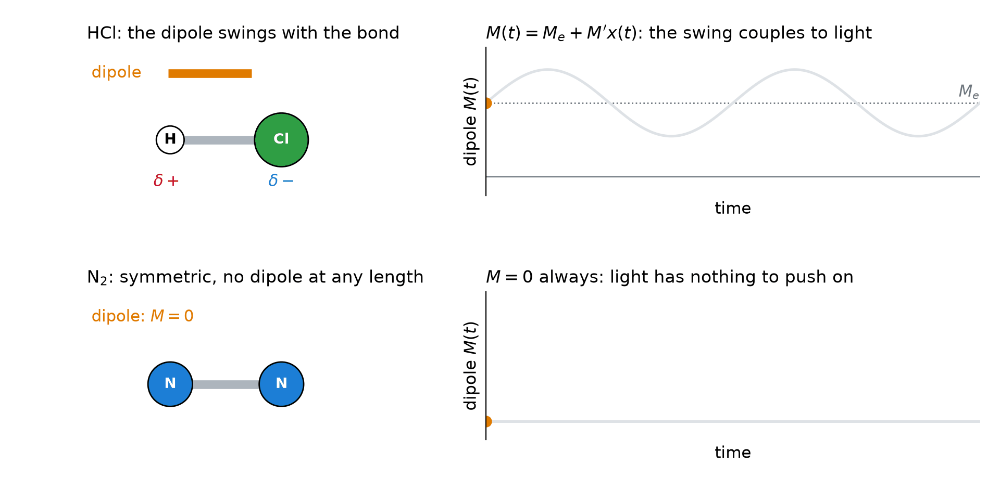
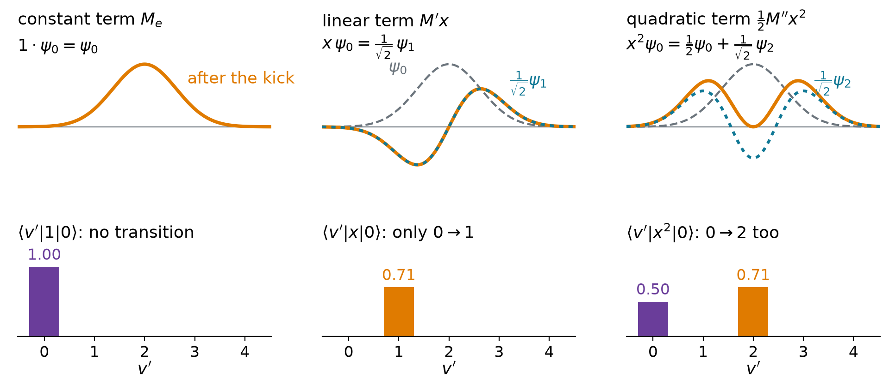
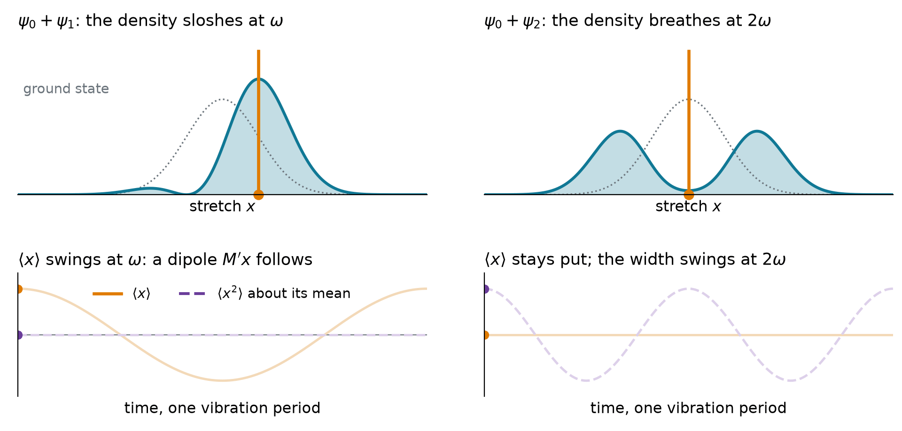
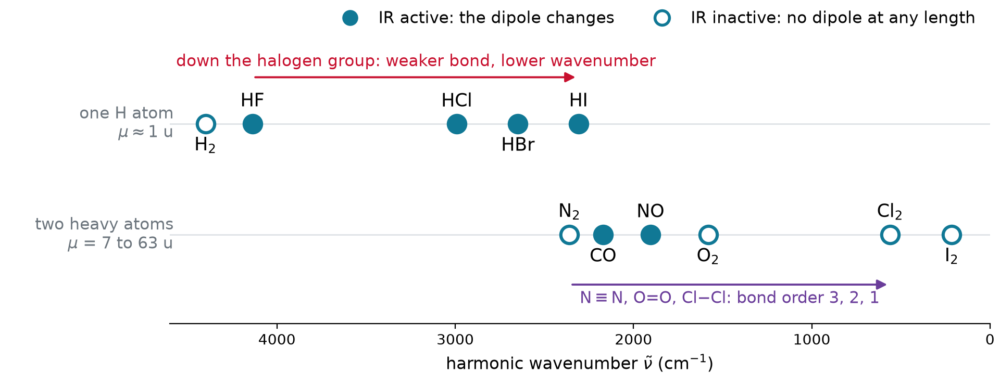
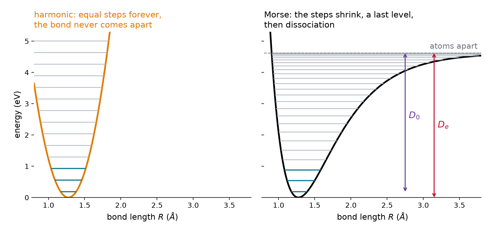
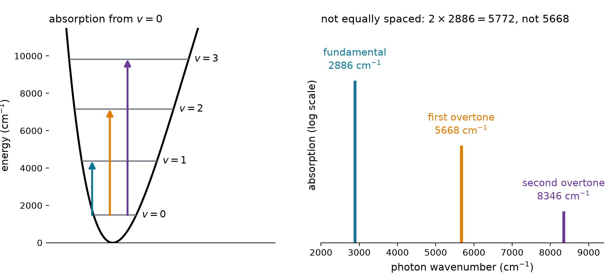
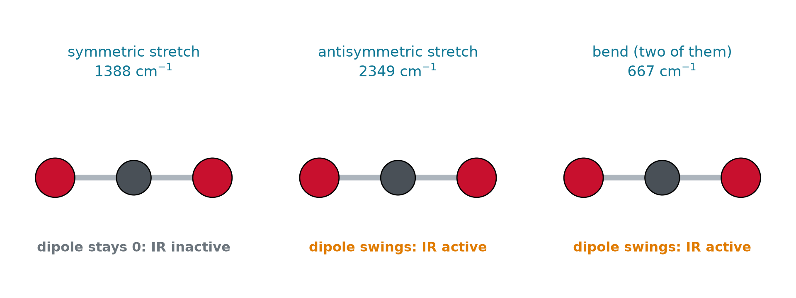
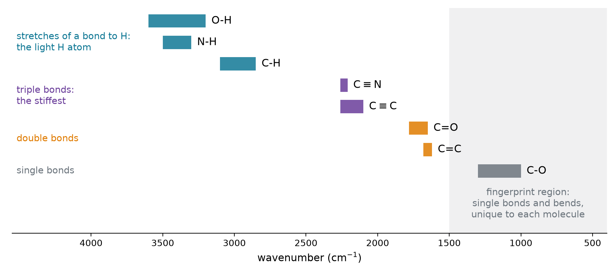
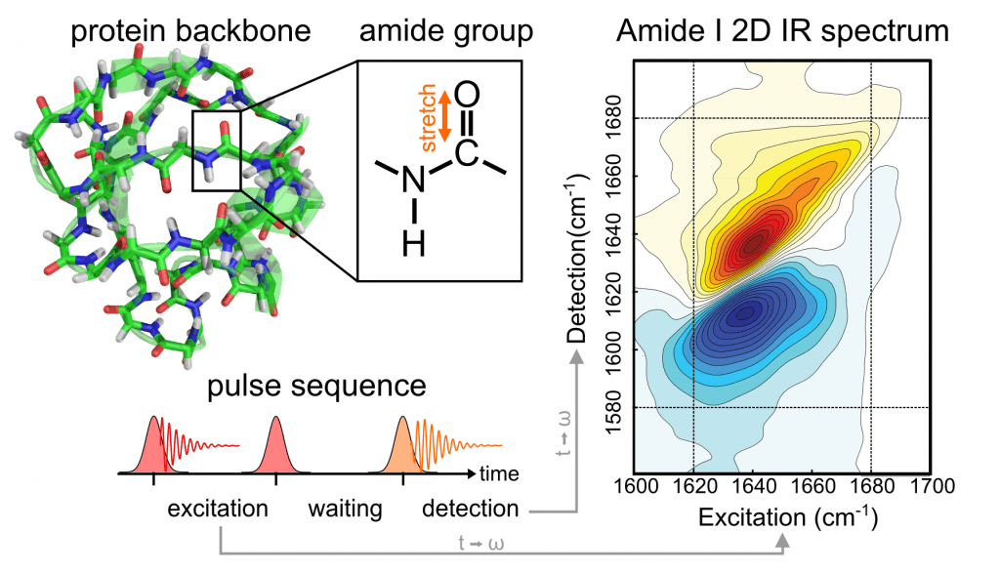
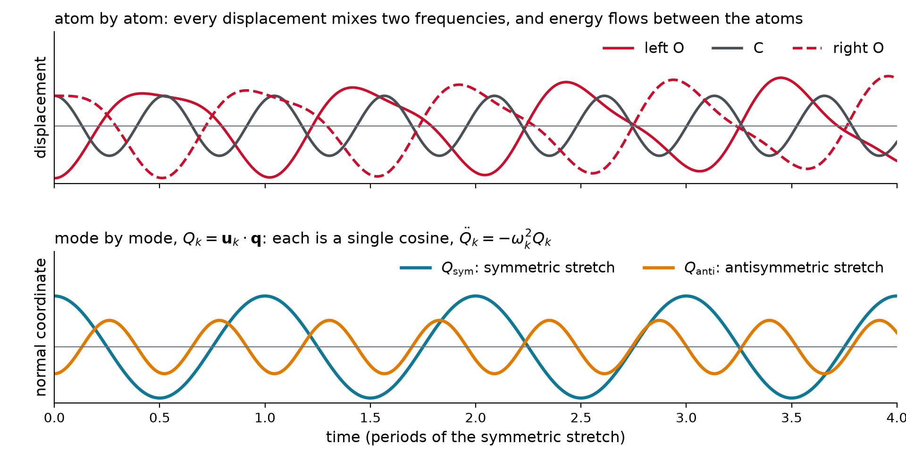

## From the ladder to a spectrum

A photon is absorbed when $h\nu$ **matches a gap**. Spectroscopists measure light in wavenumbers, $\tilde{\nu} = 1/\lambda$:

$$E = h\nu = \frac{hc}{\lambda} = hc\,\tilde{\nu}$$

::: {.keyeq}
$$G(v) = \frac{E_v}{hc} = \tilde{\nu}\left(v + \frac{1}{2}\right), \qquad \tilde{\nu} = \frac{1}{2\pi c}\sqrt{\frac{k}{\mu}}$$
:::

- Lifting $v \to v + 1$ takes a photon of wavenumber $\tilde{\nu}$: the bond's **own** vibration

## What one wavenumber is worth

| quantity | value | what it tells you |
|:--|:--|:--|
| 1 cm$^{-1}$ | $1.24\times10^{-4}$ eV $= 0.0120$ kJ/mol | the conversion factor $hc$ |
| 1 eV | 8066 cm$^{-1}$ | chemical bonds: a few eV |
| $k_BT$ at 300 K | 208 cm$^{-1}$ | below this, levels are warm |
| bond vibrations | 200 to 4400 cm$^{-1}$ | 2.3 to 50 μm: the **infrared** |

- Italic $v$: the quantum number. $\tilde{\nu}$ ("nu tilde"): the wavenumber

## Example: the HCl line

::: {.worked}
HCl absorbs at 2886 cm$^{-1}$. Find the wavelength, frequency and photon energy, and compare with $k_BT = 208$ cm$^{-1}$.
:::

::: {.soln .fragment}
$$\lambda = \frac{1}{\tilde{\nu}} = 3.47\ \mu\text{m}, \qquad \nu = c\tilde{\nu} = 8.65\times10^{13}\ \text{Hz}$$

$$E = hc\tilde{\nu} = 0.358\ \text{eV} = 34.5\ \text{kJ/mol} \approx 14\,k_BT$$
:::

- The line sits below the harmonic 2990 cm$^{-1}$ of Lecture 4.2: **anharmonicity**, later today

## Same gap, opposite fate

{.nostretch width="70%" fig-align="center"}

- N$_2$ (2330 cm$^{-1}$) and HCl (2886 cm$^{-1}$): both mid-infrared. Air is transparent, HCl **absorbs**
- Matching $h\nu$ to a gap is the **tuning**. The swinging dipole is the **antenna**

## Light pushes on the dipole

The field is uniform across the molecule ($\lambda \approx 3$ μm, bond $\approx 0.1$ nm). It pushes $+$ and $-$ apart, so it couples to the **dipole** $M$ (here $\mu$ is the reduced mass):

$$U = -M(x)\,\mathcal{E}, \qquad F = -\frac{dU}{dx} = M'(x)\,\mathcal{E}$$

- The handle on the bond is the **slope** $M'$, not $M$ itself
- N$_2$, O$_2$ (99% of air): $M = 0$ at every length, so $M' = 0$. **No handle**

## A stationary state is not an antenna

An eigenstate's density never moves. Mix two levels (real $c$'s and $\psi$'s):

$$|\Psi|^2 = c_v^2\psi_v^2 + c_{v'}^2\psi_{v'}^2 + 2c_vc_{v'}\,\psi_v\psi_{v'}\cos\omega_{v'v}t$$

::: {.keyeq}
$$\begin{aligned}\langle M\rangle(t) = c_v^2\,\langle v|\hat{M}|v\rangle &+ c_{v'}^2\,\langle v'|\hat{M}|v'\rangle \\ &+ 2c_vc_{v'}\,\langle v'|\hat{M}|v\rangle\cos\omega_{v'v}t\end{aligned}$$
:::

- Only the cross term swings, at the **gap** frequency. Its amplitude is the **transition dipole**

## Two readings of $\langle v'|\hat{M}|v\rangle$

1. **The size of the antenna**: zero means no swing, and light cannot drive $v \to v'$
2. **A projection** (Lecture 3.6): the field multiplies $\psi_v$ by $M(x)$, and $\langle v'|\hat{M}|v\rangle$ is how much $\psi_{v'}$ the kicked function holds

$$\text{absorption rate} \;\propto\; |\langle v'|\hat{M}|v\rangle|^2$$

- Derived in Chapter 6. Lecture 3.7 met it in a box: parity removed $\omega_{31}$

## Each term of the dipole has one job

$$M(x) = M_e + M'x + \tfrac{1}{2}M''x^2 + \dots$$

{.nostretch width="76%" fig-align="center"}

- $M_e$: orthogonality, nothing. $M'x$: one rung. $\frac{1}{2}M''x^2$: two rungs, **weak**

## Slosh or breathe

{.nostretch width="70%" fig-align="center"}

- $\psi_0 + \psi_1$ **sloshes** at $\omega$: $\langle x\rangle$ swings, so $M'x$ has a handle
- $\psi_0 + \psi_2$ **breathes** at $2\omega$: only $M''$ feels it. A weak **overtone**

## Selection rules

::: {.keyeq}
$$\langle v'|\hat{M}|v\rangle \approx M'\,\langle v'|\hat{x}|v\rangle, \qquad M' = \left(\frac{\partial M}{\partial x}\right)_{R_e}$$
:::

1. **The dipole must change**: $M' \neq 0$. Homonuclear diatomics do not absorb
2. **One rung at a time** (Lecture 4.2): $\langle v'|\hat{x}|v\rangle = 0$ unless $\Delta v = \pm 1$

- At 300 K nearly every molecule starts in $v = 0$: one strong line per vibration, the **fundamental**

## Stiffness and mass set the wavenumber

{.nostretch width="82%" fig-align="center"}

- $\tilde{\nu} \propto \sqrt{k/\mu}$. Halides: same $\mu$, weaker bonds down the group. Bond order: N$\equiv$N > O=O > Cl$-$Cl

## Example: a carbon-13 label

::: {.worked}
$^{12}$C$^{16}$O absorbs at 2143 cm$^{-1}$. Where does $^{13}$C$^{16}$O absorb? (Same $k$: the electrons do not change.)
:::

::: {.soln .fragment}
$$\mu(^{12}\text{C}^{16}\text{O}) = 6.856\ \text{u}, \qquad \mu(^{13}\text{C}^{16}\text{O}) = 7.172\ \text{u}$$

$$\tilde{\nu} = 2143\ \text{cm}^{-1}\times\sqrt{\frac{6.856}{7.172}} = 2095\ \text{cm}^{-1} \quad\text{(measured: 2096)}$$
:::

- A 48 cm$^{-1}$ shift: isotope labels **tag one bond** in a big molecule

## Real bonds are anharmonic

{.nostretch width="72%" fig-align="center"}

- The real well flattens toward dissociation: the steps **shrink**, and the ladder **ends**

## The anharmonic oscillator

::: {.keyeq}
$$G(v) = \tilde{\nu}_e\left(v + \frac{1}{2}\right) - \tilde{\nu}_ex_e\left(v + \frac{1}{2}\right)^2$$

$$\tilde{\nu}_{0\to v} = v\,\tilde{\nu}_e - v(v + 1)\,\tilde{\nu}_ex_e$$
:::

- $\tilde{\nu}_e$: the harmonic wavenumber. $x_e$: the anharmonicity, about 0.005 to 0.02
- The gaps shrink by $2\tilde{\nu}_ex_e$ per rung
- Breaking the bond from $v = 0$ costs $D_0 = D_e - G(0)$

## Overtones

{.nostretch width="74%" fig-align="center"}

- Anharmonicity makes $\Delta v = 2, 3$ **weakly allowed**, each tens of times fainter
- **Hot bands** start from $v = 1$: faint at 300 K, stronger in a hot gas

## Example: HCl constants from two lines

::: {.worked}
HCl: fundamental 2886 cm$^{-1}$, first overtone 5668 cm$^{-1}$. Find $\tilde{\nu}_e$ and $\tilde{\nu}_ex_e$; predict the second overtone.
:::

::: {.soln .fragment}
$$\tilde{\nu}_e - 2\tilde{\nu}_ex_e = 2886, \qquad 2\tilde{\nu}_e - 6\tilde{\nu}_ex_e = 5668$$

$$\tilde{\nu}_ex_e = 52\ \text{cm}^{-1}, \qquad \tilde{\nu}_e = 2990\ \text{cm}^{-1}$$

$$\tilde{\nu}_{0\to3} = 3(2990) - 12(52) = 8346\ \text{cm}^{-1}$$

Measured: 8347 cm$^{-1}$. And 2990 is the $\hbar\omega$ of Lecture 4.2.
:::

## One oscillator per normal mode

::: {.keyeq}
$$G(v_1, v_2, \dots) = \sum_i \tilde{\nu}_i\left(v_i + \frac{1}{2}\right)$$
:::

- $3N - 6$ modes ($3N - 5$ linear), each an **independent** oscillator: the energies add
- A mode absorbs only if **its own motion** changes the dipole
- Silent modes show up in **Raman** spectra, which sense the polarizability instead

## CO$_2$: which modes absorb?

{.nostretch width="84%" fig-align="center"}

- Symmetric stretch: the two halves **cancel** at every instant. Antisymmetric stretch and bend: the dipole **swings**

## Example: why CO$_2$ is a greenhouse gas

::: {.worked}
The Earth (288 K) radiates most strongly near 10 μm. N$_2$, O$_2$ and CO$_2$: which can absorb it?
:::

::: {.soln .fragment}
N$_2$ and O$_2$: no dipole at any length, **transparent**.

CO$_2$ bend: $1/(667\ \text{cm}^{-1}) = 15.0\ \mu\text{m}$, right inside the Earth's emission. Antisymmetric stretch: 4.26 μm. Symmetric stretch: **silent**.
:::

- 0.04% of the air, absorbing where the other 99% cannot

## Reading an infrared spectrum

{.nostretch width="78%" fig-align="center"}

- **Bonds to H** absorb highest: the light H atom, not a stiffer bond. Then triple, double, single

## Proteins: the amide I band

{.nostretch width="60%" fig-align="center"}

- The backbone C=O stretch near 1650 cm$^{-1}$ shifts with **helix or sheet**: infrared reads protein structure

## Where the force-constant matrix comes from

One bond (Lecture 4.1): $V \approx \frac{1}{2}kx^2$ with $k = V''$. Many atoms: Taylor in **every** displacement; at the minimum all slopes vanish:

$$V \approx \frac{1}{2}\sum_{i,j} K_{ij}\,x_ix_j, \qquad K_{ij} = \frac{\partial^2 V}{\partial x_i\,\partial x_j}\ \ \text{(the Hessian)}$$

CO$_2$ with one spring per bond:

$$V = \tfrac{1}{2}k(x_2 - x_1)^2 + \tfrac{1}{2}k(x_3 - x_2)^2 \quad\Longrightarrow\quad K = k\begin{pmatrix} 1 & -1 & 0 \\ -1 & 2 & -1 \\ 0 & -1 & 1 \end{pmatrix}$$

Newton: $\;m_i\ddot{x}_i = -\sum_j K_{ij}x_j$. Off-diagonal entries **couple** the atoms

## Look for a mode: an eigenvalue problem

Weight by mass, $q_i = \sqrt{m_i}\,x_i$: $\quad\ddot{\mathbf{q}} = -F\mathbf{q}$, $\quad F_{ij} = K_{ij}/\sqrt{m_im_j}$ is **symmetric**

**Guess** a normal mode: every atom in step, at one frequency, in fixed proportions $\mathbf{u}$

$$\mathbf{q}(t) = \mathbf{u}\cos\omega t \quad\Longrightarrow\quad -\omega^2\,\mathbf{u}\cos\omega t = -F\mathbf{u}\cos\omega t$$

::: {.keyeq}
$$F\,\mathbf{u}_k = \omega_k^2\,\mathbf{u}_k$$
:::

- Eigenvectors: the mode **shapes**. Eigenvalues: $\omega_k^2$. Six (five) zeros: translations, rotations
- $F$ symmetric: the eigenvectors are **perpendicular**, $\mathbf{u}_k\cdot\mathbf{u}_l = \delta_{kl}$

## Three symbols

| symbol | what it is | in time | CO$_2$ example |
|:--|:--|:-:|:--|
| $\mathbf{q}(t)$ | the **configuration**: every mass-weighted displacement | changes | $(\sqrt{m_O}\,x_1,\ \sqrt{m_C}\,x_2,\ \sqrt{m_O}\,x_3)$ |
| $\mathbf{u}_k$ | mode $k$: a fixed **shape**, an eigenvector of $F$ | fixed | $\mathbf{u}_{\text{sym}} = (-1, 0, 1)/\sqrt{2}$ |
| $Q_k(t)$ | **how much** of mode $k$ is present, $Q_k = \mathbf{u}_k\cdot\mathbf{q}$ | changes | $Q_{\text{sym}} = A\cos\omega_{\text{sym}}t$ |

$$\mathbf{q}(t) = \sum_k Q_k(t)\,\mathbf{u}_k \qquad\text{like}\qquad \psi = \sum_n c_n\,\psi_n$$

- Configuration $=$ (how much) $\times$ (shape). The guess of the last slide: one $Q_k = \cos\omega t$, the rest zero

## Project onto the modes: they come apart

Start from $\mathbf{q} = \sum_k Q_k\,\mathbf{u}_k$ and project Newton's equation onto one axis $\mathbf{u}_k$:

$$\begin{aligned}
\ddot{Q}_k &= \mathbf{u}_k\cdot\ddot{\mathbf{q}} = -\mathbf{u}_k\cdot(F\mathbf{q}) && \text{Newton} \\
&= -(F\mathbf{u}_k)\cdot\mathbf{q} && F \text{ symmetric} \\
&= -\omega_k^2\,\mathbf{u}_k\cdot\mathbf{q} && \text{eigenvector}
\end{aligned}$$

::: {.keyeq}
$$\ddot{Q}_k = -\omega_k^2\,Q_k$$
:::

- Only $Q_k$ on the right: each mode is its **own spring**, whatever the others do

## The Hamiltonian becomes a sum

Mass-weighted: kinetic $\frac{1}{2}\dot{\mathbf{q}}\cdot\dot{\mathbf{q}}$, potential $\frac{1}{2}\mathbf{q}\cdot F\mathbf{q}$. Insert $\mathbf{q} = \sum_k Q_k\mathbf{u}_k$:

$$\dot{\mathbf{q}}\cdot\dot{\mathbf{q}} = \sum_{k,l}\dot{Q}_k\dot{Q}_l\,\mathbf{u}_k\cdot\mathbf{u}_l = \sum_k\dot{Q}_k^2, \qquad \mathbf{q}\cdot F\mathbf{q} = \sum_{k,l}Q_kQ_l\,\omega_l^2\,\mathbf{u}_k\cdot\mathbf{u}_l = \sum_k\omega_k^2Q_k^2$$

::: {.keyeq}
$$H = \sum_k\left(\frac{1}{2}\dot{Q}_k^2 + \frac{1}{2}\omega_k^2Q_k^2\right) = \sum_k H_k$$
:::

- $\mathbf{u}_k\cdot\mathbf{u}_l = \delta_{kl}$ kills **every cross term**, like the $-kx_1x_2$ that passes energy between atoms
- Quantum: $\hat{H} = \sum_k\hat{H}_k$, so energies add, $G = \sum_k\tilde{\nu}_k(v_k + \frac{1}{2})$ (Lecture 4.1)

## CO$_2$: coupled atoms, independent modes

{.nostretch width="54%" fig-align="center"}

$$\omega_{\text{sym}}^2 = \frac{k}{m_O}, \qquad \omega_{\text{anti}}^2 = \frac{k}{m_O}\left(1 + \frac{2m_O}{m_C}\right)$$

- Modes $(-1, 0, 1)$ and $(1, -2.7, 1)$; frequency ratio 1.91 (measured 1.69)

## Live: energy in atoms and in modes

```{=html}
<div id="nm-live" style="width: 1100px; margin: 0 auto;"></div>
<script type="module">
  import widget from "../../widgets/normal_modes.mjs";
  const opts = { fontSize: "18px", status: false };
  widget.render({ model: { get: (k) => opts[k] }, el: document.getElementById("nm-live") });
</script>
```

# Takeaway {.center}

> An infrared spectrum reads the vibrational ladder in wavenumbers, $G(v) = \tilde{\nu}(v + \frac{1}{2})$ with $\tilde{\nu} = \frac{1}{2\pi c}\sqrt{k/\mu}$. Light pushes on the **dipole**: a superposition of two levels swings at the gap frequency with amplitude $\langle v'|\hat{M}|v\rangle$, so only vibrations that change the dipole absorb, one rung at a time. Real bonds are **anharmonic**: the steps shrink, the bond can break, and weak overtones appear. A polyatomic molecule is a set of independent oscillators, one per normal mode, found as the eigenvectors of $F\mathbf{u} = \omega^2\mathbf{u}$; CO$_2$'s bend absorbs the Earth's infrared, N$_2$ and O$_2$ cannot.
