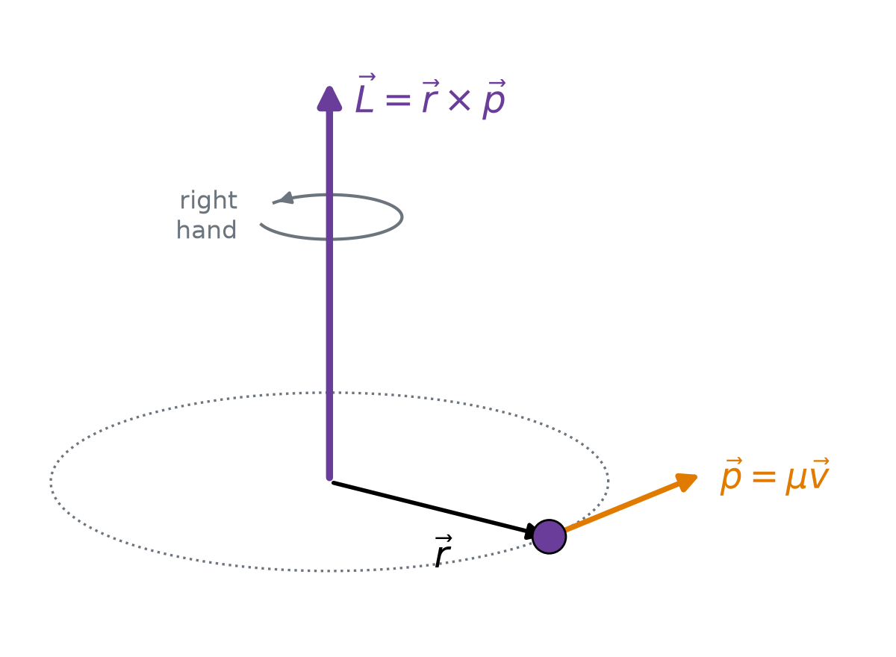
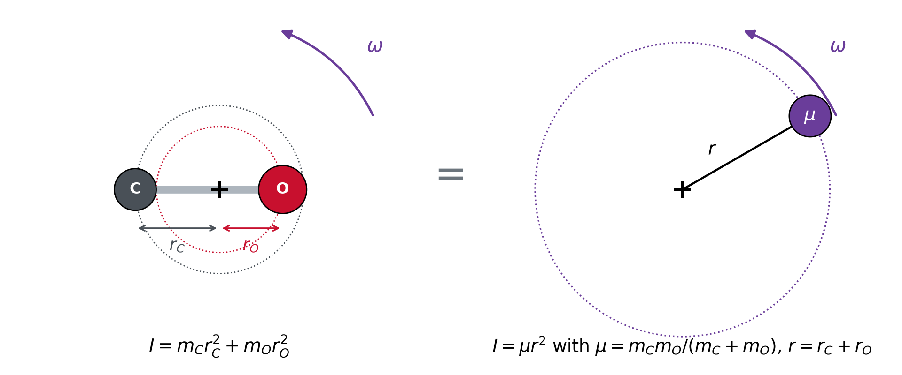
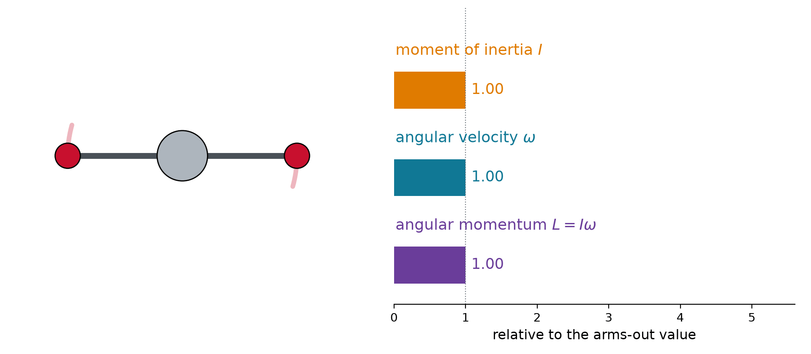
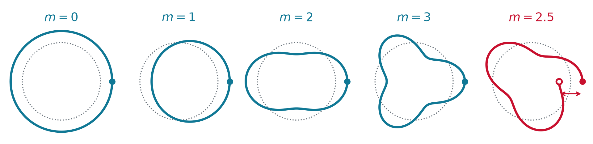
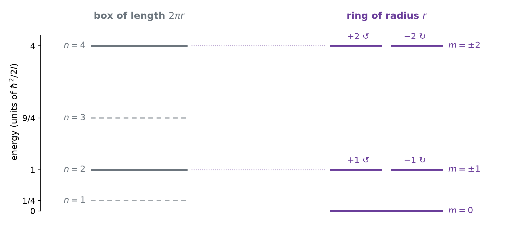
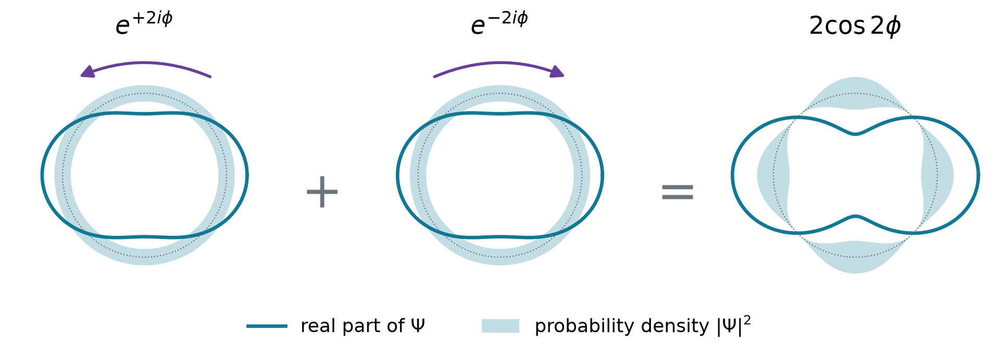
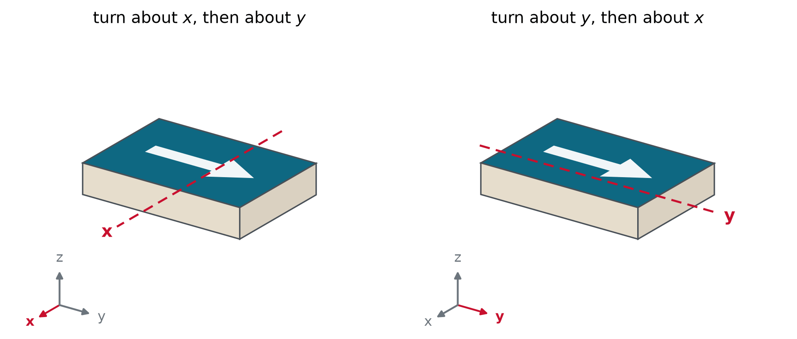
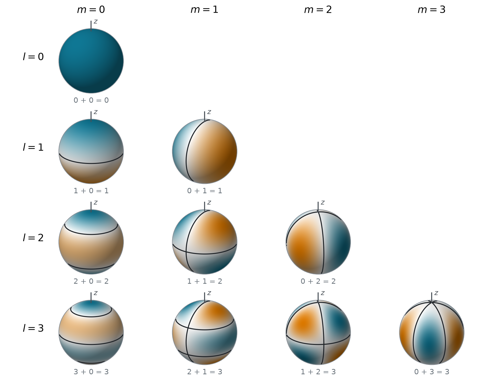
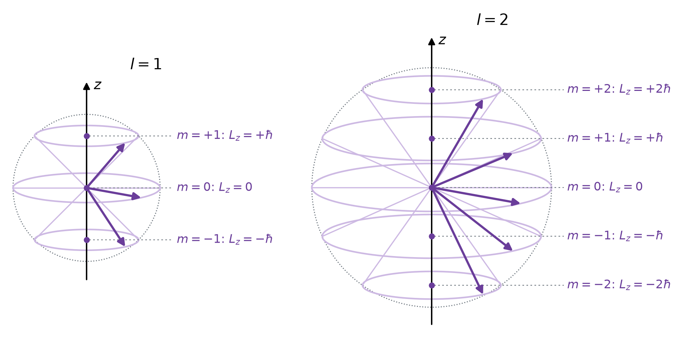

## Our model: a particle on a circle

:::: {.columns}

::: {.column width="64%"}
```{=html}
<div id="cv-live" style="width: 700px; margin: 0 auto;"></div>
<script type="module">
  import widget from "../../widgets/circle_vectors.mjs";
  const opts = { fontSize: "17px", width: 700, status: false };
  widget.render({ model: { get: (k) => opts[k] }, el: document.getElementById("cv-live") });
</script>
```
:::

::: {.column width="36%"}
$$s = r\phi$$

$$\omega = \frac{d\phi}{dt}$$

$$\vec{v} = \vec{\omega}\times\vec{r}$$

$$v = r\omega$$
:::

::::

## Angular momentum is a vector product

$$\vec{L} = \vec{r}\times\vec{p} = \begin{vmatrix} \hat{\imath} & \hat{\jmath} & \hat{k} \\ x & y & z \\ p_x & p_y & p_z \end{vmatrix} = \left(yp_z - zp_y,\ zp_x - xp_z,\ xp_y - yp_x\right)$$

:::: {.columns}

::: {.column width="50%"}
{width="100%"}
:::

::: {.column width="50%"}
$$\begin{aligned}
L &= rp\sin\alpha && \text{length of } \vec{r}\times\vec{p} \\
&= r\,\mu v && \text{circle: } \alpha = 90^\circ \\
&= \mu r^2\omega && v = r\omega \\
&= I\omega && I = \mu r^2
\end{aligned}$$
:::

::::

## Kinetic energy becomes $L^2/2I$

$$\begin{aligned}
E &= \tfrac{1}{2}\mu v^2 && \text{kinetic energy} \\
&= \tfrac{1}{2}\mu r^2\omega^2 && v = r\omega \\
&= \tfrac{1}{2}I\omega^2 && I = \mu r^2 \\
&= \frac{L^2}{2I} && \omega = L/I
\end{aligned}$$

::: {.keyeq}
$$\vec{L} = \vec{r}\times\vec{p}, \qquad L = I\omega, \qquad E = \frac{1}{2}I\omega^2 = \frac{L^2}{2I}, \qquad I = \mu r^2$$
:::

- The same form as $p^2/2\mu$: $L$ plays the momentum, $I$ plays the mass

## Linear and angular: the analogy

| | straight line | rotation |
|:--|:--|:--|
| position | $x$ | angle $\phi$ |
| velocity | $v = dx/dt$ | angular velocity $\omega = d\phi/dt$ |
| inertia | mass $\mu$ | moment of inertia $I = \mu r^2$ |
| momentum | $p = \mu v$ | angular momentum $L = I\omega$ |
| kinetic energy | $p^2/2\mu$ | $L^2/2I$ |
| changed by | force: $dp/dt = F$ | torque: $d\vec{L}/dt = \vec{r}\times\vec{F}$ |
| conserved when | no force | no torque |

- Quantum mechanics keeps the analogy: $\hat{p} = -i\hbar\,d/dx$ becomes $\hat{L}_z = -i\hbar\,d/d\phi$

## A model system: the rigid dumbbell

{.nostretch width="70%" fig-align="center"}

- A diatomic turning about its center of mass **is** one particle $\mu$ on a circle of radius $r$, the bond length
- Everything so far applies with $I = \mu r^2$: rotating molecules are particles on circles

## No torque, no change: the spinning skater

$$\frac{d\vec{L}}{dt} = \underbrace{\vec{v}\times\mu\vec{v}}_{0} + \vec{r}\times\frac{d\vec{p}}{dt} = \vec{r}\times\vec{F} = \vec{\tau}$$

{.nostretch width="60%" fig-align="center"}

- Pulling inward exerts **no torque**: $L = I\omega$ stays, so smaller $I$ means faster $\omega$

## Example: the spinning skater

::: {.worked}
1 turn per second with the arms out, $I = 4.0$ kg m$^2$. Arms in: $I' = 1.6$ kg m$^2$. New spin rate?
:::

::: {.soln .fragment}
$$L = I\omega = (4.0)(2\pi) = 25.1\ \text{kg m}^2\,\text{s}^{-1}$$

$$\omega' = \frac{L}{I'} = \frac{25.1}{1.6} = 15.7\ \text{s}^{-1} = 2.5\ \text{turns per second}$$
:::

- Faster by $I/I' = 2.5$, with the **same** $L$. Also: a diver's tuck, a pulsar, a tumbling molecule

## Conservation from symmetry

:::: {.columns}

::: {.column width="52%"}
**Noether's theorem**: every continuous symmetry gives a conserved quantity

| nothing changes when you | conserved |
|:--|:--|
| shift in space | momentum |
| **turn about an axis** | **angular momentum** |
| shift the clock | energy |

- Quantum: $[\hat{H}, \hat{L}] = 0$ (Lecture 3.7), so $L$ can **label the states**
:::

::: {.column width="48%"}
{width="100%"}
:::

::::

## The same particle, quantum

A mass $\mu$ on a circle of radius $r$, no potential. Arc length $s = r\phi$:

$$\hat{L}_z = r\,\hat{p}_s = -i\hbar\,r\,\frac{d}{ds} = -i\hbar\,\frac{d}{d\phi}, \qquad \hat{H} = \frac{\hat{L}_z^2}{2I} = -\frac{\hbar^2}{2I}\,\frac{d^2}{d\phi^2}$$

- $\hat{L}_z$ is the **momentum operator** with an angle in place of $x$; $I$ plays the mass
- $\hat{H}$ is built from $\hat{L}_z$, so they **commute** and share eigenfunctions

## The wave must join up

$$-i\hbar\,\frac{d\Phi}{d\phi} = L_z\Phi \quad\Longrightarrow\quad \Phi = e^{iL_z\phi/\hbar}$$

$$\Phi(\phi + 2\pi) = \Phi(\phi) \quad\Longrightarrow\quad e^{2\pi iL_z/\hbar} = 1 \quad\Longrightarrow\quad \frac{L_z}{\hbar} = m = 0, \pm 1, \pm 2, \dots$$

{.nostretch width="78%" fig-align="center"}

- $m = 2.5$: the ends **miss**, not allowed. The ring **closing on itself** quantizes $m$

## Particle on a ring

::: {.keyeq}
$$\Phi_m(\phi) = \frac{1}{\sqrt{2\pi}}\,e^{im\phi}, \qquad L_z = m\hbar, \qquad E_m = \frac{m^2\hbar^2}{2I}$$

$$m = 0, \pm 1, \pm 2, \dots$$
:::

- $I = \mu r^2$. Positive $m$ runs **counterclockwise** seen from $+z$, negative $m$ clockwise
- Same speed, opposite directions: $\pm m$ share an energy

## Cut the ring open: a box

{.nostretch width="70%" fig-align="center"}

- The ring keeps the **even** box levels, **twice** each, and adds $m = 0$
- **No zero-point energy**: $\Phi_0$ is flat, no curvature; the position is completely unknown

## Running and standing waves

{.nostretch width="64%" fig-align="center"}

$$\Psi = \frac{1}{\sqrt{2}}\big(\Phi_{+2} + \Phi_{-2}\big) = \frac{\cos 2\phi}{\sqrt{\pi}}, \qquad \hat{H}\Psi = E_2\,\Psi$$

- $m = \pm 2$ have the **same energy**: that is why their superposition is still **stationary**
- Not sharp in $L_z$: a measurement gives $\pm 2\hbar$, each with probability $\frac{1}{2}$

## Example: benzene's π electrons

::: {.worked}
Six π electrons on a ring of radius 139 pm. Where should benzene absorb?
:::

::: {.soln .fragment}
$$\frac{\hbar^2}{2m_e r^2} = \frac{(1.055\times10^{-34}\ \text{J s})^2}{2\,(9.109\times10^{-31}\ \text{kg})(1.39\times10^{-10}\ \text{m})^2} = 1.97\ \text{eV}$$

Two electrons per state: $m = 0$ (2) and $m = \pm 1$ (4). Lowest empty level: $\lvert m\rvert = 2$.

$$\Delta E = (2^2 - 1^2)(1.97\ \text{eV}) = 5.9\ \text{eV}, \qquad \lambda = \frac{1240\ \text{eV nm}}{5.9\ \text{eV}} = 210\ \text{nm}$$
:::

- Benzene absorbs between 180 and 260 nm: colorless, as the model says

## Classical and quantum, side by side

| | classical particle on a circle | quantum particle on a ring |
|:--|:--|:--|
| angular momentum | any value, $L = I\omega$ | only $L_z = m\hbar$ |
| energy | any value, $L^2/2I$ | only $m^2\hbar^2/2I$ |
| where it is | a definite angle, $\phi = \omega t$ | with sharp $L_z$: anywhere, $\lvert\Phi_m\rvert^2 = 1/2\pi$ |
| lowest energy | 0, at rest at a known angle | 0, the angle completely unknown |
| two directions | same energy | the pair $\pm m$ |

- Heavy or large rotors: steps far too small to see. A spinning wheel has $m \approx 10^{31}$

## Three components, three operators

::: {.keyeq}
$$\hat{L}_x = -i\hbar\left(y\frac{\partial}{\partial z} - z\frac{\partial}{\partial y}\right), \qquad \hat{L}_y = -i\hbar\left(z\frac{\partial}{\partial x} - x\frac{\partial}{\partial z}\right)$$

$$\hat{L}_z = -i\hbar\left(x\frac{\partial}{\partial y} - y\frac{\partial}{\partial x}\right), \qquad \hat{L}^2 = \hat{L}_x^2 + \hat{L}_y^2 + \hat{L}_z^2$$
:::

In spherical coordinates, a turn about $z$ changes only $\phi$, and the chain rule gives

$$\frac{\partial}{\partial\phi} = x\frac{\partial}{\partial y} - y\frac{\partial}{\partial x} \quad\Longrightarrow\quad \hat{L}_z = -i\hbar\,\frac{\partial}{\partial\phi}\ \ \text{(the ring operator)}$$

- Each component measures how a function changes under a **small turn** about its axis

## Turns about different axes do not commute

{.nostretch width="76%" fig-align="center"}

- Same two turns, opposite orders, **different results**: the components cannot commute

## The commutators

Only $z$ and $\hat{p}_z$ fail to commute, $[z, \hat{p}_z] = i\hbar$, so two of four terms survive:

$$[\hat{L}_x, \hat{L}_y] = [y\hat{p}_z, z\hat{p}_x] + [z\hat{p}_y, x\hat{p}_z] = -i\hbar\,y\hat{p}_x + i\hbar\,x\hat{p}_y = i\hbar\,\hat{L}_z$$

::: {.keyeq}
$$[\hat{L}_x, \hat{L}_y] = i\hbar\,\hat{L}_z, \qquad [\hat{L}_y, \hat{L}_z] = i\hbar\,\hat{L}_x, \qquad [\hat{L}_z, \hat{L}_x] = i\hbar\,\hat{L}_y$$

$$[\hat{L}^2, \hat{L}_x] = [\hat{L}^2, \hat{L}_y] = [\hat{L}^2, \hat{L}_z] = 0$$
:::

- Cyclic: $x \to y \to z \to x$. Two small turns, $x$ then $y$, differ from $y$ then $x$ by a turn about $z$

## Example: $\hat{L}_z$ turns $x$ into $y$

::: {.worked}
Apply $\hat{L}_z = -i\hbar\,(x\,\partial_y - y\,\partial_x)$ to $x$, $y$ and $z$. Which combinations are eigenfunctions?
:::

::: {.soln .fragment}
$$\hat{L}_z\,x = i\hbar\,y, \qquad \hat{L}_z\,y = -i\hbar\,x, \qquad \hat{L}_z\,z = 0$$

$$\hat{L}_z\,(x \pm iy) = i\hbar\,y \pm i\,(-i\hbar\,x) = \pm\hbar\,(x \pm iy)$$

$$x \pm iy = r\sin\theta\,e^{\pm i\phi}\ \ (m = \pm 1), \qquad z = r\cos\theta\ \ (m = 0)$$
:::

- A turn about $z$ **mixes** $x$ and $y$; the mixtures $x \pm iy$ are the ring's $e^{\pm i\phi}$ again

## Only one component at a time

- Sharp $L_x$ and $L_y$ would need $[\hat{L}_x, \hat{L}_y]\psi = i\hbar\hat{L}_z\psi = 0$: then **all three** vanish
- Otherwise: $\sigma_{L_x}\sigma_{L_y} \geq \frac{\hbar}{2}\lvert\langle L_z\rangle\rvert$ (Lecture 3.6)
- $\hat{L}^2$ commutes with every component: know the **length** and **one projection**
- Convention: $\hat{L}_z$. The $z$ axis is your choice: a magnetic field, a laser's polarization
- Contrast $\hat{p}_x, \hat{p}_y, \hat{p}_z$: they commute, and a plane wave has all three sharp

## A particle on a sphere

$$\hat{L}^2 = -\hbar^2\left[\frac{1}{\sin\theta}\frac{\partial}{\partial\theta}\left(\sin\theta\,\frac{\partial}{\partial\theta}\right) + \frac{1}{\sin^2\theta}\frac{\partial^2}{\partial\phi^2}\right]$$

$$\nabla^2 = \frac{1}{r^2}\frac{\partial}{\partial r}\left(r^2\frac{\partial}{\partial r}\right) - \frac{\hat{L}^2}{\hbar^2r^2} \qquad\Longrightarrow\qquad \hat{H} = \frac{\hat{L}^2}{2I}\ \ \text{on a sphere of radius } r$$

- Angles only. A diatomic with fixed bond length: the **rigid rotor** (Lecture 4.5)
- Separate $Y = \Theta(\theta)\,\Phi(\phi)$: the $\phi$ part is the **ring** again, $e^{im\phi}$
- $\Theta$ stays finite at both poles only for $L^2 = \hbar^2 l(l+1)$, whole $l \geq \lvert m\rvert$

## Spherical harmonics

::: {.keyeq}
$$\hat{L}^2\,Y_l^m = \hbar^2\,l(l+1)\,Y_l^m, \qquad \hat{L}_z\,Y_l^m = m\hbar\,Y_l^m$$

$$l = 0, 1, 2, \dots \qquad m = -l, \dots, l \quad (2l + 1\ \text{values})$$

$$\langle l'm'|lm\rangle = \int_0^{2\pi}\!\!\int_0^{\pi} Y_{l'}^{m'*}\,Y_l^m\,\sin\theta\,d\theta\,d\phi = \delta_{ll'}\,\delta_{mm'}$$
:::

- $l$: the **length**, $\sqrt{l(l+1)}\,\hbar$. $m$: the **projection** on $z$. Letters s, p, d, f for $l = 0, 1, 2, 3$

## The first few

| $l$ | $m$ | $Y_l^m(\theta, \phi)$ | $r^l\,Y_l^m$ in $x, y, z$ |
|:-:|:-:|:--|:--|
| 0 | 0 | $\sqrt{1/4\pi}$ | $\sqrt{1/4\pi}$ |
| 1 | 0 | $\sqrt{3/4\pi}\,\cos\theta$ | $\sqrt{3/4\pi}\,z$ |
| 1 | $\pm 1$ | $\mp\sqrt{3/8\pi}\,\sin\theta\,e^{\pm i\phi}$ | $\mp\sqrt{3/8\pi}\,(x \pm iy)$ |
| 2 | 0 | $\sqrt{5/16\pi}\,(3\cos^2\theta - 1)$ | $\sqrt{5/16\pi}\,(3z^2 - r^2)$ |
| 2 | $\pm 1$ | $\mp\sqrt{15/8\pi}\,\sin\theta\cos\theta\,e^{\pm i\phi}$ | $\mp\sqrt{15/8\pi}\,z\,(x \pm iy)$ |
| 2 | $\pm 2$ | $\sqrt{15/32\pi}\,\sin^2\theta\,e^{\pm 2i\phi}$ | $\sqrt{15/32\pi}\,(x \pm iy)^2$ |

- Each is $e^{im\phi}$ times a function of $\theta$. In $x, y, z$: a polynomial of degree $l$

## Example: check $Y_1^0$

::: {.worked}
Show that $Y_1^0 \propto \cos\theta$ has $l = 1$ and $m = 0$.
:::

::: {.soln .fragment}
No $\phi$ in it, so $\hat{L}_z\cos\theta = 0$: $m = 0$. Inside out:

$$\frac{\partial}{\partial\theta}\cos\theta = -\sin\theta, \qquad \frac{1}{\sin\theta}\frac{\partial}{\partial\theta}\left(-\sin^2\theta\right) = -2\cos\theta$$

$$\hat{L}^2\cos\theta = 2\hbar^2\cos\theta = \hbar^2\,l(l+1)\cos\theta, \qquad l = 1$$
:::

## $l$ nodal lines on the globe

{.nostretch width="46%" fig-align="center"}

- Teal $+$, orange $-$. Nodes: $l - \lvert m\rvert$ around the axis $+$ $\lvert m\rvert$ through the poles $= l$

## Live: spherical harmonics

```{=html}
<div id="sh-live" style="width: 1100px; margin: 0 auto;"></div>
<script type="module">
  import widget from "../../widgets/spherical_harmonics.mjs";
  const opts = { fontSize: "20px", size: 330 };
  widget.render({ model: { get: (k) => opts[k] }, el: document.getElementById("sh-live") });
</script>
```

## The vector model

{.nostretch width="62%" fig-align="center"}

- Length $\sqrt{l(l+1)}\,\hbar$, height $m\hbar$, direction around $z$ **unknown**: a cone
- $\langle L_x^2\rangle + \langle L_y^2\rangle = \hbar^2[l(l+1) - m^2] > 0$: never along $z$. Nothing actually precesses

## Example: how close to the $z$ axis?

::: {.worked}
Find the smallest angle between $\vec{L}$ and $z$ for $l = 1$, $2$ and $10$, and for a spinning top with $l \approx 10^{31}$.
:::

::: {.soln .fragment}
$$\cos\theta_{\min} = \frac{l}{\sqrt{l(l+1)}}$$

$l = 1$: 45°. $\ l = 2$: 35.3°. $\ l = 10$: 17.5°. Large $l$: $\theta_{\min} \approx 1/\sqrt{l} \approx 3\times10^{-16}$ rad for the top.
:::

- Large angular momentum looks **classical**: the correspondence principle again

## Toward the rigid rotor

| | ring | sphere |
|:--|:--|:--|
| sharp | $\hat{L}_z$ | $\hat{L}^2$, $\hat{L}_z$ |
| states | $e^{im\phi}/\sqrt{2\pi}$ | $Y_l^m(\theta, \phi)$ |
| energies | $m^2\hbar^2/2I$ | $l(l+1)\hbar^2/2I$ |
| states per level | 2 (1 for $m = 0$) | $2l + 1$ |

- A diatomic: $\hat{H} = \hat{L}^2/2I$, $I = \mu R_e^2$. Its dipole couples through $\cos\theta$: $\Delta l = \pm 1$
- **Lecture 4.5**: $J$ for $l$, and microwave spectra

# Takeaway {.center}

> Classically $L = I\omega$ and $E = L^2/2I$, conserved without torque. On a ring, $\hat{L}_z = -i\hbar\,d/d\phi$ and the wave must join up: $L_z = m\hbar$ with whole $m$, energies $m^2\hbar^2/2I$ in $\pm m$ pairs from zero. In space the components **do not commute**, $[\hat{L}_x, \hat{L}_y] = i\hbar\hat{L}_z$, because turns do not commute: only the length and one projection are sharp. Their eigenfunctions are the **spherical harmonics**, $L^2 = \hbar^2 l(l+1)$ and $L_z = m\hbar$ with $\lvert m\rvert \leq l$, with $l$ nodal lines. $\vec{L}$ lies on a cone, never along $z$.
