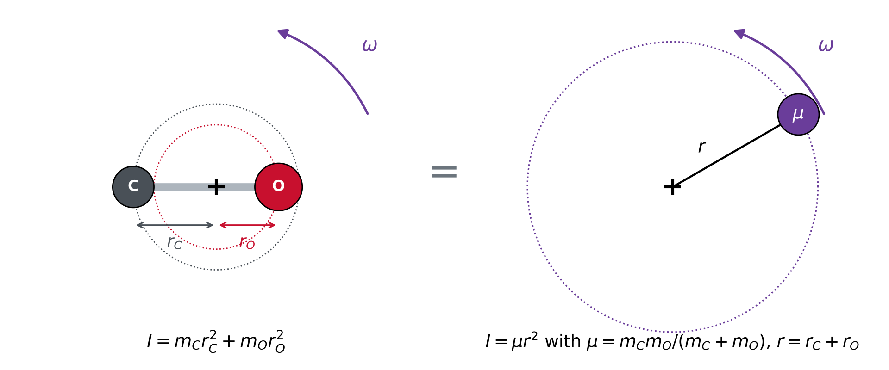
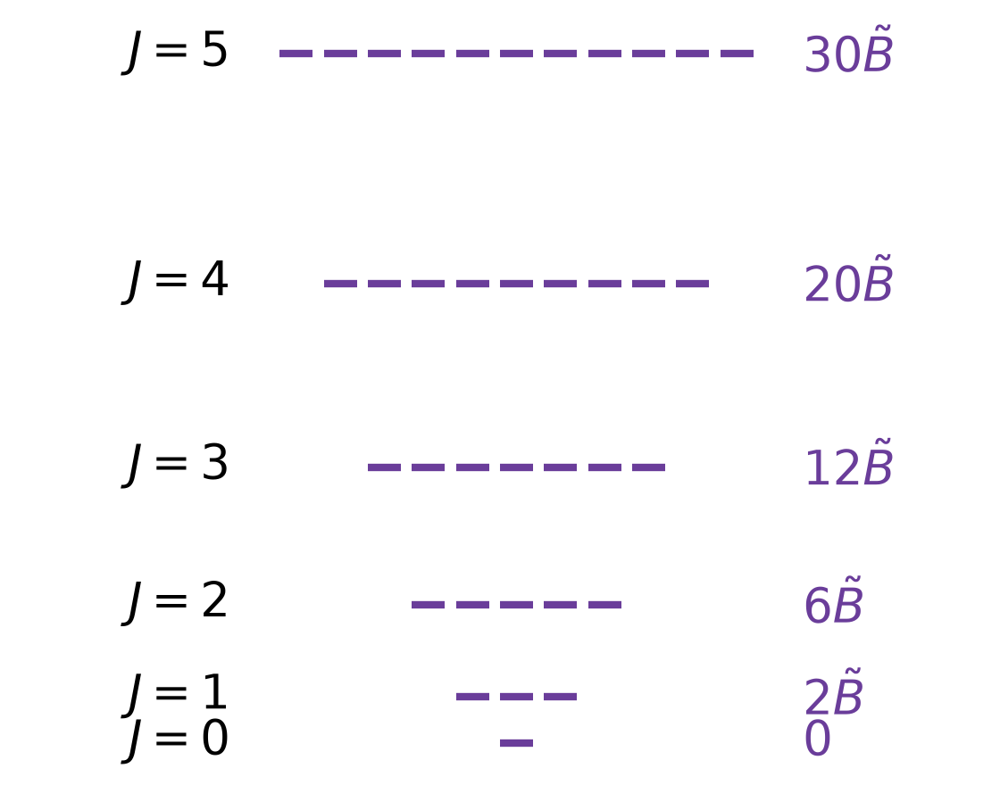
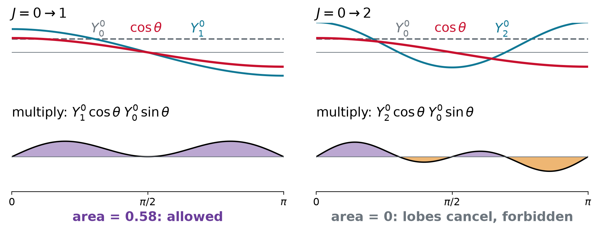
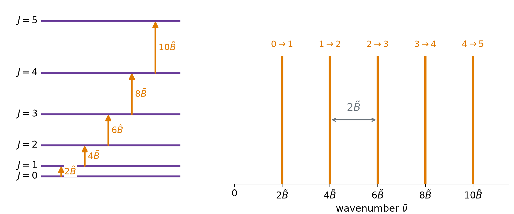
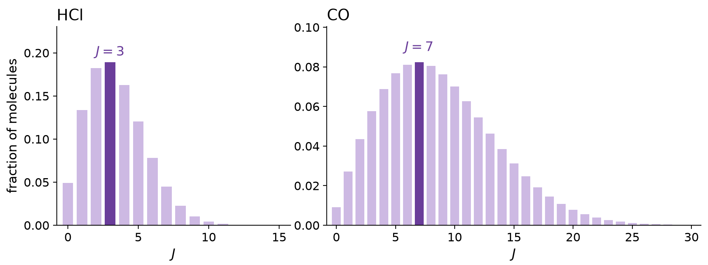
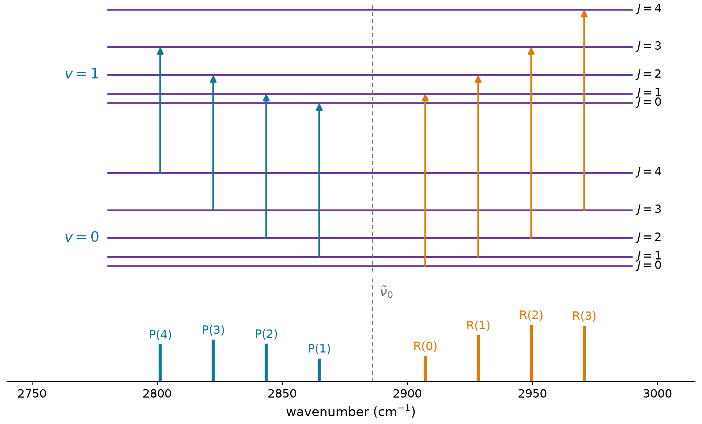

## A rotating molecule is a particle on a sphere

{.nostretch width="64%" fig-align="center"}

$$\hat{H} = \frac{\hat{L}^2}{2I}, \qquad I = \mu R_e^2$$

- Fixed bond length, no potential: all the energy is rotation. Lecture 4.4 already solved it

## The rigid rotor

:::: {.columns}

::: {.column width="40%"}
{width="100%"}
:::

::: {.column width="60%"}
::: {.keyeq}
$$\hat{H}\,Y_J^{M_J} = E_J\,Y_J^{M_J}$$

$$E_J = \frac{\hbar^2}{2I}\,J(J+1)$$

$$J = 0, 1, 2, \dots \qquad M_J = -J, \dots, J$$
:::

- $2J + 1$ states per level, one for each $M_J$
- Gaps of $2, 4, 6, \dots$ times $\hbar^2/2I$: they **grow**
- $J = 0$ has $E = 0$: **no zero-point rotation**
- $J$ and $M_J$ are the $l$ and $m$ of Lecture 4.4
:::

::::

## The rotational constant

::: {.keyeq}
$$F(J) = \frac{E_J}{hc} = \tilde{B}\,J(J+1), \qquad \tilde{B} = \frac{h}{8\pi^2cI}$$
:::

| molecule | $\tilde{B}$ (cm$^{-1}$) | vibration $\tilde{\nu}$ (cm$^{-1}$) | $k_BT/hc\tilde{B}$ at 300 K |
|:--|--:|--:|--:|
| H$_2$ | 60.9 | 4161 | 3.4 |
| HCl | 10.6 | 2886 | 20 |
| CO | 1.93 | 2143 | 108 |
| I$_2$ | 0.037 | 213 | 5600 |

- Rotation is **cheap**: $\tilde{B} \ll k_BT = 208$ cm$^{-1}$, so many $J$ levels are occupied

## Example: the rotational constant of HCl

::: {.worked}
H$^{35}$Cl: $R_e = 127.5$ pm, $\mu = 0.9796$ u. Find $I$, $\tilde{B}$ and the energy of $J = 1$.
:::

::: {.soln .fragment}
$$I = \mu R_e^2 = (1.6266\times10^{-27}\ \text{kg})(127.5\times10^{-12}\ \text{m})^2 = 2.644\times10^{-47}\ \text{kg m}^2$$

$$\tilde{B} = \frac{h}{8\pi^2cI} = 10.59\ \text{cm}^{-1}, \qquad F(1) = 2\tilde{B} = 21.2\ \text{cm}^{-1}$$
:::

- In $J = 1$: $L = \sqrt{2}\,\hbar$, and $L_z$ is $-\hbar$, $0$ or $+\hbar$

## A rotating dipole is an antenna

$$\langle J'M_J'|\hat{M}_z|JM_J\rangle = M_e\int Y_{J'}^{M_J'*}\,\cos\theta\;Y_J^{M_J}\,\sin\theta\,d\theta\,d\phi$$

- The dipole $M_e$ points along the bond: as the molecule turns, the dipole **turns with it**
- No dipole, no microwave spectrum: H$_2$, N$_2$, O$_2$, CO$_2$, CH$_4$ are **silent**; HCl, CO, H$_2$O absorb

## One rung at a time

{.nostretch width="62%" fig-align="center"}

::: {.keyeq}
$$M_e \neq 0, \qquad \Delta J = \pm 1, \qquad \Delta M_J = 0, \pm 1$$
:::

- $\cos\theta\,Y_J^{M_J}$ mixes only $Y_{J\pm1}^{M_J}$. The photon carries **one unit** $\hbar$ of angular momentum

## The microwave spectrum

$$\tilde{\nu}_J = F(J+1) - F(J) = \tilde{B}\,\big[(J+1)(J+2) - J(J+1)\big]$$

::: {.keyeq}
$$\tilde{\nu}_J = 2\tilde{B}\,(J+1), \qquad \tilde{\nu}_{J+1} - \tilde{\nu}_J = 2\tilde{B}$$
:::

{.nostretch width="60%" fig-align="center"}

## Example: the bond length of CO

::: {.worked}
CO absorbs at 3.845, 7.690 and 11.535 cm$^{-1}$ (115, 231, 346 GHz). Find its bond length ($\mu = 6.856$ u).
:::

::: {.soln .fragment}
$$2\tilde{B} = 3.845\ \text{cm}^{-1} \;\Longrightarrow\; \tilde{B} = 1.9225\ \text{cm}^{-1}$$

$$I = \frac{h}{8\pi^2c\tilde{B}} = 1.456\times10^{-46}\ \text{kg m}^2$$

$$R = \sqrt{\frac{I}{\mu}} = \sqrt{\frac{1.456\times10^{-46}}{1.1385\times10^{-26}}}\ \text{m} = 113.1\ \text{pm}$$
:::

- Radio astronomers map the cold gas between the stars with CO's 115 GHz line

## Populations

::: {.keyeq}
$$\frac{N_J}{N_0} = (2J+1)\,e^{-hc\tilde{B}J(J+1)/k_BT}$$
:::

{.nostretch width="64%" fig-align="center"}

- Degeneracy **rises**, Boltzmann **falls**: HCl peaks at $J = 3$, CO at $J = 7$

## Rotation rides on vibration

$$\tilde{E}(v, J) = \tilde{\nu}\left(v + \tfrac{1}{2}\right) + \tilde{B}\,J(J+1), \qquad \Delta v = +1, \quad \Delta J = \pm 1$$

{.nostretch width="56%" fig-align="center"}

## The P and R branches

::: {.keyeq}
$$\tilde{\nu}_R(J) = \tilde{\nu}_0 + 2\tilde{B}\,(J+1), \qquad \tilde{\nu}_P(J) = \tilde{\nu}_0 - 2\tilde{B}\,J$$
:::

- **R** ($\Delta J = +1$) above the band origin $\tilde{\nu}_0$, **P** ($\Delta J = -1$) below
- No line at $\tilde{\nu}_0$: $\Delta J = 0$ is forbidden, so R(0) and P(1) are $4\tilde{B}$ apart
- Each branch rises and falls with the populations of its starting levels

## Example: reading the HCl band

::: {.worked}
The lines next to the gap are R(0) = 2906.25 and P(1) = 2865.10 cm$^{-1}$. Find $\tilde{\nu}_0$ and $\tilde{B}$ (rigid rotor).
:::

::: {.soln .fragment}
$$\tilde{\nu}_0 = \frac{2906.25 + 2865.10}{2} = 2885.68\ \text{cm}^{-1}$$

$$\tilde{B} = \frac{2906.25 - 2865.10}{4} = 10.29\ \text{cm}^{-1}$$
:::

- The microwave value is $\tilde{B}_0 = 10.44$ cm$^{-1}$: the bond is a little longer in $v = 1$

## Beyond the rigid rotor

**The bond is longer in $v = 1$**

$$\tilde{B}_v = \tilde{B}_e - \alpha_e\left(v + \tfrac{1}{2}\right) \qquad \text{HCl: } \tilde{B}_0 = 10.44,\ \tilde{B}_1 = 10.14\ \text{cm}^{-1}$$

**Fast rotation stretches the bond**

$$F(J) = \tilde{B}\,J(J+1) - \tilde{D}\,J^2(J+1)^2, \qquad \tilde{D} \approx \frac{4\tilde{B}^3}{\tilde{\nu}^2}$$

- R lines crowd, P lines spread, high-$J$ levels fall slightly. Both are small at low $J$

## Live: temperature and the spectrum

```{=html}
<div id="rs-live" style="width: 1100px; margin: 0 auto;"></div>
<script type="module">
  import widget from "../../widgets/rotor_spectrum.mjs";
  const opts = { fontSize: "19px" };
  widget.render({ model: { get: (k) => opts[k] }, el: document.getElementById("rs-live") });
</script>
```

# Takeaway {.center}

> A diatomic with a fixed bond length is a particle on a sphere: $E_J = \hbar^2J(J+1)/2I$, with $2J+1$ states per level and no zero-point rotation. In wavenumbers $F(J) = \tilde{B}J(J+1)$ with $\tilde{B} = h/8\pi^2cI$. A permanent dipole and $\Delta J = \pm 1$ give microwave lines evenly spaced by $2\tilde{B}$, which measure bond lengths, with heights that follow the populations $(2J+1)e^{-hcF(J)/k_BT}$. In the infrared, rotation rides on vibration: P and R branches around a gap at the band origin.
