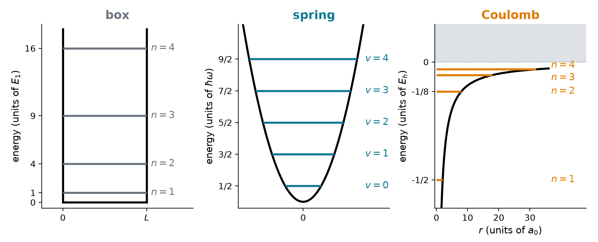
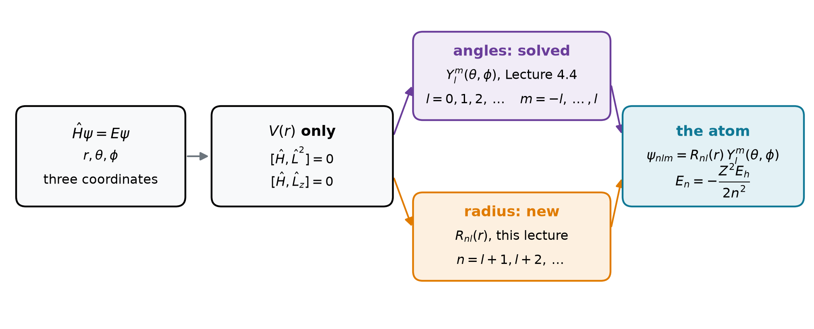
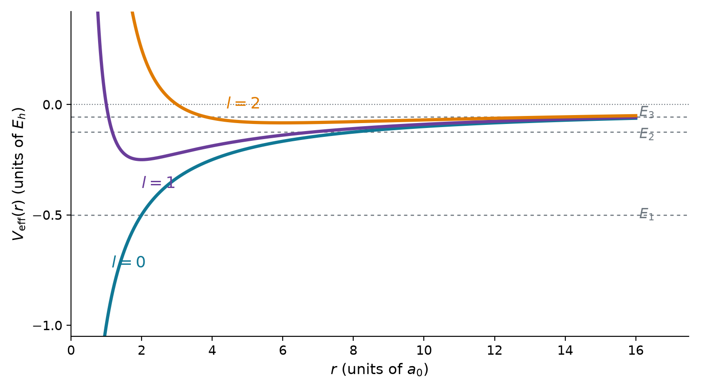
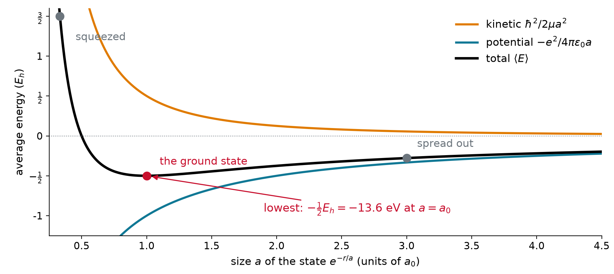
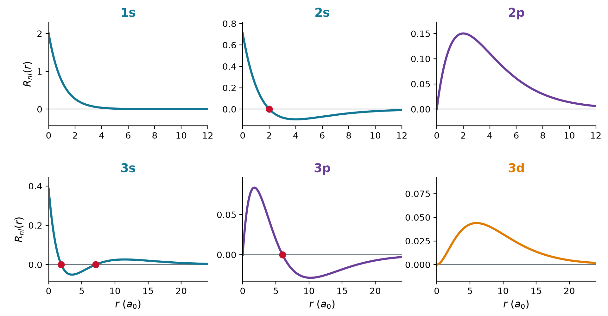
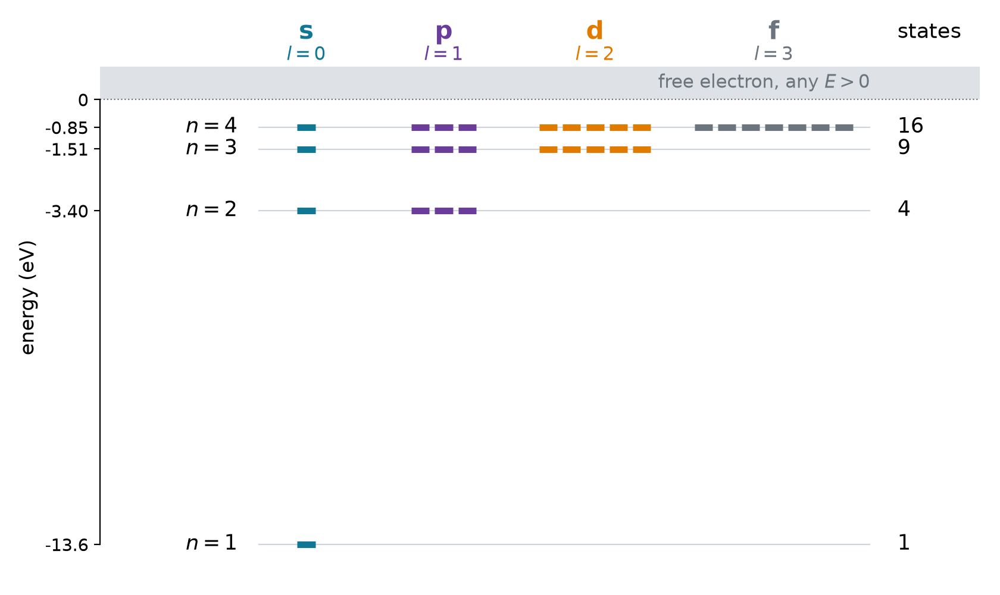
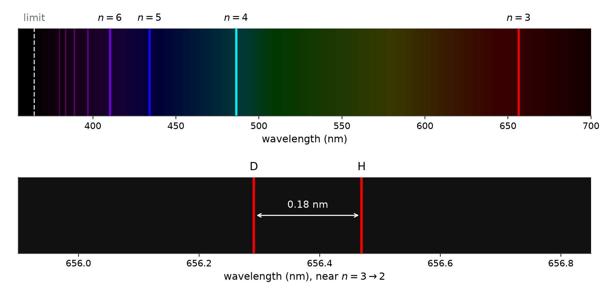

## A third model well

{.nostretch width="76%" fig-align="center"}

- Box: gaps **grow**. Spring: gaps **equal**. Coulomb, $-Ze^2/4\pi\varepsilon_0 r$: gaps **shrink** toward $E = 0$
- Above zero the electron is **free**. Below zero: the **atom**, the last well solved exactly

## One electron, one nucleus

::: {.keyeq}
$$\hat{H} = -\frac{\hbar^2}{2\mu}\nabla^2 - \frac{Ze^2}{4\pi\varepsilon_0 r}, \qquad \hat{H}\,\psi(r, \theta, \phi) = E\,\psi(r, \theta, \phi)$$
:::

- $Z = 1$: H. $\ Z = 2$: He$^+$. $\ Z = 3$: Li$^{2+}$. One electron, one nucleus of charge $Ze$
- Two bodies, one **reduced mass** $\mu = m_em_N/(m_e + m_N)$, as for a diatomic (4.1): $\mu = 0.99946\,m_e$ for hydrogen
- No walls, no spring: the well falls without limit at the nucleus and fades to zero far away
- Helium adds $e^2/4\pi\varepsilon_0 r_{12}$ between its electrons, and the exact solution is gone (Chapter 7)

## A central force: angular momentum is conserved

$V$ depends on $r$ **alone**. Turn the atom about the nucleus: nothing changes (Noether, Lecture 4.4)

$$[\hat{H}, \hat{L}^2] = 0, \qquad [\hat{H}, \hat{L}_z] = 0$$

$$\nabla^2 = \frac{1}{r^2}\frac{\partial}{\partial r}\left(r^2\frac{\partial}{\partial r}\right) - \frac{\hat{L}^2}{\hbar^2r^2}
\quad\Longrightarrow\quad
\hat{H} = -\frac{\hbar^2}{2\mu}\,\frac{1}{r^2}\frac{\partial}{\partial r}\left(r^2\frac{\partial}{\partial r}\right) + \frac{\hat{L}^2}{2\mu r^2} - \frac{Ze^2}{4\pi\varepsilon_0 r}$$

- Commuting operators share eigenfunctions (Operators 2): the states carry sharp $L^2 = \hbar^2l(l+1)$ and $L_z = m\hbar$
- The middle term is the rigid rotor's $L^2/2I$ with $I = \mu r^2$: rotation at a radius that can change

## Separate: the angles are already solved

{.nostretch width="84%" fig-align="center"}

$$\psi(r, \theta, \phi) = R(r)\,Y_l^m(\theta, \phi), \qquad \hat{L}^2\,Y_l^m = \hbar^2l(l+1)\,Y_l^m$$

## The radial equation

Insert $R\,Y_l^m$, let $\hat{L}^2$ act, divide by $Y_l^m$:

$$-\frac{\hbar^2}{2\mu}\,\frac{1}{r^2}\frac{d}{dr}\left(r^2\frac{dR}{dr}\right) + \left[\frac{\hbar^2l(l+1)}{2\mu r^2} - \frac{Ze^2}{4\pi\varepsilon_0 r}\right]R = E\,R$$

Then $R = u/r$ makes the radial term $-(\hbar^2/2\mu)\,u''/r$; multiply by $r$. A **wall at the nucleus**: $u(0) = 0$

::: {.keyeq}
$$-\frac{\hbar^2}{2\mu}\,\frac{d^2u}{dr^2} + V_{\mathrm{eff}}(r)\,u = E\,u, \qquad u(0) = 0$$

$$V_{\mathrm{eff}}(r) = -\frac{Ze^2}{4\pi\varepsilon_0 r} + \frac{\hbar^2l(l+1)}{2\mu r^2}$$
:::

## The effective potential

{.nostretch width="56%" fig-align="center"}

- $l = 0$: the bare Coulomb well. $l > 0$: the **centrifugal** term $L^2/2\mu r^2$ wins at small $r$: a bowl with its bottom at $r = l(l+1)\,a_0$
- The $l = 1$ bowl bottoms out above $E_1$: no $l = 1$ state can be the ground state

## One length, one energy

$\hat{H}$ contains only $\hbar$, $\mu$ and $e^2/4\pi\varepsilon_0$: they build **one length** and **one energy**

**Length**: where confining the electron costs as much kinetic energy as the attraction pays

$$\frac{\hbar^2}{\mu a^2} = \frac{e^2}{4\pi\varepsilon_0 a} \quad\Longrightarrow\quad a_0 = \frac{4\pi\varepsilon_0\hbar^2}{\mu e^2} = 52.9\ \text{pm}$$

**Energy**: the Coulomb energy at that distance

$$E_h = \frac{e^2}{4\pi\varepsilon_0a_0} = \frac{\hbar^2}{\mu a_0^2} = 27.2\ \text{eV}$$

- The Bohr radius with no orbit assumed. Half a hartree, 13.6 eV, binds the ground state. For a nucleus $Ze$: $a_0/Z$, $Z^2E_h$

## Why the atom does not collapse

{.nostretch width="66%" fig-align="center"}

$$\langle E\rangle = \frac{\hbar^2}{2\mu a^2} - \frac{e^2}{4\pi\varepsilon_0 a} \quad\text{is lowest at } a = a_0: \quad \langle E\rangle = -\frac{E_h}{2} = -13.6\ \text{eV}$$

- Squeeze the state $e^{-r/a}$: kinetic energy wins. Spread it out: the attraction is lost

## The solution

::: {.keyeq}
$$E_n = -\frac{Z^2}{n^2}\,\frac{E_h}{2} = -13.6\ \text{eV}\,\frac{Z^2}{n^2}, \qquad \psi_{nlm}(r, \theta, \phi) = R_{nl}(r)\,Y_l^m(\theta, \phi)$$

$$n = 1, 2, 3, \dots \qquad l = 0, 1, \dots, n - 1 \qquad m = -l, \dots, l$$
:::

- The series for $u$ must **stop**, as Hermite's did (4.2): only for $\kappa a_0 = Z/n$ with whole $n > l$
- $n$ sets the energy and the size $n^2a_0/Z$. The energy depends on **neither $l$ nor $m$**
- $l$ and $m$ are the angular momentum quantum numbers of 4.4: s, p, d, f for $l = 0, 1, 2, 3$

## Example: check the ground state

::: {.worked}
Show that $u = re^{-r/a}$ solves the radial equation with $l = 0$. Find $a$ and $E$.
:::

:::: {.fragment}

::: {.soln}
$$u'' = \left(\frac{r}{a^2} - \frac{2}{a}\right)e^{-r/a} \quad\Longrightarrow\quad -\frac{\hbar^2}{2\mu}\left(\frac{r}{a^2} - \frac{2}{a}\right) - \frac{Ze^2}{4\pi\varepsilon_0} = E\,r \quad\text{for every } r$$

$$\text{no } r: \ \frac{\hbar^2}{\mu a} = \frac{Ze^2}{4\pi\varepsilon_0} \Rightarrow a = \frac{a_0}{Z} \qquad\qquad \text{with } r: \ E = -\frac{\hbar^2}{2\mu a^2} = -\frac{Z^2E_h}{2}$$
:::

- $R_{10} \propto e^{-Zr/a_0}$: the size the trade-off chose, no node, and $l = 0$: **no angular momentum at all**

::::

## The radial functions

Polynomial of degree $n - 1$ times $e^{-\rho/n}$, with $\rho = Zr/a_0$ and a common factor $(Z/a_0)^{3/2}$:

| orbital | $n$ | $l$ | $R_{nl}\,/\,(Z/a_0)^{3/2}$ | radial nodes |
|:-----:|:---:|:---:|:--------------------------------------|:---------:|
| 1s | 1 | 0 | $2\,e^{-\rho}$ | 0 |
| 2s | 2 | 0 | $\frac{1}{2\sqrt{2}}\,(2 - \rho)\,e^{-\rho/2}$ | 1 |
| 2p | 2 | 1 | $\frac{1}{2\sqrt{6}}\,\rho\,e^{-\rho/2}$ | 0 |
| 3s | 3 | 0 | $\frac{2}{81\sqrt{3}}\,(27 - 18\rho + 2\rho^2)\,e^{-\rho/3}$ | 2 |
| 3p | 3 | 1 | $\frac{4}{81\sqrt{6}}\,(6 - \rho)\,\rho\,e^{-\rho/3}$ | 1 |
| 3d | 3 | 2 | $\frac{4}{81\sqrt{30}}\,\rho^2\,e^{-\rho/3}$ | 0 |

- $n - l - 1$ radial nodes, plus the $l$ angular nodes of $Y_l^m$: $n - 1$ in all, like the box

## Polynomial times exponential

{.nostretch width="72%" fig-align="center"}

- $r^l$ at the nucleus: only **s** functions are nonzero there. The tail $e^{-Zr/na_0}$ reaches out to about $n^2a_0/Z$

## Live: the radial functions

```{=html}
<div id="re-live" style="width: 1100px; margin: 0 auto;"></div>
<script type="module">
  import widget from "../../widgets/radial_explorer.mjs";
  const opts = { fontSize: "19px", n: 2, l: 0 };
  widget.render({ model: { get: (k) => opts[k] }, el: document.getElementById("re-live") });
</script>
```

## Live: the s orbitals in 3D

```{=html}
<div id="oc-live" style="width: 1100px; margin: 0 auto;"></div>
<script type="module">
  import widget from "../../widgets/orbital_cloud.mjs";
  const opts = { fontSize: "19px", orbital: "2s", height: 450 };
  widget.render({ model: { get: (k) => opts[k] }, el: document.getElementById("oc-live") });
</script>
```

## One level, $n^2$ states

{.nostretch width="56%" fig-align="center"}

- $\sum_{l=0}^{n-1}(2l+1) = n^2$, and $2n^2$ with spin: 2, 8, 18, 32, the rows of the periodic table
- $m$: rotational symmetry, split by a field (5.3). $l$: special to $1/r$, lifted by screening (Ch. 7)

## Example: the states with $n = 3$

::: {.worked}
List the states of hydrogen with $n = 3$ and what measurements of $E$, $L^2$ and $L_z$ give.
:::

:::: {.fragment}

::: {.soln}
$$3s\ (m = 0), \qquad 3p\ (m = -1, 0, 1), \qquad 3d\ (m = -2, \dots, 2)$$

$$1 + 3 + 5 = 9 = 3^2 \ \text{states, all with } E_3 = -\frac{13.6\ \text{eV}}{9} = -1.51\ \text{eV}$$

$$L^2 = 0,\ 2\hbar^2,\ 6\hbar^2 \ \text{for s, p, d}, \qquad L_z = m\hbar$$
:::

- Each has $n - 1 = 2$ nodes: 3s two radial, 3p one radial and one angular, 3d two angular

::::

## Example: He$^+$ and Li$^{2+}$

::: {.worked}
Ionization energy, size of the ground state, and the $2 \to 1$ line for He$^+$ and Li$^{2+}$.
:::

:::: {.fragment}

::: {.soln}
$$-E_1 = 13.6\,Z^2\ \text{eV}: \quad 54.4\ \text{eV (He}^+), \quad 122.4\ \text{eV (Li}^{2+})$$

$$a_0/Z: \quad 26.5\ \text{pm (He}^+), \quad 17.6\ \text{pm (Li}^{2+})$$

$$2 \to 1 \text{ photon, } \tfrac{3}{4}\times13.6\,Z^2\ \text{eV}: \quad 40.8\ \text{eV},\ 30.4\ \text{nm (He}^+)$$

$$\phantom{2 \to 1 \text{ photon, } \tfrac{3}{4}\times13.6\,Z^2\ \text{eV}:} \quad 91.8\ \text{eV},\ 13.5\ \text{nm (Li}^{2+})$$
:::

- Everything scales: lengths by $1/Z$, energies by $Z^2$. Hydrogen's line is at 121.6 nm

::::

## The spectrum, derived

::: {.keyeq}
$$\tilde{\nu} = R\,Z^2\left(\frac{1}{n_1^2} - \frac{1}{n_2^2}\right), \qquad R_\infty = \frac{E_h}{2hc} = 109\,737\ \text{cm}^{-1}$$

$$R_M = \frac{R_\infty}{1 + m_e/m_N} \quad \text{for a nucleus of mass } m_N$$
:::

- Rydberg's formula of Lecture 1.5, its constant now **built from** $m_e$, $e$, $\varepsilon_0$, $h$, $c$
- Lyman ($n_1 = 1$, ultraviolet), Balmer ($n_1 = 2$, visible), Paschen ($n_1 = 3$, infrared); each series ends at a **limit**
- The nucleus moves too: $R_H = 109\,678$ cm$^{-1}$, a little below $R_\infty$

## The Balmer lines

{.nostretch width="72%" fig-align="center"}

- Lines crowd toward the limit at 364.7 nm. At H$\alpha$, deuterium sits 0.18 nm to the blue: a heavier nucleus, a larger $\mu$

## Example: deuterium

::: {.worked}
H$\alpha$ of hydrogen is at 656.47 nm in vacuum. Where is deuterium's? ($m_p = 1836.15\,m_e$, $m_d = 3670.48\,m_e$)
:::

:::: {.fragment}

::: {.soln}
$$\frac{\mu_H}{m_e} = \frac{1}{1 + 1/1836.15} = 0.999456, \qquad \frac{\mu_D}{m_e} = \frac{1}{1 + 1/3670.48} = 0.999728$$

$$\lambda_D = \lambda_H\,\frac{\mu_H}{\mu_D} = 656.47\ \text{nm}\times\frac{0.999456}{0.999728} = 656.29\ \text{nm}$$
:::

- A 0.18 nm satellite on every Balmer line: Urey's discovery of deuterium, 1931

::::

## What the solution gives, and what it leaves

| the hydrogen atom gives | what comes next |
|:--|:--|
| every level $E_n$ and every state $R_{nl}Y_l^m$ | shapes, sizes, real orbitals $p_x$, $d_{xy}$: **Lecture 5.2** |
| $n^2$ states per level | spin doubles it; fields and spin-orbit coupling split it: **Lecture 5.3** |
| the $l$ degeneracy of $1/r$ | screening lifts it: 2s below 2p, the aufbau order: **Chapter 7** |
| Rydberg's constant from $m_e$, $e$, $\varepsilon_0$, $h$, $c$ | what Bohr's model could not reach: helium, intensities, fine structure |

- Bohr's orbit is gone: the ground state has $l = 0$ and is a standing wave densest **at** the nucleus

# Takeaway {.center}

> One electron and a nucleus $Ze$: a central Coulomb force, so angular momentum is conserved and $\psi = R_{nl}(r)\,Y_l^m(\theta, \phi)$ with the angles already solved. The radial function obeys a one-dimensional equation in $V_{\mathrm{eff}} = -Ze^2/4\pi\varepsilon_0 r + \hbar^2l(l+1)/2\mu r^2$. The constants build one length, $a_0 = 52.9$ pm, and one energy, $E_h = 27.2$ eV; the balance of confinement against attraction keeps the atom from collapsing. The radial function must die at large $r$, and that gives $E_n = -Z^2E_h/2n^2$ with $l < n$: $n^2$ states per level, a degeneracy special to $1/r$. The level differences are Rydberg's formula, now derived, down to the isotope shift of deuterium.
