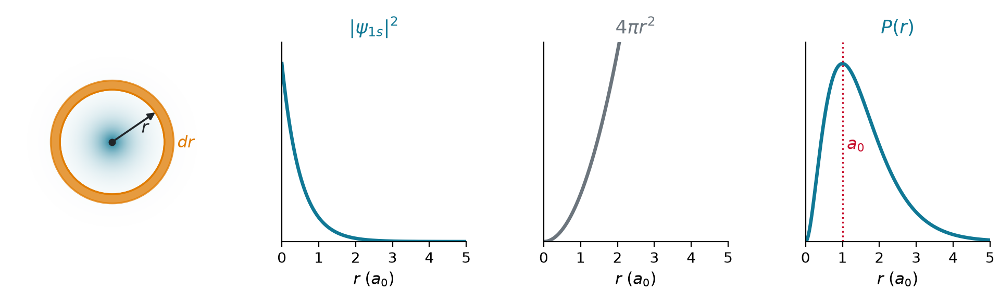
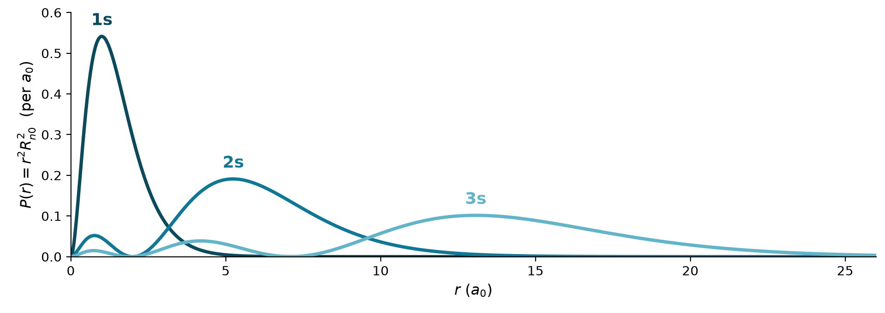
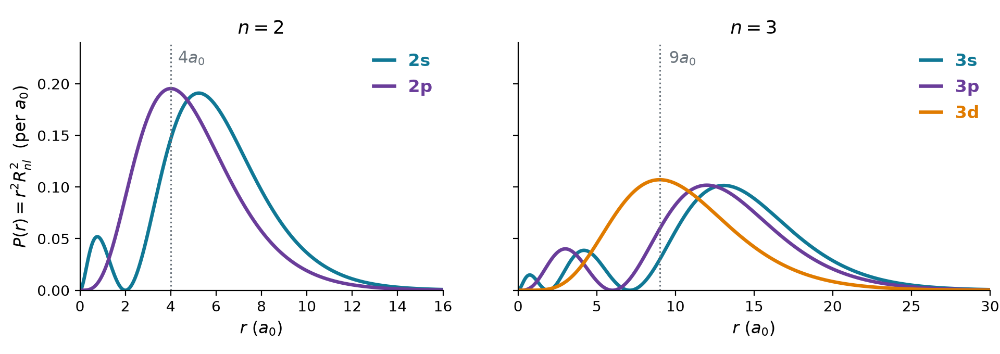
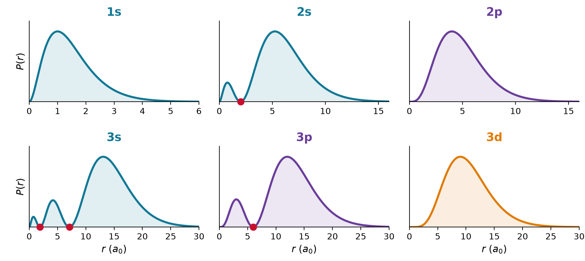
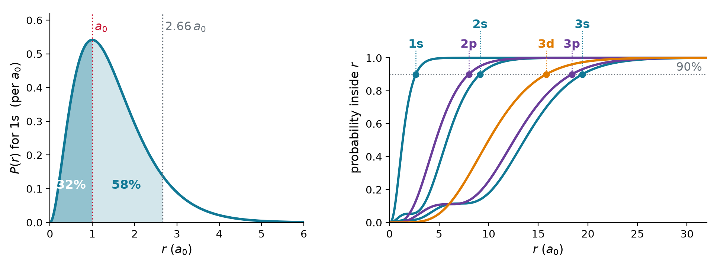
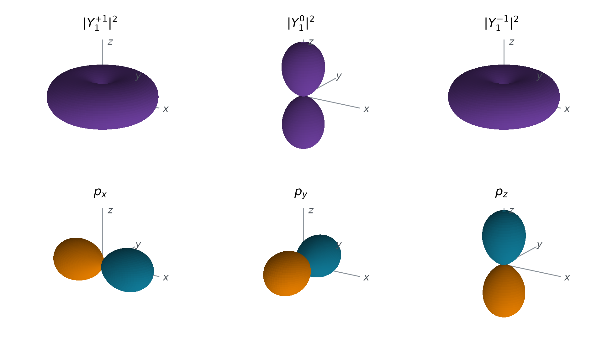
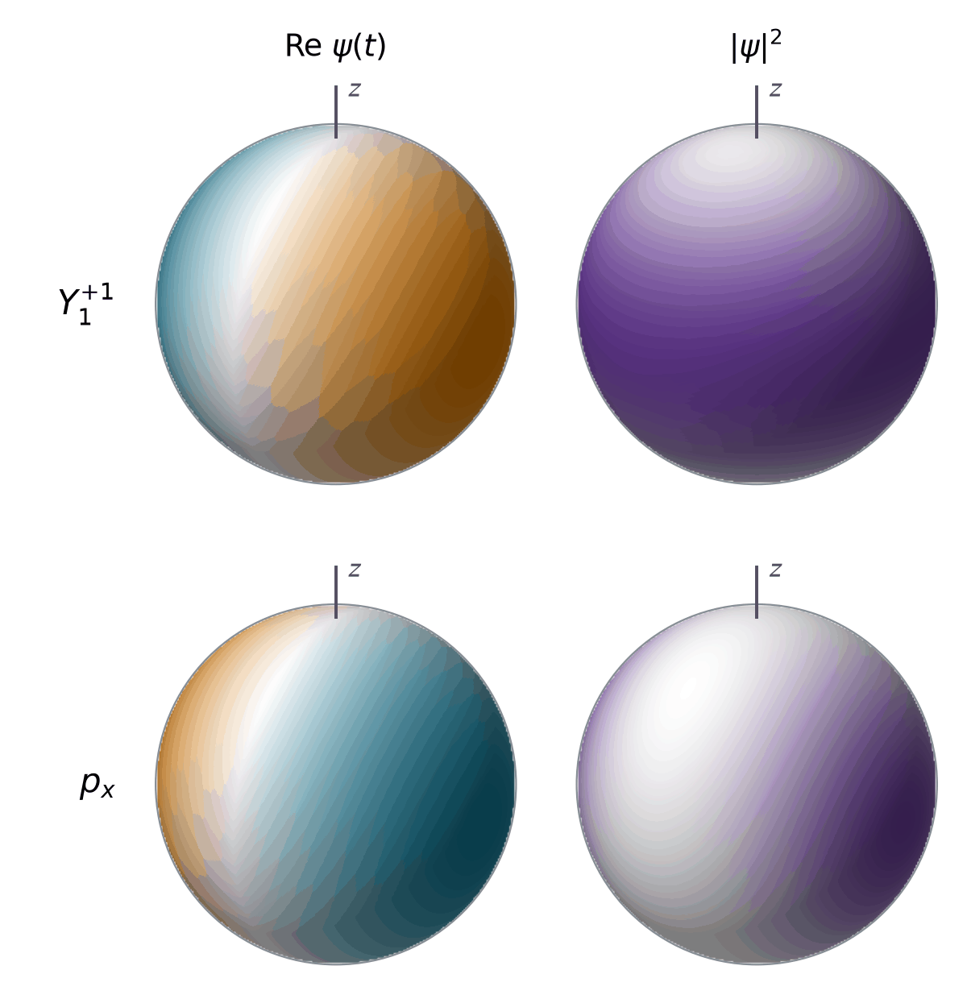
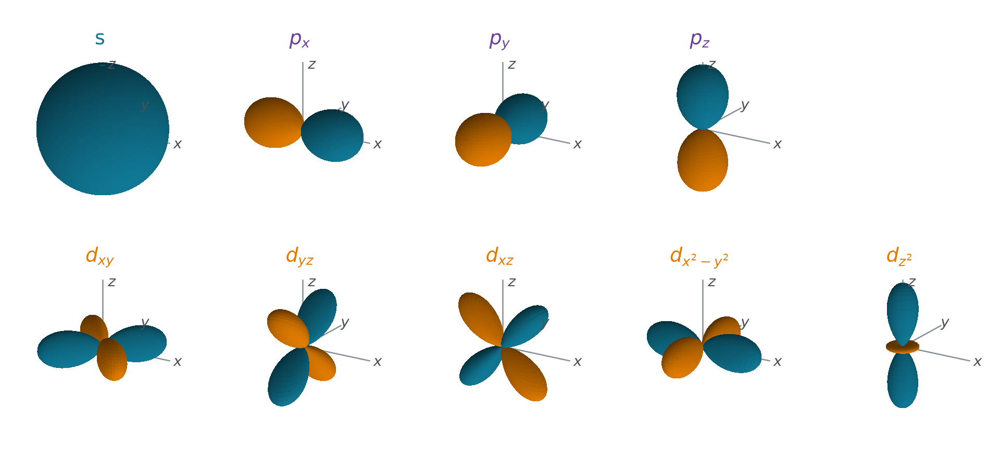
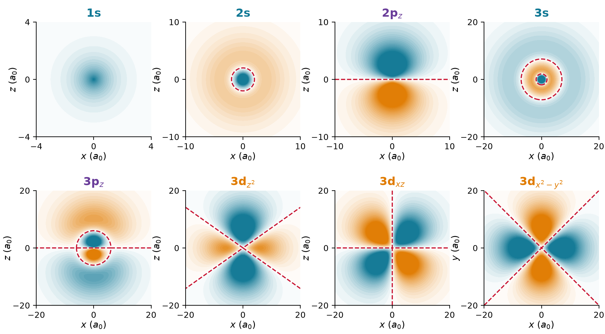

## An orbital is a one-electron wavefunction

$$\psi_{nlm} = R_{nl}(r)\,Y_l^m(\theta, \phi), \qquad n = 1, 2, \dots \qquad l < n \qquad \lvert m\rvert \leq l$$

| $n$ | $l$ | orbitals | how many | energy |
|:---:|:---:|:--------|:--------:|:------:|
| 1 | 0 | 1s | 1 | $-E_h/2$ |
| 2 | 0, 1 | 2s, 2p | $1 + 3 = 4$ | $-E_h/8$ |
| 3 | 0, 1, 2 | 3s, 3p, 3d | $1 + 3 + 5 = 9$ | $-E_h/18$ |

- **Orbital** = one electron's wavefunction, named by $n$ and the letter of $l$. Nothing orbits
- Lecture 5.1 solved for them. Today: **where** the electron is, what **shape**, where $\psi$ **vanishes**, and what a picture shows

## Three ways to ask where the electron is

::: {.keyeq}
$$\lvert\psi_{nlm}\rvert^2\,dV = \underbrace{R_{nl}^2(r)\,r^2\,dr}_{\text{distance}}\;\times\;\underbrace{\lvert Y_l^m\rvert^2\,\sin\theta\,d\theta\,d\phi}_{\text{direction}}$$

$$P(r) = r^2R_{nl}^2(r), \quad \int_0^\infty P\,dr = 1 \qquad\qquad \lvert Y_l^m\rvert^2, \quad \int\lvert Y_l^m\rvert^2\,d\Omega = 1$$
:::

- $\lvert\psi\rvert^2\,dV$: probability in a small **volume**
- $P(r)\,dr$: probability at **distance** $r$ to $r + dr$, any direction: the **radial distribution**
- $\lvert Y_l^m\rvert^2\,d\Omega$: probability in a **direction**, any distance: the **angular distribution**

## Why $r^2$: the area of a shell

{.nostretch width="92%" fig-align="center"}

- The 1s **density** is largest at the nucleus; the shell at distance $r$ has area $4\pi r^2$, zero at the nucleus
- Their product $P(r) = 4\pi r^2\lvert\psi_{1s}\rvert^2$ peaks in between, at $a_0$. $P(0) = 0$ for **every** state

## Example: the most probable distance in 1s

::: {.worked}
Where is $P(r) = 4r^2e^{-2r}$ largest ($r$ in $a_0$)?
:::

:::: {.fragment}

::: {.soln}
$$\frac{dP}{dr} = 8r\,e^{-2r} - 8r^2e^{-2r} = 8r\,(1 - r)\,e^{-2r} = 0 \quad\Longrightarrow\quad r_{\mathrm{mp}} = a_0$$
:::

- Bohr's orbit is gone ($l = 0$, no angular momentum), but its **radius survives** as the peak of $P(r)$

::::

## Example: inside the Bohr radius

::: {.worked}
How often is the 1s electron closer than $a_0$? What is its average distance?
:::

:::: {.fragment}

::: {.soln}
$$P(r < x) = \int_0^x 4r^2e^{-2r}\,dr = 1 - e^{-2x}(2x^2 + 2x + 1)$$

$$P(r < a_0) = 1 - 5e^{-2} = 0.32, \qquad\qquad P(r < 2.66\,a_0) = 0.90$$

$$\langle r\rangle = 4\int_0^\infty r^3e^{-2r}\,dr = 4\cdot\frac{3!}{2^4} = \frac{3}{2}\,a_0$$
:::

- Three lengths for one state: most probable $a_0$, average $1.5\,a_0$, **90% inside** $2.66\,a_0$

::::

## The s states: farther out, one more peak

{.nostretch width="84%" fig-align="center"}

- Each step in $n$ pushes the outer peak out: maxima at $1$, $5.2$, $13\,a_0$, close to $n^2a_0$
- Each step adds a peak: 1s one, 2s two, 3s three. The outermost peak carries most of the probability

## Same $n$, different $l$

{.nostretch width="84%" fig-align="center"}

- Raising $l$ removes the inner peaks: 3s three, 3p two, 3d one
- $l = n - 1$: a single peak, at Bohr's $n^2a_0$. The s state **penetrates** closest to the nucleus (Chapter 7)

## Count the peaks: the radial nodes

{.nostretch width="64%" fig-align="center"}

$$\text{peaks of } P(r) = n - l, \qquad\qquad \text{radial nodes} = n - l - 1$$

- A radial node: a sphere where the electron is never found. The $l$ angular nodes of $Y_l^m$ complete the count to $n - 1$

## Three ways to say how big

| orbital | most probable $r$ | average $\langle r\rangle$ | 90% inside |
|:---:|:---:|:---:|:---:|
| 1s | $a_0$ | $1.5\,a_0$ | $2.66\,a_0$ |
| 2s | $5.24\,a_0$ | $6\,a_0$ | $9.12\,a_0$ |
| 2p | $4\,a_0$ | $5\,a_0$ | $7.99\,a_0$ |
| 3s | $13.07\,a_0$ | $13.5\,a_0$ | $19.44\,a_0$ |
| 3p | $12\,a_0$ | $12.5\,a_0$ | $18.39\,a_0$ |
| 3d | $9\,a_0$ | $10.5\,a_0$ | $15.80\,a_0$ |

$$\langle r\rangle_{nl} = \frac{n^2a_0}{Z}\left[1 + \frac{1}{2}\left(1 - \frac{l(l+1)}{n^2}\right)\right] \qquad\qquad \text{every length} \propto \frac{n^2}{Z}$$

## Live: pick an orbital

```{=html}
<div id="re-live" style="width: 1100px; margin: 0 auto;"></div>
<script type="module">
  import widget from "../../widgets/radial_explorer.mjs";
  const opts = { fontSize: "19px", n: 2, l: 0 };
  widget.render({ model: { get: (k) => opts[k] }, el: document.getElementById("re-live") });
</script>
```

## The boundary surface

{.nostretch width="78%" fig-align="center"}

- No edge: $P(r)$ never reaches zero. Chemists draw the surface that holds **90%**
- 1s: $2.66\,a_0 = 141$ pm (the H$_2$ bond is 74 pm). Grows as $n^2$, shrinks as $1/Z$

## The $m$ states are symmetric about $z$. But which $z$?

$$\lvert Y_1^{0}\rvert^2 = \frac{3}{4\pi}\cos^2\theta \ \text{(dumbbell along } z) \qquad\qquad \lvert Y_1^{\pm1}\rvert^2 = \frac{3}{8\pi}\sin^2\theta \ \text{(ring around } z)$$

- $Y_l^m \propto e^{im\phi}$: a state of **definite $m$** is symmetric about the axis it was quantized along
- For a free atom nothing picks $z$. Quantize along $x$ instead: the $m_x = 0$ state is $\sqrt{3/4\pi}\,x/r$, which is $p_x$
- A field along $z$ selects the $m$ states; a bond along $x$ selects $p_x$. Both sets describe **the same level**

## A degenerate level is a space: pick new axes

$$\hat{H}\psi_a = E\psi_a, \ \hat{H}\psi_b = E\psi_b \quad\Longrightarrow\quad \hat{H}\,(c_a\psi_a + c_b\psi_b) = E\,(c_a\psi_a + c_b\psi_b)$$

- The $2l + 1$ states of one $n$, $l$ share $E_n$ and $L^2$: **any combination** is again a stationary state
- $Y_l^{-l}, \dots, Y_l^{l}$ are one set of axes in that space; we may turn them (Lecture 3.5, Appendix A.3)
- The price: the new functions are **not** $\hat{L}_z$ eigenfunctions

## The real $p$ orbitals

::: {.keyeq}
$$p_z = Y_1^0 = \sqrt{\frac{3}{4\pi}}\,\frac{z}{r}$$

$$p_x = \frac{Y_1^{-1} - Y_1^{+1}}{\sqrt{2}} = \sqrt{\frac{3}{4\pi}}\,\frac{x}{r} \qquad\qquad p_y = \frac{i\,(Y_1^{-1} + Y_1^{+1})}{\sqrt{2}} = \sqrt{\frac{3}{4\pi}}\,\frac{y}{r}$$
:::

- Times $R_{n1}(r)$: the orbitals $np_x$, $np_y$, $np_z$. Same $n$, same $l = 1$, same $E_n$, same $L^2 = 2\hbar^2$
- Real, normalized, orthogonal: **one shape, three axes**
- $p_x$: no definite $L_z$ ($\pm\hbar$, half each), but $L_x = 0$: the $m = 0$ state about $x$

## Example: build $p_x$

::: {.worked}
From $Y_1^{\pm1} = \mp\sqrt{3/8\pi}\,\sin\theta\,e^{\pm i\phi}$, form $(Y_1^{-1} - Y_1^{+1})/\sqrt{2}$.
:::

:::: {.fragment}

::: {.soln}
$$Y_1^{-1} - Y_1^{+1} = \sqrt{\frac{3}{8\pi}}\sin\theta\left(e^{-i\phi} + e^{+i\phi}\right) = \sqrt{\frac{3}{8\pi}}\sin\theta\,(2\cos\phi)$$

$$p_x = \frac{1}{\sqrt{2}}\cdot2\sqrt{\frac{3}{8\pi}}\sin\theta\cos\phi = \sqrt{\frac{3}{4\pi}}\sin\theta\cos\phi = \sqrt{\frac{3}{4\pi}}\,\frac{x}{r}$$
:::

- Normalized for free: $\lvert c_{-1}\rvert^2 + \lvert c_{+1}\rvert^2 = \tfrac{1}{2} + \tfrac{1}{2} = 1$, the two $L_z$ probabilities

::::

## Rings or lobes: two bases for $l = 1$

{.nostretch width="56%" fig-align="center"}

- Two rings become two dumbbells; each real $p$ has **one nodal plane**
- Either set adds to $3/4\pi$ in every direction: a full $p$ shell is a **sphere** (Unsöld)

## Running or standing

:::: {.columns}
::: {.column width="46%"}
{width="100%"}
:::
::: {.column width="54%"}
$$Y_1^{+1}e^{-iEt/\hbar} \propto \sin\theta\,e^{i(\phi - Et/\hbar)}$$

$$p_x\,e^{-iEt/\hbar} \propto \sin\theta\cos\phi\,e^{-iEt/\hbar}$$

- $m = +1$ **runs** around $z$ (the ring state of 4.4 on a sphere): its density is a ring
- $p_x$ **stands** and pulses along $x$: its density is two lobes
- Both stationary, same energy. A field along $z$ picks the first; a neighbour along $x$ picks the second
:::
::::

## The five real $d$ orbitals

| orbital | combination | angular function | lobes |
|:--|:--|:--|:--|
| $d_{z^2}$ | $Y_2^0$ | $\sqrt{5/16\pi}\,(3z^2 - r^2)/r^2$ | two along $z$ plus a ring |
| $d_{xz}$ | $(Y_2^{-1} - Y_2^{+1})/\sqrt{2}$ | $\sqrt{15/4\pi}\,xz/r^2$ | four, between $x$ and $z$ |
| $d_{yz}$ | $i\,(Y_2^{-1} + Y_2^{+1})/\sqrt{2}$ | $\sqrt{15/4\pi}\,yz/r^2$ | four, between $y$ and $z$ |
| $d_{x^2-y^2}$ | $(Y_2^{+2} + Y_2^{-2})/\sqrt{2}$ | $\sqrt{15/16\pi}\,(x^2 - y^2)/r^2$ | four, along $x$ and $y$ |
| $d_{xy}$ | $(Y_2^{+2} - Y_2^{-2})/(i\sqrt{2})$ | $\sqrt{15/4\pi}\,xy/r^2$ | four, between $x$ and $y$ |

- The names are the polynomials $r^2Y$: $xy$, $yz$, $xz$, $x^2 - y^2$, $3z^2 - r^2$. Each has **two** nodal surfaces

## Shapes for $l \leq 2$

{.nostretch width="62%" fig-align="center"}

- Four clovers turned in space; $d_{z^2}$ is two lobes and a ring ($m = 0$ has no partner)
- Colour is the **sign** of $\psi$: invisible in the density, decisive for bonding

## Nodes: spheres, planes and cones

::: {.keyeq}
$$\underbrace{n - l - 1}_{\text{spheres: } R_{nl} = 0} \;+\; \underbrace{l}_{\text{planes or cones: } Y = 0} \;=\; n - 1 \ \text{nodal surfaces}$$
:::

- A **sphere**: never at that distance, in any direction. A **plane or cone**: never in that direction, at any distance
- $n - 1$ in all, like the box ($n - 1$) and the oscillator ($v$): more nodes, more bending, higher $E_n$

## Cross-sections through the nucleus

{.nostretch width="70%" fig-align="center"}

- Spheres from $R$ (2s, 3s, 3p); planes from $Y$ ($p_z$, $d_{xz}$, $d_{x^2-y^2}$); the cones of $d_{z^2}$ at $54.7^\circ$

## Example: count the nodes of 3p$_z$ and 3d$_{z^2}$

::: {.worked}
Where does each vanish, and how many surfaces is that?
:::

:::: {.fragment}

::: {.soln}
$$3p_z:\quad R_{31} = 0 \text{ at } \rho = 6 \ \text{(a sphere)}, \qquad \cos\theta = 0 \ \text{(the plane } z = 0)$$

$$3d_{z^2}:\quad R_{32} \neq 0 \text{ for } \rho > 0, \qquad 3\cos^2\theta = 1 \text{ at } 54.7^\circ, 125.3^\circ \ \text{(two cones)}$$

$$1 + 1 = 2 \qquad\qquad\qquad 0 + 2 = 2$$
:::

- The total $n - 1$ is fixed by $n$; $l$ decides how many are spheres and how many are planes or cones

::::

## Live: the orbitals in 3D

```{=html}
<div id="oc-live" style="width: 1100px; margin: 0 auto;"></div>
<script type="module">
  import widget from "../../widgets/orbital_cloud.mjs";
  const opts = { fontSize: "19px", height: 440, orbital: "2pz",
    orbitals: ["1s", "2s", "2px", "2py", "2pz", "3s", "3px", "3py", "3pz", "3dxy", "3dyz", "3dxz", "3dx2y2", "3dz2"] };
  widget.render({ model: { get: (k) => opts[k] }, el: document.getElementById("oc-live") });
</script>
```

## What a picture shows, and what it hides

| picture | shows | hides |
|:--|:--|:--|
| radial distribution $P(r)$ | distance, radial nodes, size | the shape |
| angular surface $\lvert Y\rvert^2$ | shape, angular nodes | the size |
| $\psi$ on a plane | sign, every node, size | two dimensions |
| 90% boundary surface | size and shape together | the inside, the tail |
| point cloud | the density itself | the sign, unless coloured |

- No picture **is** the orbital. Real or complex is a choice of axes; the sign is physics, not decoration
- Next: **spin**, which doubles every orbital and separates the $m$ states in a field (Lecture 5.3)

# Takeaway {.center}

> An orbital is one electron's wavefunction, $R_{nl}Y_l^m$. Its probability factors into a radial distribution $P(r) = r^2R_{nl}^2$, which peaks at Bohr's radius for 1s and grows as $n^2a_0/Z$, and an angular distribution $\lvert Y_l^m\rvert^2$. Because the $2l + 1$ states of a level are degenerate, their real combinations $p_x$, $p_y$, $p_z$ and the five $d$ are stationary states too, pointing along axes at the cost of a definite $L_z$. Every orbital has $n - l - 1$ spherical nodes and $l$ planes or cones, $n - 1$ in all, and the textbook drawing is the surface that holds 90% of the electron.
