## A moving charge is a magnet

:::: {.columns}
::: {.column width="44%"}
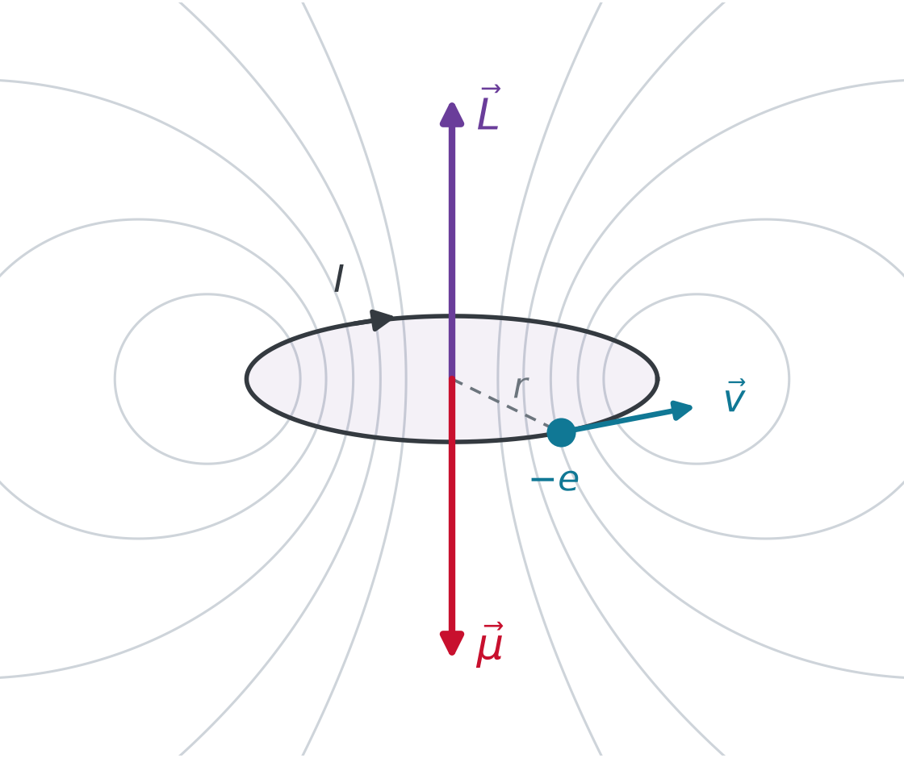{width="100%"}
:::
::: {.column width="56%"}
$$I = \frac{q}{T} = \frac{qv}{2\pi r}$$

$$\mu = I\cdot\pi r^2 = \frac{qvr}{2} = \frac{q}{2m}\,L$$

$$\vec{\mu} = -\frac{e}{2m_e}\,\vec{L} \qquad \text{electron, } q = -e$$

- A charge $q$ of mass $m$ on a circle (speed $v$, radius $r$, period $T$) is a **loop of current** $I$
- Current times area is its **magnetic moment** $\mu$. Negative charge: $\vec{\mu}$ points **against** $\vec{L}$
:::
::::

## A magnet in a field: twist or push

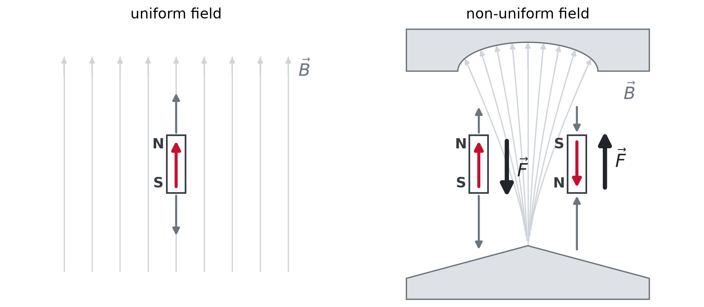{.nostretch width="56%" fig-align="center"}

$$E = -\vec{\mu}\cdot\vec{B} = -\mu_zB \qquad\qquad\qquad F_z = -\frac{\partial E}{\partial z} = \mu_z\,\frac{\partial B}{\partial z}$$

- **Uniform** field $\vec{B}$: the forces on the two poles cancel. A twist, no push
- **Non-uniform** field: a net force proportional to $\mu_z$. It **sorts** magnets by $\mu_z$

## The orbital magnetic moment

::: {.keyeq}
$$\hat{\vec{\mu}} = -\frac{e}{2m_e}\,\hat{\vec{L}}, \qquad\qquad \mu_z = -\mu_B\,m_l, \qquad\qquad \mu_B = \frac{e\hbar}{2m_e}$$
:::

| the **Bohr magneton** $\mu_B$ as | value | what it sets |
|:--|:--|:--|
| in SI units | $9.274\times10^{-24}$ J/T | the unit of an electron's magnetism |
| energy per tesla | $5.79\times10^{-5}$ eV/T | the shift of a level |
| wavenumber per tesla | 0.467 cm$^{-1}$/T | the shift of a spectral line |
| frequency per tesla | 14.0 GHz/T | the photon between two magnetic levels |

- $\hat{L}_z$ gives $m_l\hbar$ (the $m$ of 4.4 to 5.2, now $m_l$): $2l + 1$ values of $\mu_z$. An s electron has **none**

## An atom in a magnetic field

::: {.keyeq}
$$\hat{H} = \hat{H}_0 + \frac{\mu_BB}{\hbar}\,\hat{L}_z, \qquad E_{nm_l} = E_n + \mu_BB\,m_l$$
:::

- A field $B$ along $z$ adds $-\hat{\mu}_zB$ to the hydrogen Hamiltonian $\hat{H}_0$ of 5.1
- $\hat{L}_z$ commutes with $\hat{H}_0$: the states $\psi_{nlm_l}$ **do not change**, each shifts by its $m_l$, the **magnetic** quantum number
- A level $l$ splits into $2l + 1$ levels, $\mu_BB$ apart. Each $m_l$ now has its own energy: use the $m_l$ states, not $p_x$, $p_y$

## The Zeeman effect: one line becomes three

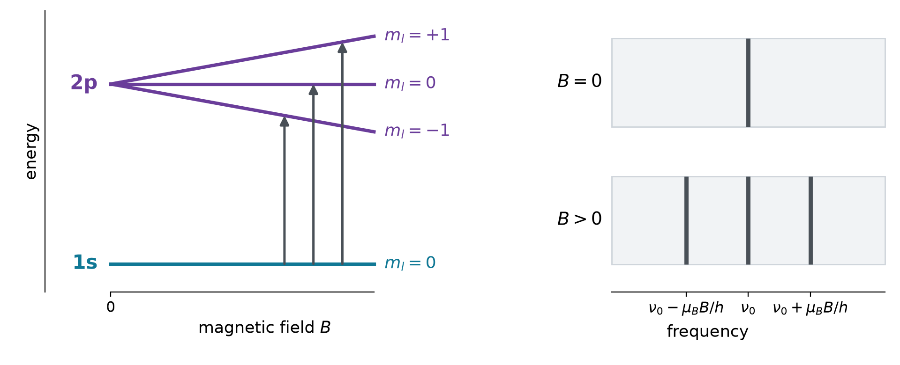{.nostretch width="80%" fig-align="center"}

- Light changes $m_l$ by 0 or $\pm1$: three lines, whatever $l$. The **normal** Zeeman effect
- Most lines split into more: the **anomalous** Zeeman effect. Something is missing

## Example: how far apart are the Zeeman lines?

::: {.worked}
Cadmium's red line at 643.85 nm shows the triplet. How far from the center are the outer lines at 1.0 T?
:::

:::: {.fragment}

::: {.soln}
$$\Delta\tilde{\nu} = \frac{\mu_BB}{hc} = 0.467\ \text{cm}^{-1} \qquad\text{against}\qquad \tilde{\nu}_0 = \frac{1}{\lambda} = 15\,532\ \text{cm}^{-1}$$

$$\lvert\Delta\lambda\rvert = \lambda^2\,\Delta\tilde{\nu} = (643.85\times10^{-7}\ \text{cm})^2\times0.467\ \text{cm}^{-1} = 0.019\ \text{nm}$$
:::

- Three parts in $10^5$: ten times finer than the H and D pair of 5.1

::::

## The Stern-Gerlach experiment (1922)

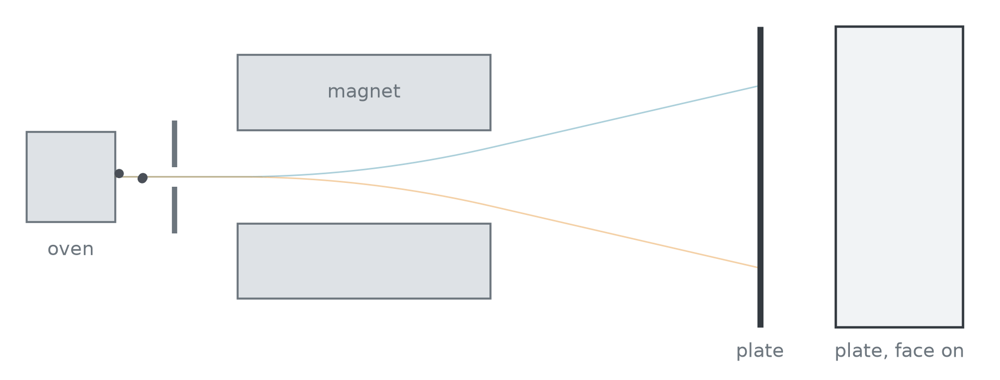{.nostretch width="86%" fig-align="center"}

- Silver atoms from an oven, a **non-uniform** field, a glass plate
- The push is proportional to $\mu_z$: the magnet turns $\mu_z$ into a **position**, one atom at a time

## What the plate should show, and what it showed

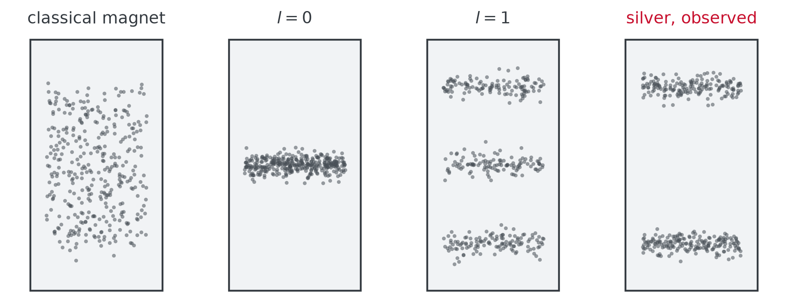{.nostretch width="70%" fig-align="center"}

- Classical magnets: a **band**. Orbital moments: $2l + 1$ spots, an **odd** number
- Silver's outer electron is 5s, $l = 0$: **one** spot expected
- Found: **two**. $2l + 1 = 2$ would need $l = \frac{1}{2}$, which no orbital motion has

## Spin: a new angular momentum

::: {.keyeq}
$$\hat{S}^2\alpha = \tfrac{3}{4}\hbar^2\,\alpha, \quad \hat{S}_z\alpha = +\tfrac{1}{2}\hbar\,\alpha \qquad\qquad \hat{S}^2\beta = \tfrac{3}{4}\hbar^2\,\beta, \quad \hat{S}_z\beta = -\tfrac{1}{2}\hbar\,\beta$$

$$\langle\alpha|\alpha\rangle = \langle\beta|\beta\rangle = 1, \qquad \langle\alpha|\beta\rangle = 0$$
:::

- Two spots: $2s + 1 = 2$, so $s = \frac{1}{2}$. Two states: $\alpha$ (**spin up**, $m_s = +\frac{1}{2}$) and $\beta$ (**spin down**, $m_s = -\frac{1}{2}$)
- $\hat{S}_x$, $\hat{S}_y$, $\hat{S}_z$ obey the commutators of $\hat{\vec{L}}$ (4.4), so $\hat{S}^2$ gives $s(s+1)\hbar^2$ and $\hat{S}_z$ gives $m_s\hbar$
- **Intrinsic**, like charge and mass. **Not a motion in space**, and not in the Schrödinger equation

## The vector model for spin

:::: {.columns}
::: {.column width="52%"}
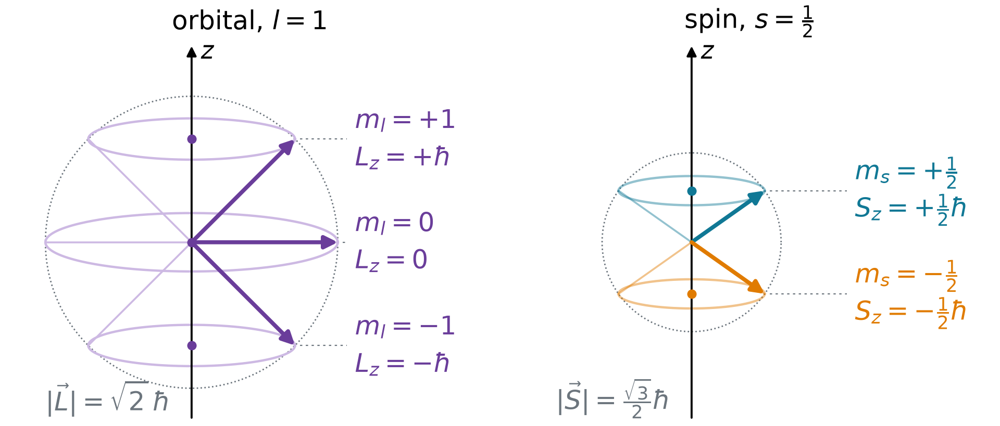{width="100%"}
:::
::: {.column width="48%"}
$$\lvert\vec{S}\rvert = \sqrt{s(s+1)}\,\hbar = \tfrac{\sqrt{3}}{2}\hbar$$

$$\cos\theta = \frac{1/2}{\sqrt{3}/2} = \frac{1}{\sqrt{3}} \quad\Longrightarrow\quad \theta = 54.7°$$

- Length and one component are sharp. $S_x$ and $S_y$ are not: the cone
- "Spin up" is **54.7°** from straight up, the magic angle of 4.4 and 5.2
:::
::::

## Example: is the electron a spinning ball?

::: {.worked}
A solid ball of radius $r = 2.8\times10^{-15}$ m turns with angular momentum $\frac{1}{2}\hbar$. How fast does its equator move?
:::

:::: {.fragment}

::: {.soln}
$$L = I\omega = \tfrac{2}{5}m_er^2\,\omega = \tfrac{2}{5}m_er\,v \qquad\Longrightarrow\qquad v = \frac{5L}{2m_er} = \frac{5\hbar}{4m_er}$$

$$v = \frac{5\times1.055\times10^{-34}}{4\times9.11\times10^{-31}\times2.8\times10^{-15}}\ \frac{\text{m}}{\text{s}} = 5.2\times10^{10}\ \frac{\text{m}}{\text{s}} \approx 170\,c$$
:::

- Nothing is rotating. Spin is angular momentum **without** rotation

::::

## Spin states are two-component vectors

$$\chi = c_\alpha\,\alpha + c_\beta\,\beta = \begin{pmatrix}c_\alpha\\ c_\beta\end{pmatrix} \qquad\qquad \alpha = \begin{pmatrix}1\\ 0\end{pmatrix} \qquad \beta = \begin{pmatrix}0\\ 1\end{pmatrix}$$

$$\hat{S}_x = \frac{\hbar}{2}\begin{pmatrix}0 & 1\\ 1 & 0\end{pmatrix} \qquad \hat{S}_y = \frac{\hbar}{2}\begin{pmatrix}0 & -i\\ i & 0\end{pmatrix} \qquad \hat{S}_z = \frac{\hbar}{2}\begin{pmatrix}1 & 0\\ 0 & -1\end{pmatrix}$$

- The smallest quantum system: Lectures 3.5 and 3.6 with $2\times2$ matrices. A bracket is a dot product
- Born rule: $S_z = +\frac{1}{2}\hbar$ with probability $\lvert c_\alpha\rvert^2$, and $-\frac{1}{2}\hbar$ with probability $\lvert c_\beta\rvert^2$
- $\hat{S}_z$ is diagonal: $\alpha$, $\beta$ are its eigenvectors. $\hat{S}_x$ **flips** the spin, so $\alpha$ is not its eigenvector

## Example: measure $S_x$ on a spin-up electron

::: {.worked}
The electron is in $\alpha$. What can a measurement of $S_x$ give, and how often?
:::

:::: {.fragment}

::: {.soln}
$$\det\big(\hat{S}_x - \lambda\big) = \lambda^2 - \tfrac{1}{4}\hbar^2 = 0 \;\Longrightarrow\; \lambda = \pm\tfrac{1}{2}\hbar, \qquad \chi_{\pm x} = \frac{\alpha \pm \beta}{\sqrt{2}}$$

$$P\left(\pm\tfrac{1}{2}\hbar\right) = \lvert\langle\chi_{\pm x}|\alpha\rangle\rvert^2 = \left(\tfrac{1}{\sqrt{2}}\right)^2 = \tfrac{1}{2}$$
:::

- Certain along $z$, a **coin toss** along $x$. After the reading the state is $\chi_{\pm x}$: the certainty about $S_z$ is gone

::::

## One magnet after another

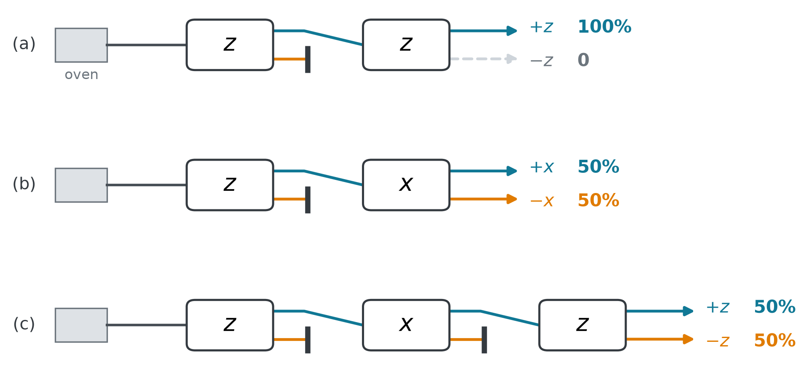{.nostretch width="60%" fig-align="center"}

- Each box measures the spin along its axis; the lower beam is blocked. **(a)** Same axis twice, same answer: the **collapse** of 3.6
- **(b)** A sharp $S_z$ is an undecided $S_x$: the two do not commute (3.5b)
- **(c)** Measuring $S_x$ **erases** the $z$ result

## Live: one magnet after another

```{=html}
<div id="sg-live" style="width: 1100px; margin: 0 auto;"></div>
<script type="module">
  import widget from "../../widgets/stern_gerlach.mjs";
  const opts = { fontSize: "19px", angle: 90 };
  widget.render({ model: { get: (k) => opts[k] }, el: document.getElementById("sg-live") });
</script>
```

## The spin magnetic moment

::: {.keyeq}
$$\hat{\vec{\mu}}_s = -g_e\,\frac{e}{2m_e}\,\hat{\vec{S}}, \qquad \mu_z = -g_e\,\mu_B\,m_s \approx \mp\mu_B, \qquad g_e = 2.0023$$

$$E = -\mu_zB = g_e\,\mu_BB\,m_s = \pm\tfrac{1}{2}\,g_e\,\mu_BB$$
:::

- $g_e$: the electron's **g factor**. Orbital motion has $g = 1$, so spin is **twice as magnetic**
- Silver's 5s electron has only this moment: $\mu_z = \pm\mu_B$, the **two spots**
- In a field, $\beta$ (moment along $\vec{B}$) lies below $\alpha$, and they are $g_e\mu_BB$ apart

## Two levels in a field: EPR and NMR

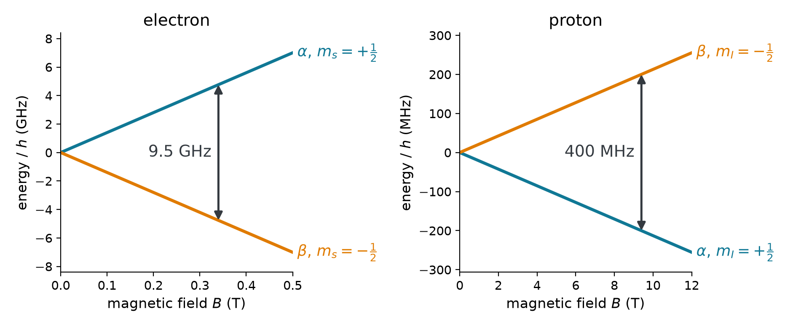{.nostretch width="62%" fig-align="center"}

$$h\nu = g_e\,\mu_BB \quad \text{electron, 28 GHz/T} \qquad\qquad h\nu = g_p\,\mu_NB \quad \text{proton, 42.6 MHz/T}$$

- **EPR** sees unpaired electrons. **NMR** sees nuclei: the proton also has spin $\frac{1}{2}$ (written $I$)
- **Nuclear magneton** $\mu_N = e\hbar/2m_p = \mu_B/1836$, and $g_p = 5.586$: 660 times lower in frequency

## Four quantum numbers

$$\psi_{nlm_lm_s} = R_{nl}(r)\,Y_l^{m_l}(\theta, \phi)\times\big(\alpha \text{ or } \beta\big) = |n, l, m_l, m_s\rangle$$

| operator | eigenvalue | quantum number |
|:---:|:---:|:--|
| $\hat{H}_0$ | $-Z^2E_h/2n^2$ | $n = 1, 2, 3, \dots$ |
| $\hat{L}^2$ | $l(l+1)\,\hbar^2$ | $l = 0, \dots, n - 1$ |
| $\hat{L}_z$ | $m_l\,\hbar$ | $m_l = -l, \dots, l$ |
| $\hat{S}^2$ | $\frac{3}{4}\hbar^2$ | $s = \frac{1}{2}$, always |
| $\hat{S}_z$ | $m_s\,\hbar$ | $m_s = +\frac{1}{2}, -\frac{1}{2}$ |

- A **spin orbital**: where the electron is, times how its spin points. $2n^2$ states in level $n$: 2, 8, 18, 32

## Spin-orbit coupling: the electron sees a moving nucleus

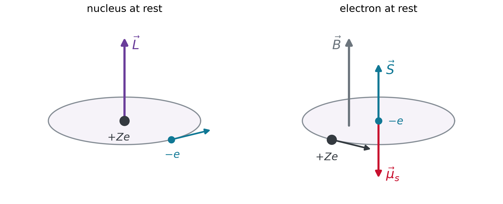{.nostretch width="50%" fig-align="center"}

$$\hat{H}_{\text{so}} = \frac{A}{\hbar^2}\;\hat{\vec{L}}\cdot\hat{\vec{S}}$$

- Seen from the electron, the nucleus is a **current loop**: its field $\vec{B}$, along $\vec{L}$, acts on $\vec{\mu}_s$
- No outside field. $A$, the **spin-orbit coupling constant**, is an energy; zero for s electrons

## Only the total angular momentum is conserved

$$\hat{J}^2 = \hat{L}^2 + \hat{S}^2 + 2\,\hat{\vec{L}}\cdot\hat{\vec{S}} \qquad\Longrightarrow\qquad \hat{\vec{L}}\cdot\hat{\vec{S}} = \tfrac{1}{2}\left(\hat{J}^2 - \hat{L}^2 - \hat{S}^2\right)$$

::: {.keyeq}
$$\hat{\vec{J}} = \hat{\vec{L}} + \hat{\vec{S}}, \qquad j = l + \tfrac{1}{2} \ \text{ or } \ l - \tfrac{1}{2}, \qquad m_j = -j, \dots, j$$

$$E_{\text{so}} = \frac{A}{2}\Big[j(j+1) - l(l+1) - s(s+1)\Big]$$
:::

- The coupling twists $\vec{L}$ and $\vec{S}$: $m_l$ and $m_s$ are no longer sharp. Nothing twists the whole atom, so $\vec{J}$ is conserved
- $\hat{J}^2$ gives $j(j+1)\hbar^2$, $\hat{J}_z$ gives $m_j\hbar$, and $m_j = m_l + m_s$. New labels: $n$, $l$, $j$, $m_j$

## Adding $l = 1$ and $s = \frac{1}{2}$: count the states

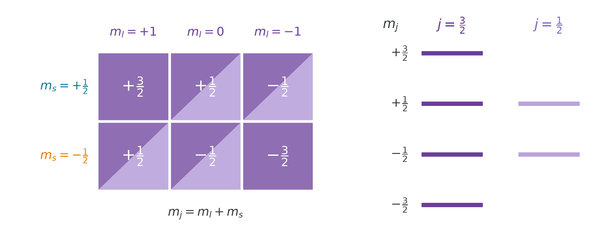{.nostretch width="72%" fig-align="center"}

- The largest $m_j$ is $\frac{3}{2}$, once: a ladder $j = \frac{3}{2}$ takes one state at each of $\frac{3}{2}, \frac{1}{2}, -\frac{1}{2}, -\frac{3}{2}$
- Left over: one state at $+\frac{1}{2}$ and one at $-\frac{1}{2}$, a ladder $j = \frac{1}{2}$. Six states, $4 + 2$

## Fine structure and term symbols

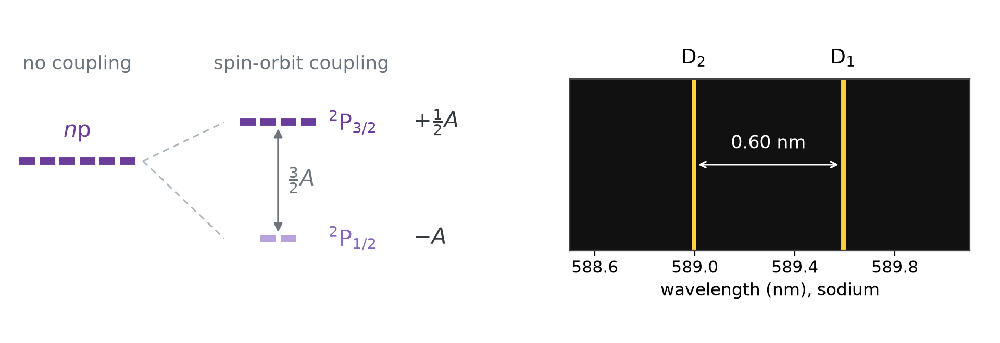{.nostretch width="68%" fig-align="center"}

$$^{2s+1}L_j \qquad\qquad ^2S_{1/2} \qquad\quad ^2P_{1/2},\ ^2P_{3/2} \qquad\quad ^2D_{3/2},\ ^2D_{5/2}$$

- **Term symbol**: capital letter of $l$, superscript $2s + 1 = 2$ ("doublet"), subscript $j$
- A level holds $2j + 1$ states. Sodium's yellow line, 3p to 3s, is a doublet: 3p is split, 3s is not

## Example: the sodium D lines

::: {.worked}
The D lines are at 588.995 and 589.592 nm. Find the splitting of sodium's 3p level and its coupling constant $A$.
:::

:::: {.fragment}

::: {.soln}
$$\tilde{\nu}_2 - \tilde{\nu}_1 = \frac{10^7}{588.995} - \frac{10^7}{589.592} = 16\,978.1 - 16\,960.9 = 17.2\ \text{cm}^{-1}$$

$$\tfrac{3}{2}A = 17.2\ \text{cm}^{-1} \qquad\Longrightarrow\qquad A = 11.5\ \text{cm}^{-1} = 1.4\ \text{meV}$$
:::

- Hydrogen's 2p splits by 0.365 cm$^{-1}$, caesium's 6p by 554 cm$^{-1}$: the coupling grows steeply with $Z$

::::

## Weak field or strong field

:::: {.columns}
::: {.column width="58%"}
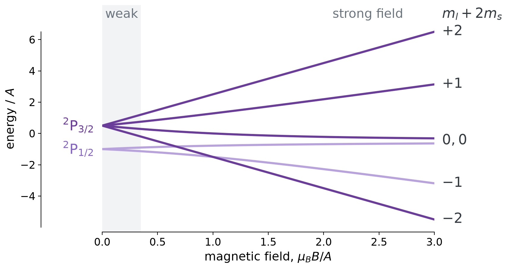{width="100%"}
:::
::: {.column width="42%"}
- **Weak**, $\mu_BB \ll A$: $\vec{L}$ and $\vec{S}$ stay locked in $\vec{J}$. Levels split by $m_j$, four and two: the **anomalous** Zeeman effect
- **Strong**, $\mu_BB \gg A$: each lines up alone, $m_l$ and $m_s$ are sharp again, five levels, the triplet returns
- 1 T is strong for hydrogen, weak for sodium
:::
::::

## Which transitions light can drive

::: {.keyeq}
$$\Delta l = \pm1, \qquad \Delta m_l = 0, \pm1, \qquad \Delta m_s = 0, \qquad \Delta n \ \text{anything}$$

$$\text{with spin-orbit coupling:} \qquad \Delta j = 0, \pm1, \qquad \Delta m_j = 0, \pm1$$
:::

- Allowed when the transition dipole $\langle\psi_f|\,\vec{r}\,|\psi_i\rangle$ is not zero, as in 4.3 and 4.5
- $\Delta l = \pm1$: a photon carries **one unit** of angular momentum
- $\Delta m_s = 0$: the electric field of light acts on where the electron is, not on its spin

## Hydrogen's lines, sorted by $l$

:::: {.columns}
::: {.column width="58%"}
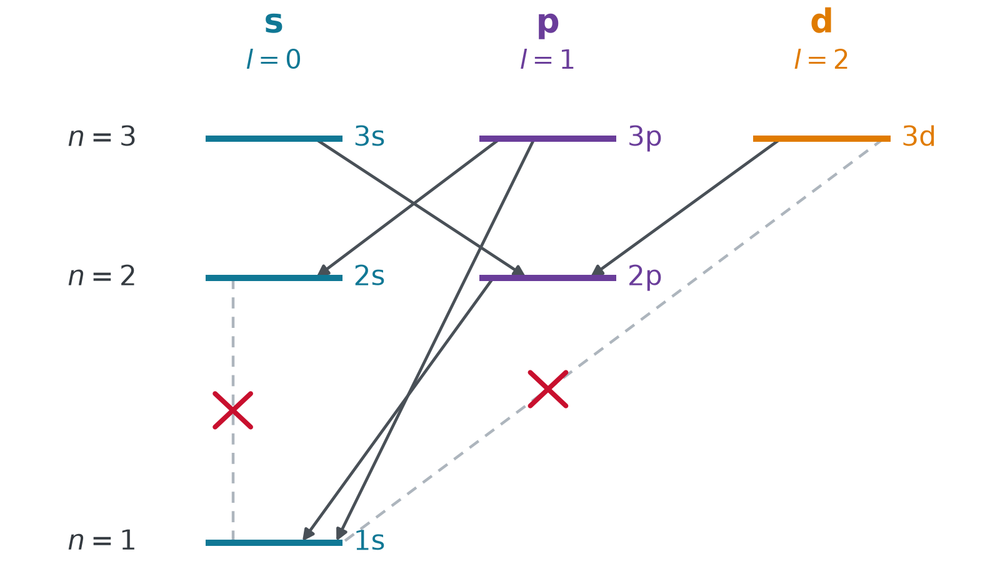{width="100%"}
:::
::: {.column width="42%"}
- Every allowed line moves **one column**
- H$\alpha$ is three lines at once: 3s to 2p, 3p to 2s, 3d to 2p
- Dashed: **forbidden**. 2s to 1s has $\Delta l = 0$, 3d to 1s has $\Delta l = 2$
- 2s is **metastable**: 0.12 s, against 1.6 ns for 2p
:::
::::

## Orbital and spin, side by side

| | orbital | spin |
|:--|:--|:--|
| quantum numbers | $l = 0, \dots, n - 1$; $\ m_l = -l, \dots, l$ | $s = \frac{1}{2}$ always; $\ m_s = \pm\frac{1}{2}$ |
| states | $Y_l^{m_l}(\theta, \phi)$, functions | $\alpha$, $\beta$: two-component vectors |
| length | $\sqrt{l(l+1)}\,\hbar$ | $\frac{\sqrt{3}}{2}\hbar$ |
| $z$ component | $m_l\hbar$ | $\pm\frac{1}{2}\hbar$ |
| magnetic moment | $\mu_z = -\mu_Bm_l$ | $\mu_z = -g_e\mu_Bm_s \approx \mp\mu_B$ |
| origin | motion in space | intrinsic (Dirac's equation) |

- Together: $\hat{\vec{J}} = \hat{\vec{L}} + \hat{\vec{S}}$, $\ j = l \pm \frac{1}{2}$. Next: two electrons and the Pauli principle (Chapters 6 and 7)

# Takeaway {.center}

> An orbiting electron is a magnet, $\mu_z = -\mu_Bm_l$, and a field splits a level into $2l + 1$. Stern and Gerlach found two spots where one was expected: the electron has an angular momentum of its own, spin, with $s = \frac{1}{2}$, two states $\alpha$ and $\beta$, and a moment twice as large as orbital motion would give. Spin states are two-component vectors, and magnets in a row show collapse and incompatible observables directly. Inside the atom spin and orbit couple: only $\vec{J} = \vec{L} + \vec{S}$ is conserved, $j = l \pm \frac{1}{2}$, and the levels with $l > 0$ split into the fine structure named by term symbols.
