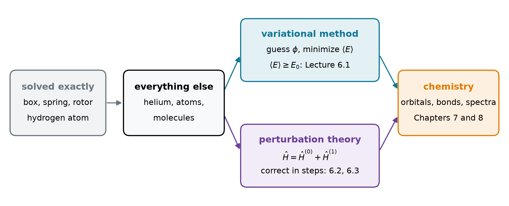
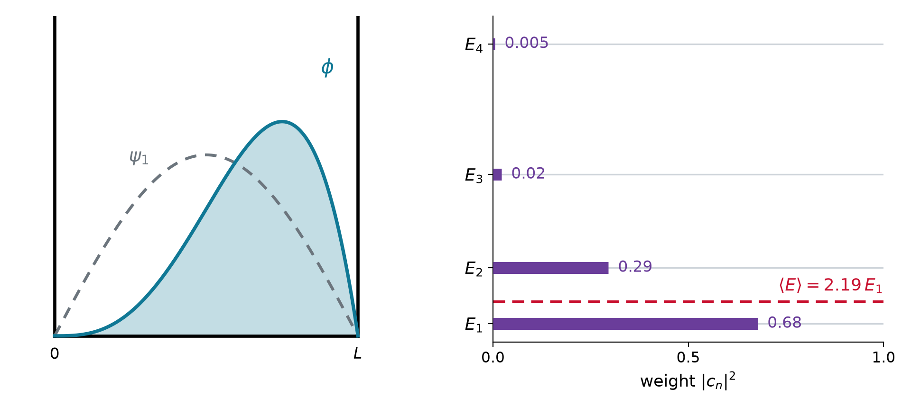
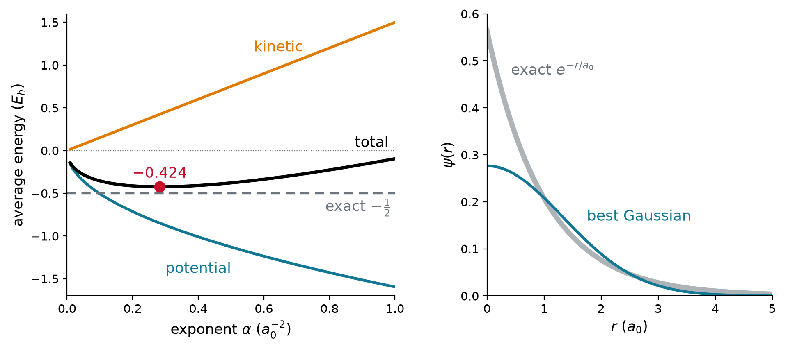
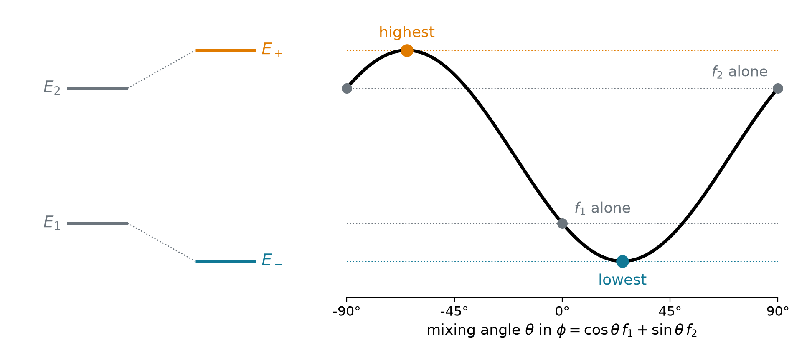
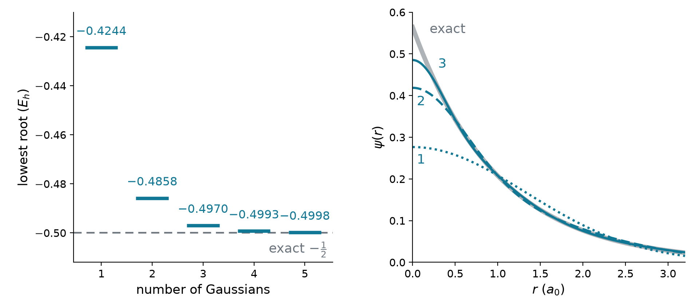

## Beyond the exact solutions

**Solved exactly**: box, spring, rotor, hydrogen. Helium adds one term that no formula handles (atomic units):

$$\hat{H} = \underbrace{-\tfrac{1}{2}\nabla_1^2 - \frac{2}{r_1}}_{\text{electron 1}}\;\;\underbrace{-\,\tfrac{1}{2}\nabla_2^2 - \frac{2}{r_2}}_{\text{electron 2}}\;+\;\underbrace{\frac{1}{r_{12}}}_{\text{repulsion}}$$

{.nostretch width="60%" fig-align="center"}

## Any guess is a mixture of the exact states

A normalized guess $\phi$, a **trial function**, has the average energy $\langle E\rangle = \langle\phi|\hat{H}|\phi\rangle$

**1. Expand** in the exact states (3.6), whether or not anyone can write them down

$$\phi = \sum_n c_n\,\psi_n, \qquad \hat{H}\psi_n = E_n\psi_n, \qquad E_0 \leq E_1 \leq E_2 \leq \dots$$

**2. Average**: a measurement returns $E_n$ with probability $|c_n|^2$

**3. Bound**: every $E_n \geq E_0$, and the probabilities add to 1

$$\langle E\rangle = \sum_n|c_n|^2\,E_n \;\geq\; E_0\sum_n|c_n|^2 = E_0$$

## An average cannot lie below its lowest entry

{.nostretch width="74%" fig-align="center"}

- A trial state $\phi$ in a box: 68% $E_1$, 29% $E_2$, a little of the rest. Average: $2.19\,E_1$
- Every reading is $E_1$ or more, so the average is too

## The variational theorem

::: {.keyeq}
$$E_\phi = \frac{\langle\phi|\hat{H}|\phi\rangle}{\langle\phi|\phi\rangle} \;\geq\; E_0$$
:::

- $\phi$: **any** trial function that obeys the boundary conditions. $E_0$: the true ground-state energy
- Every guess gives an **upper bound**. The denominator normalizes the guess
- **Lower is better**: of two guesses, the one with the lower energy is closer
- Equality only when $\phi$ is the true ground state

## The recipe

1. **Guess** a trial function with the right boundary conditions, and put **parameters** in it
2. **Compute** $E_\phi$ as a function of the parameters
3. **Minimize**: the lowest value is the best this family can do, and still an upper bound

Kinetic energy from the slope alone (integrate by parts; $\phi$ vanishes at the ends):

$$\langle\phi|\hat{T}|\phi\rangle = -\frac{\hbar^2}{2m}\int\phi\,\phi''\,dx = \frac{\hbar^2}{2m}\int\left(\phi'\right)^2dx$$

## Example: a parabola in a box

::: {.worked}
Guess $\phi = x(L - x)$ for the ground state of a box. Exact: $E_1 = \pi^2\hbar^2/2mL^2$. What energy does the guess give?
:::

:::: {.fragment}

::: {.soln}
$$\phi'' = -2 \quad\Longrightarrow\quad \hat{H}\phi = -\frac{\hbar^2}{2m}\phi'' = \frac{\hbar^2}{m}$$

$$E_\phi = \frac{\dfrac{\hbar^2}{m}\displaystyle\int_0^L x(L - x)\,dx}{\displaystyle\int_0^L x^2(L - x)^2\,dx} = \frac{\hbar^2L^3/6m}{L^5/30} = \frac{5\hbar^2}{mL^2} = 1.013\,E_1$$
:::

- 1.3% too high: above $E_1$, and close. A tent with a kink would be 21.6% high

::::

## One parameter: hydrogen with a Gaussian

Guess $\phi = e^{-\alpha r^2}$ with the exponent $\alpha$ free. Atomic units: $\hat{H} = -\frac{1}{2}\nabla^2 - 1/r$, exact $E = -\frac{1}{2}E_h$

**Compute** the average kinetic and potential energy

$$\langle T\rangle = \frac{3\alpha}{2}, \qquad \langle V\rangle = -2\sqrt{\frac{2\alpha}{\pi}}, \qquad E(\alpha) = \frac{3\alpha}{2} - 2\sqrt{\frac{2\alpha}{\pi}}$$

**Minimize**

$$\frac{dE}{d\alpha} = \frac{3}{2} - \sqrt{\frac{2}{\pi\alpha}} = 0 \quad\Longrightarrow\quad \alpha = \frac{8}{9\pi}, \qquad E = -\frac{4}{3\pi}\,E_h = -0.424\,E_h$$

- A tight Gaussian (large $\alpha$): kinetic energy grows as $\alpha$, the attraction only as $\sqrt{\alpha}$

## Every Gaussian is too high

{.nostretch width="70%" fig-align="center"}

- Best Gaussian: $-0.424\,E_h$, **15% high**. No $\alpha$ reaches the exact $-\frac{1}{2}E_h$
- Wrong shape: no cusp at the nucleus, and a tail that dies too fast

## Live: tune a trial function

```{=html}
<div id="vt-live" style="width: 1060px; margin: 0 auto;"></div>
<script type="module">
  import widget from "../../widgets/variational_tuner.mjs";
  const opts = { fontSize: "19px", well: "vee", note: false };
  widget.render({ model: { get: (k) => opts[k] }, el: document.getElementById("vt-live") });
</script>
```

## Example: the effective nuclear charge of helium

::: {.worked}
Without the repulsion, helium is two He$^+$ ions and its state is a product of two 1s orbitals. Guess that product, $\phi = e^{-\zeta(r_1 + r_2)}$, with the charge $\zeta$ free. Best $\zeta$? (Atomic units, $Z = 2$.)
:::

:::: {.fragment}

::: {.soln}
$$E(\zeta) = \underbrace{\zeta^2}_{\text{kinetic}}\;\underbrace{-\,2Z\zeta}_{\text{attraction}}\;+\;\underbrace{\tfrac{5}{8}\zeta}_{\text{repulsion}} = \zeta^2 - \tfrac{27}{8}\zeta$$

$$\frac{dE}{d\zeta} = 2\zeta - \tfrac{27}{8} = 0 \quad\Longrightarrow\quad \zeta = \tfrac{27}{16} = 1.69, \qquad E = -77.5\ \text{eV}$$
:::

- $\zeta < 2$: each electron **screens** the nucleus from the other. Exact: $-79.0$ eV

::::

## Linear combinations: mix fixed functions

$$\phi = c_1f_1 + c_2f_2 + \dots + c_Nf_N$$

- The $f_n$ are fixed **basis functions**. Only the coefficients $c_n$ vary
- Two functions, inserted into $E = \langle\phi|\hat{H}|\phi\rangle/\langle\phi|\phi\rangle$:

$$E = \frac{c_1^2H_{11} + 2c_1c_2H_{12} + c_2^2H_{22}}{c_1^2S_{11} + 2c_1c_2S_{12} + c_2^2S_{22}}$$

$$H_{ij} = \langle f_i|\hat{H}|f_j\rangle \quad\text{matrix elements (3.5)} \qquad\qquad S_{ij} = \langle f_i|f_j\rangle \quad\text{overlaps}$$

## Minimize with respect to the coefficients

Clear the fraction, differentiate with respect to $c_1$, and set $\partial E/\partial c_1 = 0$:

$$E\left(2c_1S_{11} + 2c_2S_{12}\right) = 2c_1H_{11} + 2c_2H_{12}$$

Collect the terms, and repeat for $c_2$:

$$\begin{aligned}
c_1\left(H_{11} - ES_{11}\right) + c_2\left(H_{12} - ES_{12}\right) &= 0\\
c_1\left(H_{12} - ES_{12}\right) + c_2\left(H_{22} - ES_{22}\right) &= 0
\end{aligned}$$

- Two linear equations for $c_1$ and $c_2$. A solution other than $c_1 = c_2 = 0$ exists only if their **determinant vanishes**

## The linear variational method

::: {.keyeq}
$$\phi = \sum_{n=1}^N c_n f_n \qquad\Longrightarrow\qquad \mathbf{H}\,\mathbf{c} = E\,\mathbf{S}\,\mathbf{c}, \qquad \det\left(\mathbf{H} - E\,\mathbf{S}\right) = 0$$

$$H_{ij} = \langle f_i|\hat{H}|f_j\rangle, \qquad S_{ij} = \langle f_i|f_j\rangle$$
:::

- $N$ basis functions: $N\times N$ matrices, $N$ roots. The **lowest root** is the best energy, its eigenvector the best coefficients
- $\det(\mathbf{H} - E\mathbf{S}) = 0$ is the **secular determinant**. Orthonormal basis: $\mathbf{S} = \mathbf{1}$, the eigenvalue problem of 3.5
- Adding a basis function **never raises** the lowest root

## The two-level problem

::: {.keyeq}
$$\mathbf{H} = \begin{pmatrix} E_1 & v\\ v & E_2\end{pmatrix} \quad\Longrightarrow\quad E_\pm = \frac{E_1 + E_2}{2} \pm \sqrt{\left(\frac{\Delta}{2}\right)^2 + v^2}$$
:::

:::: {.columns}
::: {.column width="56%"}
{width="100%"}
:::
::: {.column width="44%"}
- $E_1$, $E_2$: two states before they mix
- $\Delta = E_2 - E_1$: their **gap**. $\ v$: the **coupling**
- Mixing pushes the levels **apart**: $E_-$ below both, $E_+$ above both
- It returns in 6.2, 6.3 and Chapter 8
:::
::::

## Example: two equal levels

::: {.worked}
Two identical atomic orbitals $f_1$, $f_2$ on neighboring atoms: $E_1 = E_2 = \alpha$, coupling $v = \beta$. Energies and mixtures?
:::

:::: {.fragment}

::: {.soln}
$$\Delta = 0: \qquad E_\pm = \alpha \pm \beta$$

$$c_1(\alpha - E) + c_2\beta = 0 \quad\Longrightarrow\quad c_2 = \pm c_1: \qquad \phi_\pm = \frac{f_1 \pm f_2}{\sqrt{2}}$$
:::

- Equal levels mix **half and half**: the lower mixture is the chemical bond (Chapter 8)
- Distant levels, $|v| \ll \Delta$, shift by only $v^2/\Delta$: perturbation theory (Lecture 6.2)

::::

## Example: improve the parabola

::: {.worked}
Add $f_2 = x^2(L - x)^2$ to the parabola $f_1 = x(L - x)$. Find the best energy of $c_1f_1 + c_2f_2$ in the box.
:::

:::: {.fragment}

::: {.soln}
$$\mathbf{H} = \begin{pmatrix} \frac{1}{6} & \frac{1}{30}\\[2pt] \frac{1}{30} & \frac{1}{105}\end{pmatrix}, \qquad \mathbf{S} = \begin{pmatrix} \frac{1}{30} & \frac{1}{140}\\[2pt] \frac{1}{140} & \frac{1}{630}\end{pmatrix} \qquad (L = 1,\ \text{units of } \hbar^2/mL^2)$$

$$\det\left(\mathbf{H} - E\,\mathbf{S}\right) = 0: \qquad E = 4.93487 \qquad\qquad \text{exact: } \pi^2/2 = 4.93480$$
:::

- In scipy: `E, C = eigh(H, S)`. Error **0.0015%**: one more function, 900 times closer

::::

## Hydrogen from several Gaussians

{.nostretch width="70%" fig-align="center"}

- Each added Gaussian **lowers** the root: three recover 99.4% of the energy
- A **basis set** (STO-3G: three Gaussians per orbital), solved with $\mathbf{H}\mathbf{c} = E\,\mathbf{S}\mathbf{c}$

# Takeaway {.center}

> Any trial function gives an average energy at or above the true ground-state energy, because every state is a mixture of the exact levels. So guess, compute $\langle\phi|\hat{H}|\phi\rangle/\langle\phi|\phi\rangle$, and minimize: a Gaussian gives hydrogen $-0.424\,E_h$, a screened charge $\zeta = 27/16$ gives helium $-77.5$ eV. With a sum of fixed basis functions the minimization becomes the matrix equation $\mathbf{H}\mathbf{c} = E\,\mathbf{S}\mathbf{c}$ and the secular determinant. Two functions that mix are the two-level problem, with roots pushed apart, and more basis functions can only lower the energy: the working method of quantum chemistry.
