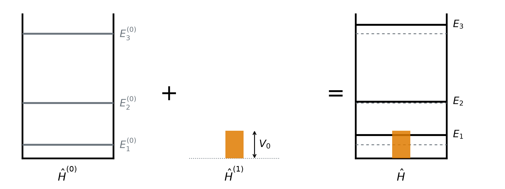
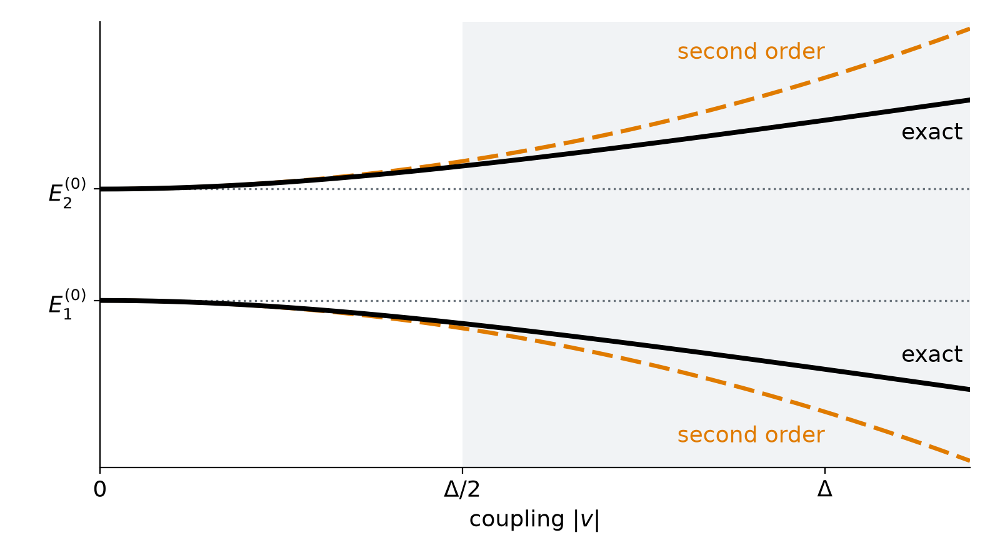
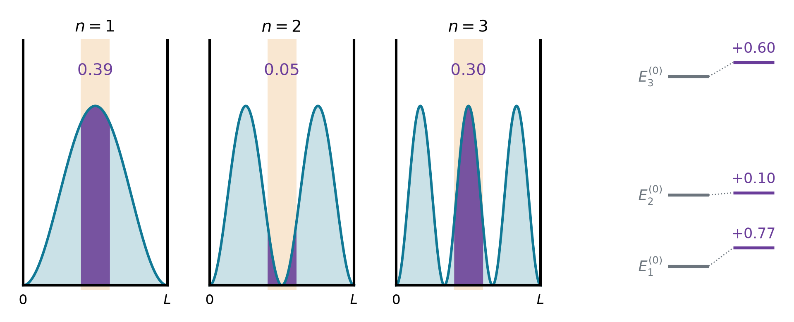
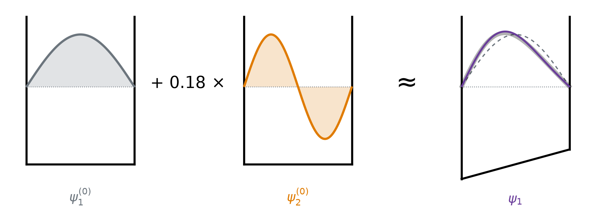
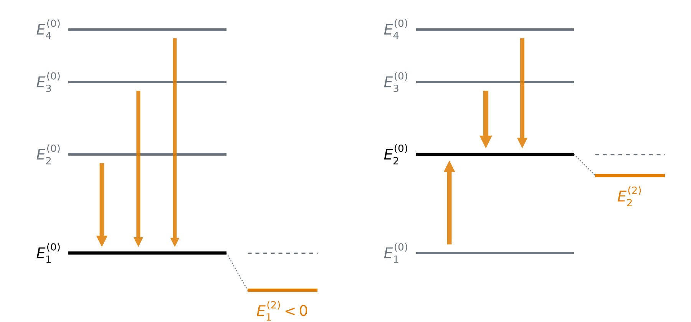
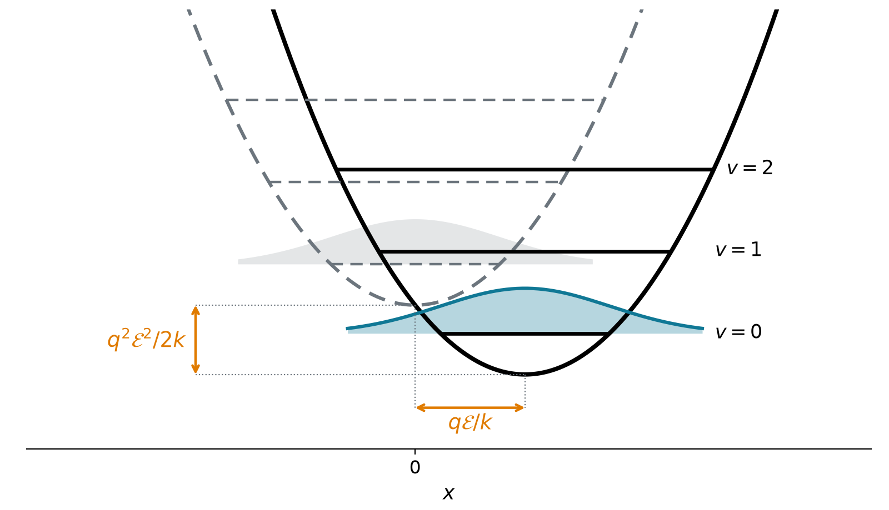
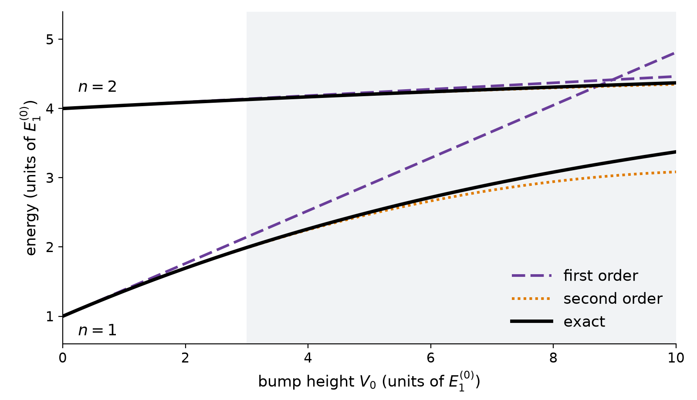
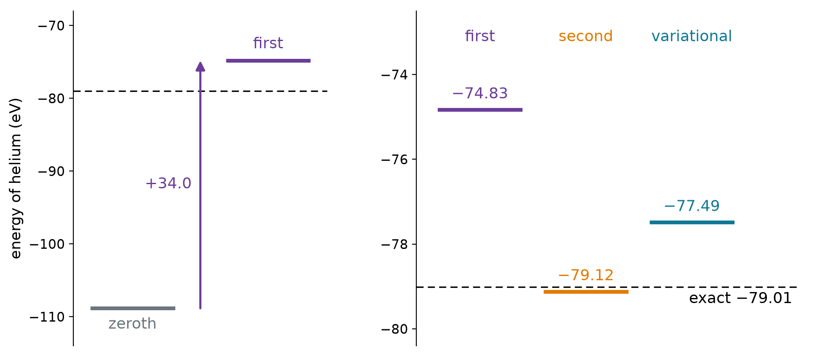

## A solved problem, plus a small change

{.nostretch width="78%" fig-align="center"}

$$\hat{H} = \hat{H}^{(0)} + \hat{H}^{(1)}, \qquad \hat{H}^{(0)}\psi_n^{(0)} = E_n^{(0)}\psi_n^{(0)} \quad\text{solved}$$

- Today's model: a box (solved) plus a **bump** on the middle fifth of its floor (the **perturbation**)

## The symbols

The superscripts count **orders of correction**. They are not powers.

| symbol | meaning |
|:-----------|:--------------------------------------------------|
| $\hat{H}^{(0)}$ | the solved, **unperturbed** Hamiltonian |
| $\hat{H}^{(1)}$ | the perturbation |
| $E_n^{(0)}$, $\psi_n^{(0)}$ | the known levels and states of $\hat{H}^{(0)}$; in a bracket the state is $\vert n\rangle$ |
| $E_n^{(1)}$, $E_n^{(2)}$ | the first and second corrections to level $n$ |
| $\psi_n^{(1)}$ | the first correction to state $n$ |
| $\langle k\vert\hat{H}^{(1)}\vert n\rangle$ | a matrix element of the perturbation between unperturbed states |

## The two-level problem, expanded

:::: {.columns}
::: {.column width="48%"}
{width="100%"}
:::
::: {.column width="52%"}
From 6.1: two levels a gap $\Delta$ apart, with a coupling $\lambda v$ dialed on from $\lambda = 0$ to 1

$$E_- = \frac{E_1^{(0)} + E_2^{(0)}}{2} - \sqrt{\left(\frac{\Delta}{2}\right)^2 + \lambda^2v^2}$$

$$\phantom{E_-} = E_1^{(0)} - \lambda^2\,\frac{v^2}{\Delta} + \lambda^4\,\frac{v^4}{\Delta^3} - \dots$$

- The exact root is a **power series** in $\lambda$
- It needs coupling **small compared with the gap**
:::
::::

## The general expansion

**1. Dial the perturbation on**, $\hat{H} = \hat{H}^{(0)} + \lambda\hat{H}^{(1)}$, and expand the unknown level and state in powers of $\lambda$

$$E_n = E_n^{(0)} + \lambda E_n^{(1)} + \lambda^2E_n^{(2)} + \dots, \qquad\qquad \psi_n = \psi_n^{(0)} + \lambda\psi_n^{(1)} + \dots$$

**2. Insert into $\hat{H}\psi_n = E_n\psi_n$** and sort by powers of $\lambda$: each power gives its own equation

$$\begin{aligned}
\lambda^0:&\qquad \hat{H}^{(0)}\psi_n^{(0)} = E_n^{(0)}\psi_n^{(0)}\\
\lambda^1:&\qquad \hat{H}^{(0)}\psi_n^{(1)} + \hat{H}^{(1)}\psi_n^{(0)} = E_n^{(0)}\psi_n^{(1)} + E_n^{(1)}\psi_n^{(0)}
\end{aligned}$$

- The first is the solved problem. The second holds two unknowns, $E_n^{(1)}$ and $\psi_n^{(1)}$

## First order: average the perturbation

Project the $\lambda^1$ equation onto the unperturbed state: multiply by $\psi_n^{(0)*}$ and integrate

$$\langle n|\hat{H}^{(0)}|\psi_n^{(1)}\rangle + \langle n|\hat{H}^{(1)}|n\rangle = E_n^{(0)}\langle n|\psi_n^{(1)}\rangle + E_n^{(1)}\langle n|n\rangle$$

- $\hat{H}^{(0)}$ is Hermitian: acting to the **left** on $\langle n|$ it gives $E_n^{(0)}$. The first terms on the two sides are equal and **cancel**

::: {.keyeq}
$$E_n^{(1)} = \langle n|\hat{H}^{(1)}|n\rangle = \int\psi_n^{(0)*}\,\hat{H}^{(1)}\,\psi_n^{(0)}\,d\tau$$
:::

- The average of the perturbation in the **unperturbed** state: no new wavefunction needed

## Example: a bump in a box

::: {.worked}
A box of length $L$ has a bump of height $V_0$ between $0.4L$ and $0.6L$. First-order shifts of the three lowest levels?
:::

:::: {.fragment}

::: {.soln}
$$E_n^{(1)} = \int_0^L\left|\psi_n^{(0)}\right|^2V^{(1)}(x)\,dx = V_0\int_{0.4L}^{0.6L}\frac{2}{L}\sin^2\frac{n\pi x}{L}\,dx$$

$$E_1^{(1)} = 0.387\,V_0, \qquad E_2^{(1)} = 0.049\,V_0, \qquad E_3^{(1)} = 0.301\,V_0$$
:::

- The shift is $V_0$ times the **probability of finding the particle on the bump**

::::

## The shift follows the density

{.nostretch width="78%" fig-align="center"}

- States 1 and 3 have a maximum on the bump and rise strongly. State 2 has a **node** there and barely moves
- With $V_0 = 2E_1^{(0)}$: shifts 0.77, 0.10, 0.60 (units of $E_1^{(0)}$). Exact: 0.71, 0.09, 0.64

## The state changes too

Expand the correction to the state in the other unperturbed states (3.6):

$$\psi_n^{(1)} = \sum_{k \neq n} c_k\,\psi_k^{(0)}$$

Project the $\lambda^1$ equation onto another state, $\langle k|$ with $k \neq n$:

$$E_k^{(0)}c_k + \langle k|\hat{H}^{(1)}|n\rangle = E_n^{(0)}c_k \quad\Longrightarrow\quad c_k = \frac{\langle k|\hat{H}^{(1)}|n\rangle}{E_n^{(0)} - E_k^{(0)}}$$

- A state is mixed in strongly if the perturbation **connects** it to $\psi_n^{(0)}$, and if its energy is **close**

## Mixing moves the particle

{.nostretch width="74%" fig-align="center"}

- A floor that slopes up to the right, $\hat{H}^{(1)} = F(x - L/2)$: the ground state borrows 0.18 of $\psi_2^{(0)}$ and leans to the low side
- Purple: first order. Thick gray: exact. For a charge in a field this lean is an **induced dipole**

## Perturbation theory through second order

::: {.keyeq}
$$E_n \approx E_n^{(0)} + \langle n|\hat{H}^{(1)}|n\rangle + \sum_{k \neq n}\frac{\left|\langle k|\hat{H}^{(1)}|n\rangle\right|^2}{E_n^{(0)} - E_k^{(0)}}$$

$$\psi_n \approx \psi_n^{(0)} + \sum_{k \neq n}\frac{\langle k|\hat{H}^{(1)}|n\rangle}{E_n^{(0)} - E_k^{(0)}}\,\psi_k^{(0)}$$
:::

- First order: one **diagonal** matrix element. Second order: the **off-diagonal** ones, each over a gap
- Everything on the right belongs to the solved problem

## Levels repel

{.nostretch width="62%" fig-align="center"}

- One arrow per term. A level **above** pushes down, a level **below** pushes up, the nearest hardest
- The ground state always **drops** in second order. Valid when each coupling is small compared with its gap

## Example: a charged oscillator in a field

::: {.worked}
A charge $q$ on a spring ($k = \mu\omega^2$) in a field $\mathcal{E}$: $\hat{H}^{(1)} = -q\mathcal{E}x$. Shift of level $v$? From 4.2, $x$ connects only $v \pm 1$, with $|\langle v + 1|x|v\rangle|^2 = (v + 1)\hbar/2\mu\omega$ and $|\langle v - 1|x|v\rangle|^2 = v\hbar/2\mu\omega$.
:::

:::: {.fragment}

::: {.soln}
$$E_v^{(1)} = -q\mathcal{E}\,\langle v|x|v\rangle = 0 \qquad (x \text{ is odd},\ |\psi_v|^2 \text{ is even})$$

$$E_v^{(2)} = q^2\mathcal{E}^2\left[\frac{(v + 1)\hbar/2\mu\omega}{-\hbar\omega} + \frac{v\hbar/2\mu\omega}{+\hbar\omega}\right] = -\frac{q^2\mathcal{E}^2}{2\mu\omega^2} = -\frac{q^2\mathcal{E}^2}{2k}$$
:::

- Two terms: the level above, $\hbar\omega$ higher, and the level below. The same drop for every $v$

::::

## The exact answer: the same parabola, moved

:::: {.columns}
::: {.column width="54%"}
{width="100%"}
:::
::: {.column width="46%"}
$$\tfrac{1}{2}kx^2 - q\mathcal{E}x = \tfrac{1}{2}k\left(x - \frac{q\mathcal{E}}{k}\right)^2 - \frac{q^2\mathcal{E}^2}{2k}$$

- Complete the square: second order is **exact** here
- The charge moves by $q\mathcal{E}/k$: an induced dipole $\alpha\,\mathcal{E}$
- **Polarizability** $\alpha = q^2/k$, and energy $-\frac{1}{2}\alpha\,\mathcal{E}^2$: a second-order effect
:::
::::

## How far it can be pushed

{.nostretch width="56%" fig-align="center"}

- First order is the **tangent** at $V_0 = 0$; second order adds the curvature
- Shaded: the bump exceeds the gap $E_2^{(0)} - E_1^{(0)}$. Too large: diagonalize the matrix (6.1)

## Live: turn the perturbation on

```{=html}
<div id="pd-live" style="width: 1060px; margin: 0 auto;"></div>
<script type="module">
  import widget from "../../widgets/perturbation_dial.mjs";
  const opts = { fontSize: "19px", shape: "bump", strength: 2, note: false };
  widget.render({ model: { get: (k) => opts[k] }, el: document.getElementById("pd-live") });
</script>
```

## Example: helium, order by order

::: {.worked}
Treat the repulsion $1/r_{12}$ of helium's two electrons as a perturbation of two He$^+$ ions ($Z = 2$). Energy to second order? Measured: $-79.01$ eV.
:::

:::: {.fragment}

::: {.soln}
$$\begin{aligned}
E^{(0)} &= 2\times\left(-\tfrac{1}{2}Z^2E_h\right) = -4E_h = -108.8\ \text{eV}\\
E^{(1)} &= \langle 1/r_{12}\rangle = \tfrac{5}{8}Z\,E_h = +34.0\ \text{eV}\\
E^{(2)} &= -0.158\,E_h = -4.3\ \text{eV}\\
E &\approx -108.8 + 34.0 - 4.3 = -79.1\ \text{eV}
\end{aligned}$$
:::

- Not a small perturbation, 34 eV on a scale of 109 eV, yet two orders land within 0.1 eV

::::

## Helium: above, then below

{.nostretch width="64%" fig-align="center"}

- First order equals the $\zeta = 2$ energy of 6.1: it is $\langle\phi|\hat{H}|\phi\rangle$, an **upper bound**
- Second order lands **below** the exact energy: perturbation theory is not a bound

## Perturbations already met

| effect | solved problem | perturbation | order | lecture |
|:---------------------|:--------------|:---------------------------|:------:|:----:|
| anharmonic levels | harmonic oscillator | cubic, quartic terms of the bond | 1st, 2nd | 4.3 |
| centrifugal distortion | rigid rotor | stretching by rotation | 2nd | 4.5 |
| Zeeman effect | hydrogen atom | $(\mu_BB/\hbar)\hat{L}_z$ | 1st, exact | 5.3 |
| fine structure | hydrogen atom | spin-orbit coupling | 1st | 5.3 |
| polarizability | atom or molecule | dipole in a field | 2nd | today |
| dispersion forces, $-C_6/R^6$ | two separate atoms | their dipoles interacting | 2nd | today |

- Second-order effects **lower** a ground state: polarization and dispersion are attractions
- Next: a perturbation that depends on **time** moves a system between levels (Lecture 6.3)

# Takeaway {.center}

> Split the Hamiltonian into a solved part and a small perturbation, and expand in powers of its strength. First order is the average of the perturbation in the unperturbed state: a bump raises each level by its height times the probability of finding the particle there. Second order sums the couplings to all other states, each squared and divided by a gap: levels repel, the nearest most strongly, and a ground state always drops. The method works when couplings are small compared with gaps. It gives a polarizability to every molecule, an attraction to every pair of atoms, and helium to within 0.1 eV.
