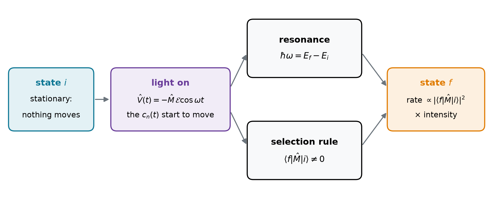
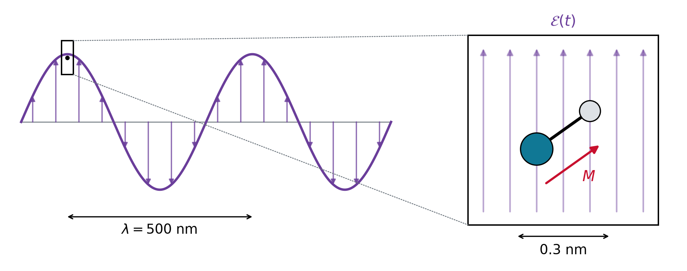
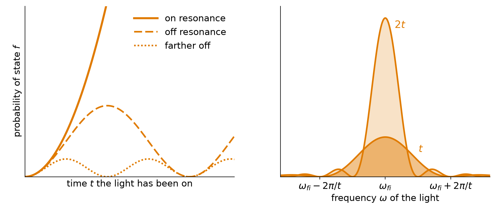
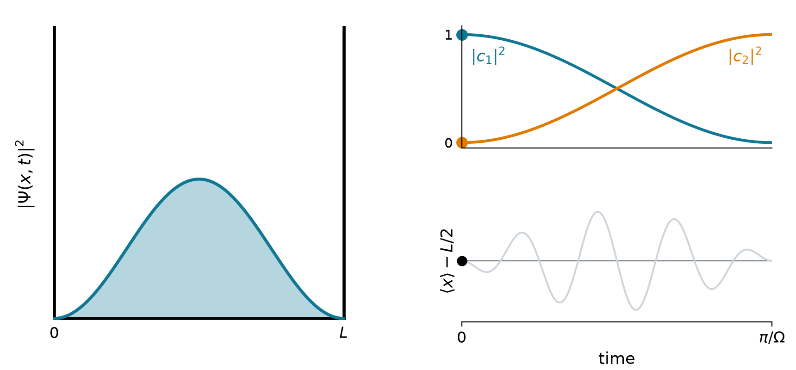
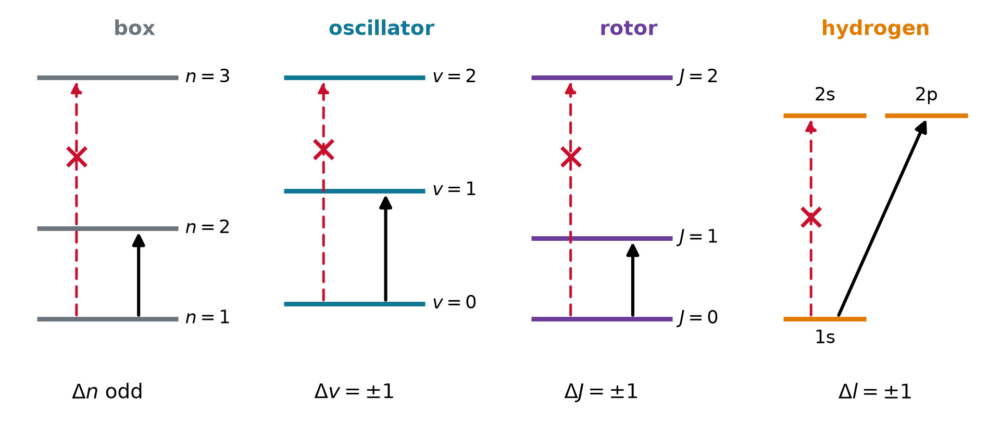

## What the earlier lectures left open

{.nostretch width="66%" fig-align="center"}

1. How does light take a molecule **out of** a stationary state (3.7)?
2. Why only when $h\nu$ matches a gap?
3. Why is the rate set by $|\langle f|\hat{M}|i\rangle|^2$, as 4.3 and 5.3 assumed?

## Light as a perturbation

A dipole $M$ in a field $\mathcal{E}$ has the energy $-M\mathcal{E}$ (4.3). In light the field oscillates:

$$\hat{H}(t) = \hat{H}^{(0)} + \hat{V}(t), \qquad \hat{V}(t) = -\hat{M}\,\mathcal{E}\cos\omega t$$

{.nostretch width="46%" fig-align="center"}

- $\mathcal{E}$: field amplitude. $\ \omega = 2\pi\nu$. $\ \hat{M}$: the dipole along the field, $-ex$ for an electron
- The wave is a thousand times longer than the molecule: the field is **uniform** across it

## The coefficients move

With a fixed Hamiltonian (3.7), each stationary state keeps its coefficient and turns its phase:

$$\Psi(t) = \sum_n c_n\,e^{-iE_nt/\hbar}\,\psi_n \qquad (c_n\ \text{constant})$$

With $\hat{V}(t)$ on, the same expansion holds, but the coefficients **depend on time**:

$$\Psi(t) = \sum_n c_n(t)\,e^{-iE_nt/\hbar}\,\psi_n$$

- $|c_n(t)|^2$: the probability of finding the system in level $n$ at time $t$
- A changing $|c_n|^2$ is a **transition**

## An equation for the coefficients

**1. Insert** into $i\hbar\,\partial\Psi/\partial t = (\hat{H}^{(0)} + \hat{V})\Psi$. **2. Cancel** the terms with $E_n$:

$$\sum_n i\hbar\,\dot{c}_n\,e^{-iE_nt/\hbar}\,\psi_n = \sum_n c_n\,e^{-iE_nt/\hbar}\,\hat{V}\psi_n$$

**3. Project** onto one state: multiply by $\psi_m^*$ and integrate

$$i\hbar\,\frac{dc_m}{dt} = \sum_n V_{mn}(t)\,e^{i\omega_{mn}t}\,c_n$$

- $V_{mn} = \langle m|\hat{V}(t)|n\rangle$: a **matrix element**. $\ \omega_{mn} = (E_m - E_n)/\hbar$: a Bohr frequency
- Exact. Population flows from $n$ to $m$ only through $V_{mn}$

## First order: a weak perturbation

Start in one stationary state, $i$: $c_i(0) = 1$, all others zero. A weak perturbation changes the coefficients slowly, so on the right keep their starting values:

$$i\hbar\,\frac{dc_f}{dt} = V_{fi}(t)\,e^{i\omega_{fi}t}$$

::: {.keyeq}
$$c_f(t) = -\frac{i}{\hbar}\int_0^t V_{fi}(t')\,e^{i\omega_{fi}t'}\,dt', \qquad P_{i \to f}(t) = |c_f(t)|^2$$
:::

- $i$: initial state. $f$: final state. Valid while $P_{i \to f}$ stays small
- Pushes on a turning phase: they add up only if $V_{fi}(t')$ oscillates at $\omega_{fi}$

## Light at frequency $\omega$

$V_{fi}(t) = -M_{fi}\,\mathcal{E}\cos\omega t$, with the **transition dipole** $M_{fi} = \langle f|\hat{M}|i\rangle$ and $\cos\omega t = \frac{1}{2}\left(e^{i\omega t} + e^{-i\omega t}\right)$:

$$c_f(t) = \frac{iM_{fi}\,\mathcal{E}}{2\hbar}\int_0^t\left[e^{i(\omega_{fi} + \omega)t'} + e^{i(\omega_{fi} - \omega)t'}\right]dt'$$

- Absorption, with the light tuned near the gap: the first term turns at about $2\omega$ and never grows
- The second turns slowly, at the **detuning** $\delta = \omega_{fi} - \omega$. Keep it:

$$\int_0^t e^{i\delta t'}dt' = \frac{e^{i\delta t} - 1}{i\delta}, \qquad \left|e^{i\delta t} - 1\right|^2 = 4\sin^2\frac{\delta t}{2}$$

## Absorption of light, to first order

::: {.keyeq}
$$P_{i \to f}(t) = \frac{|M_{fi}|^2\,\mathcal{E}^2}{\hbar^2}\;\frac{\sin^2\!\left[(\omega_{fi} - \omega)\,t/2\right]}{(\omega_{fi} - \omega)^2}, \qquad M_{fi} = \langle f|\hat{M}|i\rangle$$
:::

{.nostretch width="52%" fig-align="center"}

- On resonance: grows as $t^2$. Off resonance: rises, falls back, never builds up

## Reading the result

- **Bohr's frequency condition, derived**: $\hbar\omega = E_f - E_i$ is the condition for the pushes of the light to stay in step
- **The line has a width**: the peak reaches zero at $\omega_{fi} \pm 2\pi/t$. Light that acts for a time $t$ has a frequency defined only to about $1/t$
- **Strength**: proportional to $\mathcal{E}^2$, the intensity, and to $|M_{fi}|^2$, the transition dipole squared
- **Stimulated emission**: starting in the upper level gives the same result. Light at resonance drives a molecule **down** as readily as up
- **A steady rate**: over a band of frequencies the area of the peak grows as $t$, so ordinary light is absorbed at a constant rate $\propto |M_{fi}|^2 \times$ intensity

## Watching a transition

{.nostretch width="62%" fig-align="center"}

- Light at resonance, followed all the way: a particle in a box goes from $|\psi_1|^2$ to $|\psi_2|^2$
- In between the density **sloshes**: the dipole $\langle x\rangle$ swings only **during** the transition

## Live: drive two levels

```{=html}
<div id="rd-live" style="width: 1060px; margin: 0 auto;"></div>
<script type="module">
  import widget from "../../widgets/rabi_drive.mjs";
  const opts = { fontSize: "19px", autoplay: false, note: false };
  widget.render({ model: { get: (k) => opts[k] }, el: document.getElementById("rd-live") });
</script>
```

## The selection rule

Every result today carries the factor $|M_{fi}|^2$

::: {.keyeq}
$$\text{allowed only if}\qquad M_{fi} = \langle f|\hat{M}|i\rangle = \int\psi_f^*\,\hat{M}\,\psi_i\,d\tau \;\neq\; 0$$
:::

- If the integral is zero, light of any intensity and frequency leaves the transition untouched: **forbidden**
- **Parity**: $\hat{M}$ is odd, so the two states must have **opposite** parity
- **Angular momentum**: a photon carries one unit, $\hbar$
- Forbidden is not never: weaker mechanisms remain (H 2s lives 0.12 s; 2p, 1.6 ns)

## Every selection rule of the course

{.nostretch width="74%" fig-align="center"}

- Solid: allowed. Dashed and crossed: the transition dipole vanishes. Each rule says when the integral is zero

## Example: an electron in a box

::: {.worked}
An electron in a box of length $L$, with $\hat{M} = -ex$. Transition dipoles from $n = 1$ to $n = 2$ and to $n = 3$? From 3.7: $\langle 2|x|1\rangle = -16L/9\pi^2$.
:::

:::: {.fragment}

::: {.soln}
$$M_{21} = -e\,\langle 2|x|1\rangle = \frac{16}{9\pi^2}\,eL = 0.18\,eL \qquad\text{allowed}$$

$$M_{31} = -e\,\langle 3|x|1\rangle = 0 \qquad\text{forbidden}$$
:::

- States 1 and 3 are both even about the middle and $x - L/2$ is odd. For $L = 1$ nm, $M_{21} = 8.7$ D: why conjugated dyes absorb so strongly

::::

## The chapter in one table

| | variational method | perturbation theory | time-dependent perturbations |
|:---------|:-------------------|:-----------------------|:-----------------------|
| put in | a trial function | a solved problem and a small constant term | a solved problem and a term that depends on time |
| get out | an upper bound to $E_0$ | shifted levels, mixed states | transitions between levels |
| key integral | $\langle\phi\vert\hat{H}\vert\phi\rangle$ | $\langle k\vert\hat{H}^{(1)}\vert n\rangle$ | $\langle f\vert\hat{M}\vert i\rangle$ |
| condition | lower is better | coupling $\ll$ gap | resonance, $\hbar\omega = E_f - E_i$ |
| two levels | exact roots $E_\pm$ | the roots as a series | driven by light |

- Next: atoms with more than one electron (Chapter 7) and molecules (Chapter 8)

# Takeaway {.center}

> Light adds an oscillating term $-\hat{M}\mathcal{E}\cos\omega t$ to the Hamiltonian, and the coefficients of the stationary states begin to move. To first order the amplitude of a new state builds up only at resonance, $\hbar\omega = E_f - E_i$, with a probability proportional to the intensity and to the square of the transition dipole $\langle f|\hat{M}|i\rangle$. Where that integral vanishes the transition is forbidden, and every selection rule of the course is a statement about it: $\Delta v = \pm1$, $\Delta J = \pm1$, $\Delta l = \pm1$.
